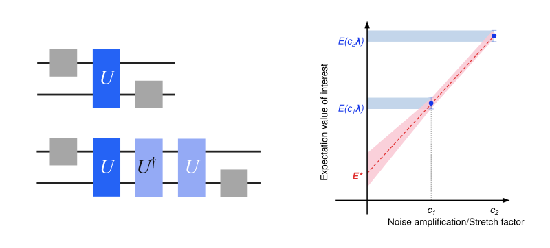

<OpenInLabBanner notebookPath="addons/qiskit-mitigation/guides/gate-folding-with-custom-extrapolation.ipynb" />


Zero-noise extrapolation (ZNE) is a technique for mitigating quantum noise in observable expectation value calculations. It works by executing a quantum circuit at increasing noise scales, taking expectation values with respect to those noise scales, and extrapolating to estimate a zero-noise expectation value. Both the noise amplification and extrapolation stages can be implemented in different ways. This guide amplifies the noise with "digital gate folding", which means that two-qubit gates are replaced with equivalent sequences of the gate and its inverse. For example, replacing a unitary $U$ with $U U^† U$ would yield a noise amplification factor of 3. You can also implement amplification with probabilistic error amplification (PEA), which needs an additional step of learning a noise model and is covered in the [probabilistic error amplification](/addons/qiskit-mitigation/guides/pea-with-noise-learning) guide. This guide extrapolates using a couple of built-in fitting strategies (linear and exponential), and it also demonstrates how to implement your own custom fitting function.

Keep in mind, while ZNE can be effective at mitigating quantum noise for a lower sampling cost than other methods, it comes with no bounds on the bias.



The workflow is as follows:
1. Specify a circuit and observable
2. Compute exact expectation values using Qiskit's statevector simulator
3. Compute noisy, unmitigated expectation values
4. Prepare a ZNE program with digital gate folding and sample circuits of varying noise scales
5. Extrapolate to the zero-noise limit with built-in and custom fitting functions
6. Compare the mitigated expectation values
### Specify a circuit and observable

Calculate the site-averaged magnetization $\langle Z \rangle_{\text{avg}} = \frac{1}{N} \sum_{i=1}^{N} \langle Z_i \rangle$ of a Trotterized transverse-field Ising model (TFIM) on eight qubits in a ring topology. You will sweep several values of the strength of the transverse field and plot the magnetization as a function of the field strength.

```python
# Added by doQumentation — installs the packages this notebook needs if they are missing
import importlib.util

_needed = {"IPython": "IPython", "matplotlib": "matplotlib", "numpy": "numpy", "qiskit": "qiskit", "qiskit_aer": "qiskit-aer", "qiskit_ibm_runtime": "qiskit-ibm-runtime", "qiskit_mitigation": "qiskit-mitigation", "scipy": "scipy"}
_missing = [pip for module, pip in _needed.items()
            if importlib.util.find_spec(module) is None]
# One at a time, so a package that fails to install does not block the others
for _pip in _missing:
    %pip install -q {_pip}
if not _missing:
    print("\u2713 All required packages are installed")
```

```python
import warnings

import numpy as np
from qiskit.circuit import Parameter, QuantumCircuit
from qiskit.quantum_info import SparsePauliOp

warnings.filterwarnings("ignore")

def trotter_circuit(num_qubits, theta, layers, num_steps):
    """Trotterized transverse-field Ising evolution: RX on every site, then a CZ layer per coupling layer."""
    circuit = QuantumCircuit(num_qubits)
    for _ in range(num_steps):
        circuit.rx(theta, range(num_qubits))
        for layer in layers:
            circuit.barrier()
            for edge in layer:
                circuit.cz(*edge)
                circuit.sdg(edge)
            circuit.barrier()
    return circuit

num_qubits = 8
trotter_steps = 15
ring_coupling = [(i, (i + 1) % num_qubits) for i in range(num_qubits)]
layers = [
    ring_coupling[0::2],
    ring_coupling[1::2],
]  # two disjoint layers of CZ gates
theta = Parameter("theta")
circuit = trotter_circuit(num_qubits, theta, layers, trotter_steps)

# Parameter values: theta in [0, 0.25 pi] - values for the transverse-field sweep
data_points = 6
parameter_values = np.linspace(0, 0.25 * np.pi, data_points).reshape(
    (data_points, 1)
)

# Define observables - Z on each site
observables = [
    SparsePauliOp("I" * (num_qubits - q - 1) + "Z" + "I" * q)
    for q in range(num_qubits)
]

print("Visualization of 1 Trotter step")
trotter_circuit(num_qubits, theta, layers, 1).draw("mpl", scale=0.7)
```

```text
Visualization of 1 Trotter step
```


### Compute exact expectation values using Qiskit's statevector simulator

Use Qiskit's ``Statevector`` class to compute the exact expectation value of $Z_i$ on each site for every value of $\theta$.

```python
import matplotlib.pyplot as plt
from qiskit.quantum_info import Statevector

exact_evs = np.array(
    [
        [
            Statevector(circuit.assign_parameters([value]))
            .expectation_value(obs)
            .real
            for value in parameter_values.ravel()
        ]
        for obs in observables
    ]
)  # shape (observables, parameter values)

x_vals = parameter_values.ravel() / np.pi
fig, ax = plt.subplots(figsize=(7, 4))
ax.plot(x_vals, exact_evs.mean(axis=0), "ko-", label="Exact")
ax.set_xlabel(r"$\theta/\pi$")
ax.set_ylabel(r"$\langle Z \rangle_{\text{avg}}$")
ax.legend()
plt.tight_layout()
plt.show()
```


### Compute noisy, unmitigated expectation values

A ``QuantumProgram`` contains a quantum circuit and a samplex in a format suitable for the [Executor primitive](/guides/get-started-with-executor). `MitigationTask.prepare` builds a ``QuantumProgram`` from the circuit, the observables, and the parameter values, and boxes the circuit with the given boxing options. You set the ``measure_annotations`` boxing option to ``"change_basis"``, which rotates the measurements into the required bases, and add ``add_tags: "unique_box"`` so the simulator can map a noise model onto the boxes of the circuit. The program is Pauli-twirled by default, which on hardware turns coherent noise into the Pauli noise that the mitigation methods assume. `num_randomizations` sets how many twirled instances of each circuit are sampled and `shots_per_randomization` sets how many shots each instance receives, so their product is the shot budget per circuit.

A user with QPU access would execute the program with an `Executor` built from a backend of the `QiskitRuntimeService`. Here, you will pass an `AerSimulator` to the `Executor`, which runs the program locally, and use its `layer_noise_model` simulator option to inject a random Pauli-Lindblad noise model on every layer of entangling gates, generated with `random_pauli_lindblad_noise` from `qiskit-mitigation` with an error per layered gate (EPLG) of ``0.003``, typical of current Heron QPUs.

```python
from qiskit.circuit import CircuitInstruction
from qiskit.quantum_info import PauliLindbladMap, pauli_basis
from qiskit_aer import AerSimulator
from qiskit_ibm_runtime import Executor
from qiskit_mitigation import MitigationTask, find_combined_unique_layers

def generate_random_pauli_lindblad_noise(
    layers,
    num_qubits: int,
    eplg: float = 3e-3,
    seed: int | None = None,
) -> list[tuple[CircuitInstruction, PauliLindbladMap]]:
    """Generate random Pauli-Lindblad noise over the full Pauli basis."""
    layer_noise_model = []
    for layer in layers:
        layer_instructions = layer.operation.params[0]
        contain_measurement = any(
            inst.name.startswith("measure") for inst in layer_instructions
        )
        if contain_measurement:  # do not add measurement noise
            layer_noise = PauliLindbladMap.identity(num_qubits)
        else:
            edges = [
                (inst.qubits[0]._index, inst.qubits[1]._index)
                for inst in layer_instructions
            ]  # extract the edges of the layer

            basis_paulis = [p for p in pauli_basis(2) if np.sum(p.x + p.z)]
            rng = np.random.default_rng(seed=seed)
            num_generators = len(basis_paulis)
            rates = rng.random(len(basis_paulis)) * eplg / num_generators

            layer_noise = PauliLindbladMap.from_sparse_list(
                [
                    (pauli.to_label(), edge, rate)
                    for pauli, rate in zip(basis_paulis, rates, strict=True)
                    for edge in edges
                ],
                num_qubits=num_qubits,
            )
        layer_noise_model.append((layer, layer_noise))
    return layer_noise_model

num_randomizations = 50
shots_per_randomization = 64

boxing_options = {
    "measure_annotations": "change_basis",
    "add_tags": "unique_box",
}

# find the unique layers to generate the layered noise for
box_layers = find_combined_unique_layers(
    [circuit], custom_boxing_options=boxing_options
)
layer_noise_model = generate_random_pauli_lindblad_noise(
    box_layers, num_qubits, seed=42
)

# a local noisy simulator in place of a QPU backend
noisy_executor = Executor(
    AerSimulator(),
    options={"simulator": {"layer_noise_model": layer_noise_model}},
)

task = MitigationTask()
program = task.prepare(
    circuit=circuit,
    observables=observables,
    parameters=parameter_values,
    num_randomizations=num_randomizations,
    shots_per_randomization=shots_per_randomization,
    custom_boxing_options=boxing_options,
)
program._semantic_role = "simulation"  # flag the program for the simulator
unmitigated_res = task.postprocess(noisy_executor.run(program).result())

fig, ax = plt.subplots(figsize=(7, 4))
ax.plot(x_vals, exact_evs.mean(axis=0), "k-", label="Exact")
ax.errorbar(
    x_vals,
    np.mean(unmitigated_res.data.evs, axis=0),
    np.mean(unmitigated_res.data.stds, axis=0),
    fmt="o-",
    label="Unmitigated",
)
ax.set_xlabel(r"$\theta/\pi$")
ax.set_ylabel(r"$\langle Z \rangle_{\text{avg}}$")
ax.legend()
plt.tight_layout()
plt.show()
```


### Prepare a ZNE program with digital gate folding and sample circuits of varying noise scales

Prepare a ZNE program containing circuits of increasing noise scales. Each noise factor represents the multiple of entangling gates that the circuit contains (noise factor of ``3.0`` holds three times more entangling gates than the original circuit). Each noise factor's circuit is twirled with the same number of randomizations and shots as the unmitigated program.

```python
from qiskit_mitigation import GateFolding

task_gf = GateFolding()
program_zne = task_gf.prepare(
    circuit=circuit,
    observables=observables,
    parameters=parameter_values,
    num_randomizations=num_randomizations,
    shots_per_randomization=shots_per_randomization,
    custom_boxing_options=boxing_options,
    noise_factors=[1, 3, 5],  # ZNE option
)
```

Draw the first Trotter step of the twirled template with noise factor 1 and with noise factor 3 to visualize the amplification. For noise factor 3.0, every layer of the circuit is replaced by the layer, its inverse, and the layer again.

```python
import IPython.display

def first_trotter_step(template, noise_factor):
    """The template up to the closing barrier of its first Trotter step (two layers, each folded ``noise_factor`` times)."""
    toy = template.copy_empty_like()
    for instruction in template.data:
        toy.append(instruction)
        if (
            instruction.operation.name == "barrier"
            and instruction.operation.label.startswith(
                f"R{2 * noise_factor - 1}@"
            )
        ):
            break
    return toy

IPython.display.display(
    first_trotter_step(program_zne.items[0].circuit, 1).draw(
        "mpl", scale=0.7, plot_barriers=False
    )
)
first_trotter_step(program_zne.items[1].circuit, 3).draw(
    "mpl", fold=-1, plot_barriers=False
)
```


Finally, run the program on the noisy simulator. Its results feed the extrapolation in the next step.

```python
program_zne._semantic_role = (
    "simulation"  # flag the program for the simulator
)
job_zne_results = noisy_executor.run(program_zne).result()
```

### Extrapolate to the zero-noise limit with built-in and custom fitting functions

Now that you have data for each noise scale, you can fit a function to the data and extrapolate back to the zero-noise value to estimate an expectation value of the noise-free observable. There are many ways to fit data, and the right choice of function depends on the nature of the data being sampled. ``GateFolding.postprocess`` provides several built-in extrapolation functions, including ``linear``, ``exponential``, and ``double_exponential``. The `postprocess` method takes a list of extrapolation methods, evaluates them in order, and returns the first value with physically-valid values and finite variance. This means the order in which you specify the extrapolators has a big impact on which extrapolator is chosen. Submitting ``fallback`` as an extrapolator means if no valid answers were found, the expectation value of the smallest noise factor will be chosen and returned. If ``fallback`` is not submitted and no extrapolator yields a physically-valid value, the result with the smallest ``std`` is returned. Under Pauli noise an observable decays exponentially with the noise factor, so with 30 layers (15 Trotter steps, 2 layers per step) of entangling gates the exponential extrapolator is the natural choice; you can also extrapolate linearly, which is a common choice when the decay is small.

To use a custom fitting function, pass the `"custom"` extrapolator together with a `custom_fit` tuple containing the fitting function, a list with an initial guess for each of its parameters, and bounds. These are forwarded to ``scipy.optimize.curve_fit``. Post-processing can be repeated with different extrapolators without re-executing the program. Here you use a custom square-root fitting function. To visualize the extrapolation, plot the site-averaged magnetization calculated at each noise factor for $\theta = 0.15\pi$, the three fits, and the site average of the extrapolated expectation values at the zero-noise point. The three data points look nearly linear, yet the linear extrapolation lands visibly below the exact value. As predicted, the exponential fit most-effectively estimates the noiseless expectation value.

```python
from scipy.optimize import curve_fit

zne_mitigated_exp = task_gf.postprocess(
    job_zne_results, extrapolator=["exponential", "linear"]
)
zne_mitigated_lin = task_gf.postprocess(
    job_zne_results, extrapolator=["linear"]
)

def sqrt_fit(x, a, b):
    return a * np.sqrt(x) + b

custom_fit = (sqrt_fit, [1.0, 1.0], (-np.inf, np.inf))
zne_mitigated_custom = task_gf.postprocess(
    job_zne_results,
    extrapolator=["custom", "exponential", "linear"],
    custom_fit=custom_fit,
)

# The result holds the expectation value at each noise factor and the extrapolated value, but
# not the fit parameters, so we refit the same models here to draw the curves.
noise_factors = np.array([1, 3, 5])
angle = 3  # theta = 0.15 pi, the angle with the largest unmitigated error
amplifications = zne_mitigated_exp.data.evs_noise_factors[:, angle, :].mean(
    axis=0
)
x_fit = np.linspace(0, 5, 51)
fits = {
    "exponential": (
        lambda x, a, b: a * np.exp(b * x),
        zne_mitigated_exp,
        "black",
    ),
    "linear": (lambda x, a, b: a * x + b, zne_mitigated_lin, "blue"),
    "square-root": (sqrt_fit, zne_mitigated_custom, "green"),
}

plt.plot(
    noise_factors, amplifications, "o", color="red", label="amplifications"
)
for name, (fit, res, color) in fits.items():
    params, _ = curve_fit(fit, noise_factors, amplifications, p0=[1.0, -0.1])
    plt.plot(
        x_fit, fit(x_fit, *params), "--", color=color, label=f"{name} fit"
    )
    plt.plot(
        [0],
        res.data.evs[:, angle].mean(),
        "*",
        color=color,
        markersize=15,
        label=f"{name} extrapolation",
    )
plt.plot(
    [0],
    exact_evs[:, angle].mean(),
    "_",
    color="red",
    markersize=15,
    markeredgewidth=3,
    label="exact",
)
plt.xlabel("noise factor")
plt.ylabel(r"$\langle Z \rangle_{\text{avg}}$")
plt.legend()
plt.show()
```


### Compare the mitigated expectation values

Plot the site-averaged magnetization of each method across the sweep across Ising rotation angles. Exponential extrapolation recovers the exact magnetization within its error bars, while linear extrapolation removes much of the bias but consistently undershoots, because the true decay is exponential. The square-root fit overshoots badly.

```python
results = {
    "Unmitigated": unmitigated_res,
    "ZNE exponential": zne_mitigated_exp,
    "ZNE linear": zne_mitigated_lin,
    "ZNE square-root": zne_mitigated_custom,
}

fig, ax = plt.subplots(figsize=(7, 4))
ax.plot(x_vals, exact_evs.mean(axis=0), "k-", label="Exact")
for label, res in results.items():
    ax.errorbar(
        x_vals,
        np.mean(res.data.evs, axis=0),
        np.mean(res.data.stds, axis=0),
        fmt="o-",
        label=label,
    )
ax.set_xlabel(r"$\theta/\pi$")
ax.set_ylabel(r"$\langle Z \rangle_{\text{avg}}$")
ax.legend()
ax.set_title(
    f"Error-Mitigated Magnetization [{num_qubits}-qubit, {trotter_steps} Trotter steps]"
)
plt.tight_layout()
plt.show()
```


