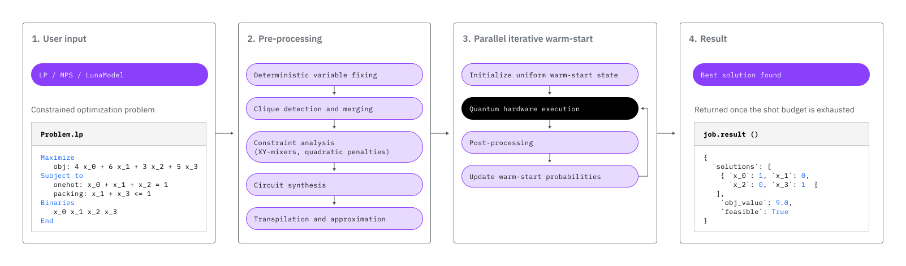

<OpenInLabBanner notebookPath="guides/aqarios-constrained-quantum-optimizer.ipynb" />


{/* cspell:ignore Aqarios QOBLIB Bucher docplex forall Zachary quicksum */}

*See the [API reference](https://docs.quantum.ibm.com/functions/aqarios-constrained-quantum-optimizer/api-reference)*

<Admonition type="note">
  IBM Quantum&reg; Functions are a beta feature available only to IBM Quantum Premium Plan, Flex Plan, and On-Prem (through the IBM Quantum Platform API) Plan users. Beta features are subject to change.
</Admonition>

## Overview

With the Constrained Quantum Optimizer by Aqarios, you can solve constrained binary optimization problems on IBM&reg; quantum hardware without manual reformulation and circuit mapping. Simply supply a problem as an LP file, an MPS file, or a [Luna Model](https://docs.aqarios.com/luna-model). The function handles reformulation, circuit synthesis, transpilation, and hardware execution automatically. The solver utilizes iterative warm-starting [\[1\]](#references) of the [FlexQAOA](https://docs.aqarios.com/luna-solve/algorithms/quantum-gate/flexqaoa/) algorithm, a constraint-native extension of the Quantum Approximate Optimization Algorithm (QAOA).

The optimizer targets binary problems with constraints. In particular, one-hot constraints and set-packing constraints can be natively enforced by using XY-mixers. Other constraint types are automatically reformulated as penalty terms.

<Admonition type="note" title="Supported variable types">
  The function solves discrete problems only. Every decision variable must be binary, or integer with an explicit lower and upper bound, so that it can be encoded into qubits. Continuous (real-valued) variables are not supported: a model that contains them is rejected with error code `4710`.
</Admonition>

## Description

<Admonition type="caution" title="Disclaimer">
Performance can depend on both the problem instance and subsequent processing steps. In some cases, classical samples and quantum-generated samples might achieve similar final solution quality after equivalent post-processing. Evaluation should therefore consider the complete optimization workflow.
</Admonition>

The Constrained Quantum Optimizer implements the Iterative warm-start XY-mixer QAOA(IWS-QAOA) [\[1\]](#references). The algorithm runs fixed-angle QAOA circuits on quantum hardware and updates the initial warm-start probabilities of each circuit using measurement outcomes from the previous iteration. No variational parameter training is required; instead, a fixed linear ramp parametrization is chosen.

By using XY-mixers to enforce one-hot constraints, you can drastically improve solution quality for constrained problems, because the search space is practically reduced to a smaller feasible subspace &mdash; and no additional complexity, due to penalty terms, is introduced in the optimization landscape.

### Workflow

The workflow of the function is described below:

1. **Preprocessing**: Before circuit synthesis, the optimizer analyzes the constraint structure of the input problem:
    - _Graph preprocessing:_ When applicable to the problem, it is analyzed as a graph, where edges determine the relationship between variables. This graph analysis enables two preprocessing problem enhancements. First, single constraints can be aggregated to one large constraint by using clique merging, so that they are represented by a single XY-mixer. Second, variables with only a single neighbor can be fixed deterministically, reducing the problem size and complexity.
    - _Constraint resolution:_ The preprocessor handles each constraint separately: If the constraint is a one-hot constraint, it can be enforced through XY-mixers. If it is a set-packing constraint, it will first be transformed to a one-hot constraint. Equality constraints are handled through quadratic penalties, and inequality constraints through [unbalanced penalization](https://doi.org/10.1088/2058-9565/ad35e4).
    - _Penalty derivation:_ Constraints that cannot be expressed as one-hot equality constraints are converted to penalty terms. The optimizer derives the penalty strength automatically from the problem structure.
2. **Iterative warm-starting**: The optimizer runs multiple _parallel warm-start chains_. Each chain holds a probability distribution over variable assignments, which is used as the starting probability of the QAOA circuit (warm-start state). At each iteration, a chain samples from the quantum circuit, applies classical postprocessing, and updates its distribution based on the occurrence of samples. Across iterations, this focuses the search on high-quality solutions without a variational optimization loop.

The number of chains (`num_parallel`), the total shot budget per chain (`total_shots`), and the number of QAOA repetitions (`reps`) are the primary controls for trading solution quality against runtime.



## Benchmarks

The benchmarks below show that the Constrained Quantum Optimizer Quantum Function is capable of finding high quality, feasible solutions to constrained optimization problems with well above 100 binary variables. Accuracy is the ratio of the found objective value to the known optimum. Runtime is wall-clock time from function invocation to result delivery. QPU usage is the billable Quantum Compute time.

Two problems were examined: The [Maximum Independent Set](/tutorials/find-the-maximum-independent-set-with-aqarios-constrained-quantum-optimizer) (MIS) problem and the Max-$k$-Cut, which is an extension of the well-known MaxCut problem to more than two categories. Max-$k$-Cut is also the optimization problem equivalent of the graph coloring decision problem (when all edges are cut, the graph is $k$-colorable).

| Problem               | Variables | Constraints | Qubits | Accuracy | Feasibility | Total runtime (s) | QPU usage (s) | Total shots |
|-----------------------|-----------|-------------|--------|----------|-------------|-------------------|---------------|-------------|
| MIS es60fst02         | 186       | 280         | 124    | 100.0%   | True        | 940.2             | 147.0         | 25.0k       |
| MIS sloane\_2dc\_128  | 128       | 5173        | 74     | 100.0%   | True        | 347.6             | 106.0         | 12.5k       |
| Max-3-Cut Karate Club | 99        | 33          | 99     | 98.7%    | True        | 279.5             | 166.0         | 25.0k       |
| Max-4-Cut Karate Club | 132       | 33          | 132    | 100.0%   | True        | 258.3             | 200.0         | 25.0k       |
### Benchmark Notes

- The above results were obtained on the `ibm_marrakesh` Heron r2 processor with default options and `use_session` enabled. For the `sloane_2dc_128` instance, `total_shots=12500` was used.
- The reduced qubit count for MIS instances (74 and 124 versus 128 and 186 variables) reflects variable fixing in preprocessing.
- The problem instances for MIS are taken from the [Quantum Optimization Benchmarking Library](https://doi.org/10.1038/s43588-026-00991-1). - The instance for the Max-$k$-Cut problem is the [Zachary Karate Club graph](https://en.wikipedia.org/wiki/Zachary%27s_karate_club), which has a chromatic number of 5.
## Get started

This guide demonstrates basic usage of the Constrained Quantum Optimizer by showing how to load the function and execute simple problems. For a more involved tutorial, see [Find the Maximum Independent Set with the Aqarios Constrained Quantum Optimizer](/tutorials/find-the-maximum-independent-set-with-aqarios-constrained-quantum-optimizer).

Authenticate with your IBM Quantum API key and instance CRN, then load the function from the catalog.

<Admonition type="note">
  The following code assumes you have saved your credentials. To set them up, follow the instructions in [Save your IBM Cloud account credentials](/guides/functions-get-started#install-qiskit-functions-catalog-client).
</Admonition>

```python
# Added by doQumentation — installs the packages this notebook needs if they are missing
import importlib.util

_needed = {"luna_model": "luna-model", "networkx": "networkx", "qiskit_addon_opt_mapper": "qiskit-addon-opt-mapper", "qiskit_ibm_catalog": "qiskit-ibm-catalog"}
_missing = [pip for module, pip in _needed.items()
            if importlib.util.find_spec(module) is None]
# One at a time, so a package that fails to install does not block the others
for _pip in _missing:
    %pip install -q {_pip}
if not _missing:
    print("\u2713 All required packages are installed")
```

```python
from qiskit_ibm_catalog import FunctionsCatalog

catalog = FunctionsCatalog(channel="ibm_quantum_platform")

# Verify that you have access to the function
catalog.list()
```

```text
[QiskitFunction(aqarios/constrained-quantum-optimizer)]
```

```python
# Load the function
optimizer = catalog.load("aqarios/constrained-quantum-optimizer")
```

```python
# Check the list of backends you have access to
catalog.backends()
```

```text
[<IBMBackend('ibm_boston')>,
 <IBMBackend('ibm_chicago')>,
 <IBMBackend('ibm_fez')>,
 <IBMBackend('ibm_kingston')>,
 <IBMBackend('ibm_marrakesh')>,
 <IBMBackend('ibm_phoenix')>,
 <IBMBackend('ibm_pittsburgh')>]
```

```python
# Select the backend you want to use
backend = catalog.backend("ibm_phoenix")
```

## Function sizes

Every job runs at one size — `S`, `M` or `L`. If you select a size that's too small, the job is rejected.  If you select a size that's larger
than needed and it runs on a bigger compute profile than the work requires. See
[Function sizes](/guides/managed-workflow-compute-profiles#best-practice-match-sizes-to-problem-sizes) for how sizes work in general.

The size comes from two properties of your model: how many variables it has, and
how densely they interact — the fraction of all variable pairs that appear together
in a term of the objective or of a constraint.

| Size | Smallest size for variables and interaction density | Compute profile | vCPU | RAM |
|---|---|---|---|---|
| `S` | At most 50 variables and density at most 0.1 | `8x32` | 8 | 32 GB |
| `M` | At most 100 variables and density at most 0.25 | `16x128` | 16 | 128 GB |
| `L` | either above the `M` bound | `16x128` | 16 | 128 GB |

A model must fit **both** bounds of a size, which is why a small but tightly coupled
model can be `L`: ten variables all coupled to each other is a density of 1.0. These
are the same bounds for every optimization function, so a size means the same
difficulty of model whichever one you call.

Two things raise the density more than they appear to:

- **A term over more than two variables couples every pair of them.** A term in
  four variables contributes all six pairs.
- **A constraint counts as the penalty that replaces it on hardware.** Squaring the
  constraint couples every pair of variables in it, so a one-hot constraint over
  four variables also contributes all six pairs.

The default is `M`, used when a job does not request a size.

Users can also read the mapping off the function itself with `optimizer.sizes_map`, and
the size used when a job does not ask for one with `optimizer.default_size`.
### Calculate the size before submitting

Run this on your own model. It reads it and does nothing else: no job is submitted and
nothing is reserved, so you can call it as often as you like while you tune a model
down to a smaller size.

It accepts the same `problem` input as the function: an LP string, an MPS string, or
a base64-encoded Luna Model. It needs `luna-model` and `qiskit-addon-opt-mapper`
installed.

```python
# %pip install luna-model qiskit-addon-opt-mapper
```

```python
# Calculate the function size a model needs, before submitting it.
#
# Call ``calculate_function_size(problem)``: it returns "S", "M" or "L" and submits
# nothing. The size comes from the number of variables and how densely they interact.

from collections.abc import Iterator
from itertools import combinations
from typing import Any, Literal

import luna_model
from qiskit_addon_opt_mapper.problems import OptimizationProblem

Size = Literal["S", "M", "L"]
_ORDER = {"S": 0, "M": 1, "L": 2}

# Limits are provided by IBM
_SMALL_NUMVARS, _SMALL_DENSITY = 50, 0.1
_MEDIUM_NUMVARS, _MEDIUM_DENSITY = 100, 0.25

def calculate_function_size(problem: Any, **kwargs: Any) -> Size:
    """Return the size ("S", "M" or "L") needed to run ``problem``."""
    metrics = _measure(problem, **kwargs)
    if _is_small(metrics):
        return "S"
    if _is_medium(metrics):
        return "M"
    return "L"

def to_optimization_problem(problem: Any) -> OptimizationProblem:
    """Convert an LP string, MPS string or base64-encoded Luna Model into an
    ``OptimizationProblem``."""
    model = (
        luna_model.Model.decode_b64(problem)
        if luna_model.Model.is_b64_encoded(problem)
        else luna_model.Model.from_(problem)
    )
    problem = model.to(luna_model.TranslationTarget.OPT_MAPPER)
    if isinstance(problem, OptimizationProblem):
        return problem
    raise NotImplementedError(
        f"cannot size a {type(problem).__name__}: pass an LP string, an MPS string "
        "or a base64-encoded Luna Model"
    )

def _measure(problem: Any, **kwargs: Any) -> dict[str, float]:
    """Return the number of variables and the interaction density."""
    model = to_optimization_problem(problem)
    num_vars = model.get_num_vars()

    pairs = set()
    for term in _interactions(model):
        pairs.update(frozenset(pair) for pair in combinations(set(term), 2))

    max_pairs = num_vars * (num_vars - 1) // 2
    return {
        "num_vars": num_vars,
        "density": len(pairs) / max_pairs if max_pairs else 0.0,
    }

def _interactions(problem: OptimizationProblem) -> Iterator[tuple[int, ...]]:
    """Yield the variables of every term that couples two or more of them.

    A constraint contributes every variable in it, because on hardware it becomes
    a penalty whose square couples them all.
    """
    objective = problem.objective
    yield from objective.quadratic.to_dict()
    for expression in objective.higher_order.values():
        yield from expression.to_dict()

    for constraint in problem.linear_constraints:
        yield _constraint_support(constraint)
    for constraint in problem.quadratic_constraints:
        yield _constraint_support(constraint)
    for constraint in problem.higher_order_constraints:
        yield _constraint_support(constraint)

def _constraint_support(constraint: Any) -> tuple[int, ...]:
    """Return every variable appearing in a constraint's left-hand side."""
    variables = set(constraint.linear.to_dict())
    if hasattr(constraint, "quadratic"):
        for term in constraint.quadratic.to_dict():
            variables.update(term)
    if hasattr(constraint, "higher_order"):
        for expression in constraint.higher_order.values():
            for term in expression.to_dict():
                variables.update(term)
    return tuple(variables)

def _is_small(metrics: dict[str, float]) -> bool:
    """Determine if the metrics fit T-size 'S'."""
    return (
        metrics["num_vars"] <= _SMALL_NUMVARS
        and metrics["density"] <= _SMALL_DENSITY
    )

def _is_medium(metrics: dict[str, float]) -> bool:
    """Determine if the metrics fit T-size 'M'."""
    return (
        metrics["num_vars"] <= _MEDIUM_NUMVARS
        and metrics["density"] <= _MEDIUM_DENSITY
    )
```

If the specified size is too small, the job fails with error `4600` and the message names the
correct size to use. If the specified size is larger than needed, the job runs normally and records a
`4601` advisory event. See [Function sizes](/guides/managed-workflow-compute-profiles#best-practice-match-sizes-to-problem-sizes) for details.
## Example 1: A simple constrained problem

The first example shows how to use the function with [LP-files](https://www.ibm.com/docs/icos/22.1.1?topic=cplex-lp-file-format-algebraic-representation), a common optimization problem specification used in operations research. You will formulate the following arbitrary optimization problem of ten binary variables $x_i \in \{0,1\}$ subject to four constraints:
$$
    \min \tfrac{3}{2} x_6 x_7 + \tfrac{3}{2} x_7 x_8 + 2 x_8 x_9 - \sum_{i=0}^{9} x_i \\
    \text{s.t.}\quad x_0 + x_1 + x_2 = 1 \\
    \quad -x_2 + x_3 \leq 0 \\
    \quad x_3 + x_4 \leq 1 \\
    \quad x_4 + x_5 + x_6 = 1
$$

### 1. Formulate the problem

Directly state the mathematical expression as the following LP-string format:

```python
lp_str = """\\Problem name: Example
Minimize
 [ 3 x6 * x7 + 3 x7 * x8 + 4 x8 * x9 ] / 2 - x0 - x1 - x2 - x3 - x4 - x5 - x6 - x7 - x8 - x9
Subject To
 c0: x0 + x1 + x2 = 1
 c1: - x2 + x3 <= 0
 c2: x3 + x4 <= 1
 c3: x4 + x5 + x6 = 1
Binaries
 x0 x1 x2 x3 x4 x5 x6 x7 x8 x9
End
"""
```

Note that `[ ... ] / 2` is a required notation for quadratic objectives from the LP standard.
### 2. Run the optimizer

Calculate the function size with `calculate_function_size` from the [Function sizes](#function-sizes) section. This problem needs `M`: its ten variables are well within the `S` bound of 50, but its four constraints couple eight of the 45 variable pairs and the objective couples three more. That is a density of about 0.24, above the `S` bound of 0.1 but within the `M` bound of 0.25.

```python
size = calculate_function_size(lp_str)  # "S", "M" or "L"
print(size)
```

```text
M
```

```python
# Set up low-resource options for the simple problem
options = {"total_shots": 2000, "num_parallel": 5, "use_session": True}

# Dispatch the job
job_1 = optimizer.run(
    problem=lp_str,
    backend_name=backend.name,
    options=options,
    function_size=size,
)

print(f"Job ID: {job_1.job_id}")
```

```text
Job ID: d442a35f-11c4-4ac4-aa5c-2bb43cfe21fb
```

```python
# Monitor the job status
job_1.status()
```

```text
'QUEUED'
```

### 3. Retrieve the result

The solution, mapping the variable names to the associated assignments, is provided by the result.

```python
result = job_1.result()

result
```

```text
{'solutions': [{'x0': 0,
   'x1': 0,
   'x2': 1,
   'x3': 1,
   'x4': 0,
   'x5': 1,
   'x6': 0,
   'x7': 1,
   'x8': 0,
   'x9': 1}],
 'solution_bitstrings': ['0011010101'],
 'raw_energy': -5.0,
 'objective_value': -5.0,
 'feasible': True,
 'metadata': {'resource_usage': {'RUNNING: MAPPING': {'CPU': 4.829},
   'RUNNING: OPTIMIZING_FOR_HARDWARE': {'CPU': 10.322},
   'RUNNING: WAITING_FOR_QPU': {'CPU': 2735.119},
   'RUNNING: EXECUTING_QPU': {'CPU': 21.959},
   'RUNNING: POST_PROCESSING': {'CPU': 5.258}},
  'circuit_metrics': {'before_transpilation': {'num_qubits': 10,
    'gate_count': 68,
    'depth': 15,
    'two_qubit_gate_count': 15,
    'two_qubit_gate_depth': 7,
    'operations': {'rz': 21,
     'ry': 14,
     'p': 12,
     'rzz': 5,
     'global_phase': 4,
     'cx': 4,
     'xx_plus_yy': 4,
     'x': 2,
     'cry': 2}},
   'after_transpilation': {'num_qubits': 10,
    'gate_count': 330,
    'depth': 87,
    'two_qubit_gate_count': 55,
    'two_qubit_gate_depth': 29,
    'operations': {'sx': 150, 'rz': 112, 'cz': 55, 'measure': 10}}},
  'solver_info': {'variable_mapping': {'x0': 0,
    'x1': 1,
    'x2': 2,
    'x3': 3,
    'x4': 4,
    'x5': 5,
    'x6': 6,
    'x7': 7,
    'x8': 8,
    'x9': 9}}}}
```

The `solutions` field in the return dictionary contains all degenerate best solutions found, as dictionaries that map each variable name to its assignment. The same solutions are also returned as bitstrings in `solution_bitstrings`; `metadata.solver_info.variable_mapping` tells you which character position of a bitstring belongs to which variable. Alongside the solution data, the `objective_value`, a `feasible` flag, and additional `metadata` are provided.
## Example 2: Maximum Independent Set

The Maximum Independent Set (MIS) problem asks for the largest subset of vertices in a graph such that no two vertices in the subset share an edge. This example solves MIS on a 30-node ring with five chords across it. For more information on the problem and a larger example, refer to the [tutorial](/tutorials/find-the-maximum-independent-set-with-aqarios-constrained-quantum-optimizer).

The problem is built with [qiskit-addon-opt-mapper](https://github.com/qiskit/qiskit-addon-opt-mapper).
Install the required packages if needed:

```python
# %pip install networkx qiskit-addon-opt-mapper
```

### Step 1: Define the problem

Build a 30-node ring, connect every third node in the first half to the node opposite it, and create the MIS optimization problem. Each graph node becomes a binary variable, and each edge introduces a constraint ensuring that at most one endpoint is selected.

```python
import networkx as nx
from qiskit_addon_opt_mapper.applications import IndependentSet
from qiskit_addon_opt_mapper.translators import to_docplex_mp

# 30-node ring with five chords to the opposite node
G = nx.cycle_graph(30)
G.add_edges_from((i, i + 15) for i in range(0, 15, 3))

# Build MIS problem and export as LP string
mis = IndependentSet(G)
mis_problem = mis.to_optimization_problem()
lp_str = to_docplex_mp(mis_problem).export_as_lp_string()

print(lp_str)
```

```text
\ This file has been generated by DOcplex
\ ENCODING=ISO-8859-1
\Problem name: Independent set

Maximize
 obj: x_0 + x_1 + x_2 + x_3 + x_4 + x_5 + x_6 + x_7 + x_8 + x_9 + x_10 + x_11
      + x_12 + x_13 + x_14 + x_15 + x_16 + x_17 + x_18 + x_19 + x_20 + x_21
      + x_22 + x_23 + x_24 + x_25 + x_26 + x_27 + x_28 + x_29
Subject To
 c0: x_0 + x_1 <= 1
 c1: x_0 + x_29 <= 1
 c2: x_0 + x_15 <= 1
 c3: x_1 + x_2 <= 1
 c4: x_2 + x_3 <= 1
 c5: x_3 + x_4 <= 1
 c6: x_3 + x_18 <= 1
 c7: x_4 + x_5 <= 1
 c8: x_5 + x_6 <= 1
 c9: x_6 + x_7 <= 1
 c10: x_6 + x_21 <= 1
 c11: x_7 + x_8 <= 1
 c12: x_8 + x_9 <= 1
 c13: x_9 + x_10 <= 1
 c14: x_9 + x_24 <= 1
 c15: x_10 + x_11 <= 1
 c16: x_11 + x_12 <= 1
 c17: x_12 + x_13 <= 1
 c18: x_12 + x_27 <= 1
 c19: x_13 + x_14 <= 1
 c20: x_14 + x_15 <= 1
 c21: x_15 + x_16 <= 1
 c22: x_16 + x_17 <= 1
 c23: x_17 + x_18 <= 1
 c24: x_18 + x_19 <= 1
 c25: x_19 + x_20 <= 1
 c26: x_20 + x_21 <= 1
 c27: x_21 + x_22 <= 1
 c28: x_22 + x_23 <= 1
 c29: x_23 + x_24 <= 1
 c30: x_24 + x_25 <= 1
 c31: x_25 + x_26 <= 1
 c32: x_26 + x_27 <= 1
 c33: x_27 + x_28 <= 1
 c34: x_28 + x_29 <= 1

Bounds
 0 <= x_0 <= 1
 0 <= x_1 <= 1
 0 <= x_2 <= 1
 0 <= x_3 <= 1
 0 <= x_4 <= 1
 0 <= x_5 <= 1
 0 <= x_6 <= 1
 0 <= x_7 <= 1
 0 <= x_8 <= 1
 0 <= x_9 <= 1
 0 <= x_10 <= 1
 0 <= x_11 <= 1
 0 <= x_12 <= 1
 0 <= x_13 <= 1
 0 <= x_14 <= 1
 0 <= x_15 <= 1
 0 <= x_16 <= 1
 0 <= x_17 <= 1
 0 <= x_18 <= 1
 0 <= x_19 <= 1
 0 <= x_20 <= 1
 0 <= x_21 <= 1
 0 <= x_22 <= 1
 0 <= x_23 <= 1
 0 <= x_24 <= 1
 0 <= x_25 <= 1
 0 <= x_26 <= 1
 0 <= x_27 <= 1
 0 <= x_28 <= 1
 0 <= x_29 <= 1

Binaries
 x_0 x_1 x_2 x_3 x_4 x_5 x_6 x_7 x_8 x_9 x_10 x_11 x_12 x_13 x_14 x_15 x_16 x_17
 x_18 x_19 x_20 x_21 x_22 x_23 x_24 x_25 x_26 x_27 x_28 x_29
End
```

### Step 2: Run the optimizer

Calculate the function size. The 35 edge constraints couple 35 of the 435 variable pairs, a density of about 0.08. With 30 variables and a density within the `S` bound of 0.1, the problem needs `S`.

```python
size = calculate_function_size(lp_str)  # "S", "M" or "L"
print(size)
```

```text
S
```

```python
options = {"total_shots": 2000, "use_session": True}

# Dispatch the job
job_2 = optimizer.run(
    problem=lp_str,
    backend_name=backend.name,
    options=options,
    function_size=size,
)

print(f"Job ID: {job_2.job_id}")
```

```text
Job ID: fc3fee79-eef2-4ded-8a55-98fb17608fe1
```

```python
# Monitor the job status
job_2.status()
```

```text
'QUEUED'
```

### Step 3: Retrieve and interpret results

Finally we retrieve the solution and verify for correctness.

```python
result = job_2.result()

print(f"Feasible: {result['feasible']}")
print(f"Independent set size: {int(result['objective_value'])}")

# Extract the selected nodes
solution = result["solutions"][0]
independent_set = [
    int(k.split("_")[1]) for k, v in solution.items() if v == 1
]
print(f"Selected nodes: {sorted(independent_set)}")

# Verify no two selected nodes share an edge
conflicts = [
    (u, v)
    for u, v in G.edges()
    if u in independent_set and v in independent_set
]
print(f"Edge conflicts: {conflicts}")
```

```text
Feasible: True
Independent set size: 15
Selected nodes: [0, 2, 4, 6, 8, 10, 12, 14, 16, 18, 20, 22, 24, 26, 28]
Edge conflicts: []
```

## Example 3: Graph 3-coloring (Max-3-Cut)

The Max-$k$-Cut problem partitions the vertices of a graph into $k$ groups to maximize the number of edges whose endpoints belong to different groups. For $k = 3$ this is equivalent to finding a 3-coloring that maximizes cross-color edges.

Formally, assign each node $i \in V$ to one of $k$ groups with binary variables $x_{i,c}$ for color $c \in \{1, \ldots, k\}$. The one-hot constraint $\sum_c x_{i,c} = 1$ for each node enforces a unique assignment. The objective maximizes cross-group edges:

$$
\min \sum_{(u,v) \in E} \sum_c x_{u,c} \, x_{v,c}\\
\text{s.t.} \sum_{c} x_{i,c} = 1 \quad \forall i \in  V
$$

The one-hot constraints are ideal for XY-mixers, which the optimizer handles natively.

This example uses the [Zachary Karate Club graph](https://en.wikipedia.org/wiki/Zachary%27s_karate_club) (34 nodes, 78 edges) and builds the model with the [Luna Model](https://docs.aqarios.com/luna-model/).
Install the required packages if needed:

```python
# %pip install networkx matplotlib luna-model
```

### Step 1: Define the problem

First, generate the binary variables with the `luna-model` package. Then, define the objective and add the constraints to the model.

```python
import networkx as nx
from luna_model import Model, quicksum

k = 3
G = nx.karate_club_graph()

# Instantiate the Model object
model = Model(name="Max-3-Cut")

# Add binary variables
x = model.add_variables("x", shape=(G.number_of_nodes(), k))

# Add the objective by using the numpy dot abstraction
model.objective = quicksum(x[i].dot(x[j]) for i, j in G.edges)

# Bulk-add the one-hot constraints
model.add_constraints(x.sum(axis=1) == 1)

# Encode the model to send via API
model_enc = model.encode_b64()
```

### Step 2: Run the optimizer

Calculate the function size. The model has 34 × 3 = 102 variables, which is above the `M` bound of 100, so it needs `L`.

```python
size = calculate_function_size(model_enc)  # "S", "M" or "L"
print(size)
```

```text
L
```

```python
options = {"use_session": True}

# Dispatch the job
job_3 = optimizer.run(
    problem=model_enc,
    backend_name=backend.name,
    options=options,
    function_size=size,
)

print(f"Job ID: {job_3.job_id}")
```

```text
Job ID: df911d83-9df7-44a1-bfad-5d66e08676c3
```

```python
# Monitor the job status
job_3.status()
```

```text
'RUNNING: WAITING_FOR_QPU'
```

### Step 3: Retrieve and visualize results

Retrieve and visualize the results.

```python
result = job_3.result()
solution = result["solutions"][0]

# Map each node to its assigned color group
node_group = {}
for i in G.nodes:
    for c in range(k):
        if solution[f"x{i},{c}"] == 1:
            node_group[i] = c

print(f"Feasible: {result['feasible']}")
print(f"Violations: {int(result['objective_value'])}")

# Visualize the partition
colors = ["tab:blue", "tab:orange", "tab:green"]
node_colors = [colors[node_group[i]] for i in G.nodes()]
nx.draw(G, nx.kamada_kawai_layout(G), node_color=node_colors, node_size=200)
```

```text
Feasible: True
Violations: 4
```


## A note on QPU time

The QPU time a function run needs depends strongly on the chosen options, the number of warm-start iterations, and shots. With the default options, the function needs considerably less QPU time than standard QAOA, because it uses iterative warm-starting instead of a variational parameter training loop on the QPU.

As an example, both approaches were compared  on `ibm_phoenix` using Maximum Independent Set instances that correspond to function sizes `M` and `L`. A [standard QAOA workflow](/tutorials/quantum-approximate-optimization-algorithm) needed about 130 and 200 seconds of QPU time, respectively. The function with default options needed about 30 seconds in both cases. Results for other problems and settings will differ.
## Changelog

### [0.4.5] - 2026-10-30

**Improvements**
- Improved the stability of the warm-start update by adaptively rescaling the Boltzmann weighting in each iteration.
- Improved the `epsilon` regularization of the warm-start probabilities, which now applies consistently to single variables and one-hot groups. Its valid range is now `[0.01, 0.5]`, where `0.5` yields the equal superposition.
- Circuits are now placed on a low-error region of the backend, based on its current calibration data, instead of on the coupling map alone.
- Dynamical decoupling (XpXm) and measurement twirling are now enabled for all circuits.

### [0.4.3] - 2026-10-12

**Improvements**
- Improved Hamiltonian rescaling by normalizing with the root-mean-square (RMS) of the energy deltas.
- Improved the derivation of penalty weights for set-packing constraints.
- Improved routing for coloring-type problems.

### [0.4.0] - 2026-09-22

**Breaking changes**
- Renamed the input parameter `model` to `problem`.
- Renamed the output field `obj_value` to `objective_value`.
- Replaced the `postprocessing` option with `postprocessing_level`, which takes an integer in the range `[0, 3]` instead of a string. The previous values map to `"off"` -> `0`, `"weak"` -> `1`, `"medium"` -> `2`, and `"strong"` -> `3`, and the default is unchanged at `3`.
- Restructured `metadata.circuit_metrics`. It now reports `num_qubits`, `gate_count`, `depth`, `two_qubit_gate_count`, `two_qubit_gate_depth`, and `operations` separately for `before_transpilation` and `after_transpilation`, instead of a single flat dictionary of averaged gate counts. The field is `None` when the problem was solved during preprocessing and no circuit was run (error code `4712`).

**Features**
- Added the `seed_transpiler` option to make circuit synthesis and routing reproducible across runs.
- Added the `job_tags` option to attach your own tags to every Qiskit Runtime job the function submits.
- Added the output field `solution_bitstrings`, which returns the same solutions as `solutions` in bitstring form.
- Added `metadata.solver_info.variable_mapping`, which maps each variable name to its character position in the entries of `solution_bitstrings`.

**Documentation**
- Documented that continuous (real-valued) variables are not supported and that integer variables require explicit bounds. Such models fail with error code `4710`.
## Get support

For questions or issues, contact [support@aqarios.com](mailto:support@aqarios.com) with your job ID.
## Next steps

<Admonition type="tip" title="Recommendations">
  - [Request access to the Constrained Quantum Optimizer by Aqarios](https://aqarios.com/qiskit-function-access/).
  - Visit the [API reference](https://docs.quantum.ibm.com/functions/aqarios-constrained-quantum-optimizer/api-reference) for the complete parameter and output documentation.
  - Try the [Find the Maximum Independent Set with the Aqarios Constrained Quantum Optimizer](/tutorials/find-the-maximum-independent-set-with-aqarios-constrained-quantum-optimizer) tutorial for a deep-dive into a real QOBLIB benchmark instance.
  - Review the publication [Constrained Quantum Optimization via Iterative Warm-Start XY-Mixers](https://doi.org/10.1088/1367-2630/ae8ea2).
  - Review the [functions overview](/guides/functions), includes cost per execution.
  - Learn about [managed workflows](/guides/managed-workflows).
  - Understand [resource units (RUs)](/guides/plans-overview#rus).
  - Learn how to choose [problem sizes and compute profiles](/guides/managed-workflow-compute-profiles).
  - Review the [IBM Quantum Platform plans](/guides/plans-overview).
</Admonition>
## References

1. Bucher et al. (2026), *Constrained Quantum Optimization via Iterative Warm-Start XY-Mixers* [10.1088/1367-2630/ae8ea2](https://doi.org/10.1088/1367-2630/ae8ea2)