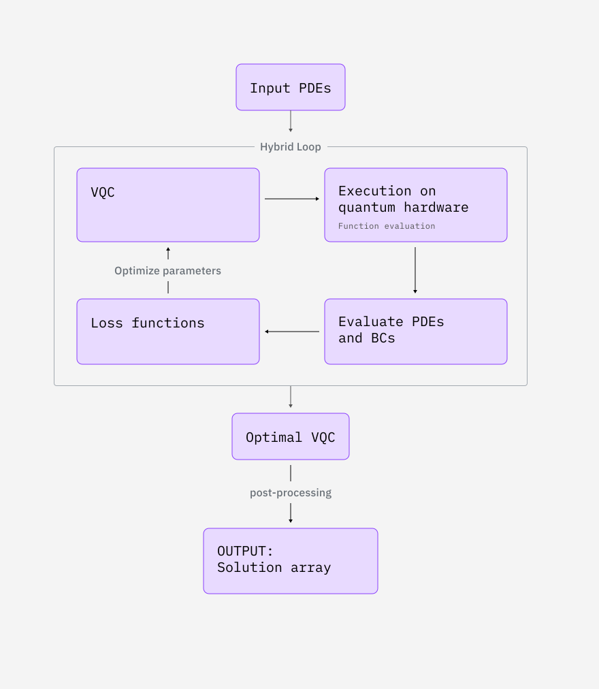

<OpenInLabBanner notebookPath="guides/colibritd-pde.ipynb" />


{/* cspell:ignore CMAES, Hypoelastic, edgecolor, royalblue, rstride, cstride, colibritd, xlabel, ylabel, zlabel, Jaffali, Pressureless, Colorplot, viridis, fontsize, fontweight, Scholes, RMSE, BPM, popsize, volatilities, Jacobians, frameon, argmin, depthshade */}
*See the [API reference](https://docs.quantum.ibm.com/functions/colibritd-pde/api-reference)*
<Admonition type="note">
  IBM Quantum&reg; Functions are a beta feature available only to IBM Quantum Premium Plan, Flex Plan, and On-Prem (through the IBM Quantum Platform API) Plan users. Beta features are subject to change.
</Admonition>
## Overview

The Partial Differential Equation (PDE) solver presented here is part of our Quantum Innovative Computing Kit (QUICK) platform (QUICK-PDE), and is packaged as a Quantum Function. With the QUICK-PDE function, you can solve domain-specific partial differential equations on IBM Quantum QPUs. This function is based on the algorithm described in [ColibriTD's H-DES description paper](https://arxiv.org/abs/2410.01130). This algorithm can solve complex multi-physics problems, starting with Computational Fluid Dynamics (CFD) and Materials Deformation (MD), and now including quantitative finance with the Black-Scholes equation for options on one to three assets. Other use cases are coming soon.

To tackle the differential equations, the trial solutions are encoded as linear combinations of orthogonal functions (typically Chebyshev polynomials, and more specifically up to $2^n$ of them where $n$ is the number of qubits encoding your function), parametrized by the angles of a Variable Quantum Circuit (VQC). The ansatz generates a state encoding the function, which is evaluated by observables whose combinations allow for evaluating the function at all points. You can then evaluate the loss function in which the differential equations are encoded, and fine-tune the angles in a hybrid loop, as shown in the following. The trial solutions get gradually closer to the actual solutions until you reach a satisfactory result.



In addition to this hybrid loop, you can also chain together different optimizers. This is useful when you want a global optimizer to find a good set of angles, and then a more fine-tuned optimizer to follow a gradient to the best set of neighboring angles. In the case of computational fluid dynamics (CFD), the default optimization sequence produces the best results - but in the case of material deformation (MD), while the default provides good results, you can configure it further for problem-specific benefits.

Note that for each variable of the function, you specify the number of qubits (which you can experiment with). By stacking 10 identical circuits and evaluating the 10 identical observables on different qubits throughout one big circuit, you can noise-mitigate within the CMA optimization process or parallelize the PSR computations, relying on the noise learner method, and significantly reducing the number of shots needed.
### Computational fluid dynamics

**The inviscid Burgers' equation** models flowing non-viscous fluids as follows:

$\frac{\partial u}{\partial t} + u\frac{\partial u}{\partial x} = 0$,

$u$ represents the fluid speed field. This use-case has a temporal boundary condition: you can select the initial condition and then allow the system to relax. Currently, the only accepted initial conditions are linear functions: $ax + b$. The analytical solution is:

$u(t, x) = \frac{ax + b}{at + 1}$.

**The pressureless Euler equations** model compressible inviscid fluid flow with damping as follows:

$\frac{\partial g}{\partial t} + u\frac{\partial g}{\partial x} + g\frac{\partial u}{\partial x} = 0$,

$u\frac{\partial g}{\partial t} + g\frac{\partial u}{\partial t} + u^2\frac{\partial g}{\partial x} + 2gu\frac{\partial u}{\partial x} + \frac{\mu}{(1+t)^{\lambda}} g u = 0$,

$g$ represents the density field, $u$ the velocity field and $\mu$ a damping coefficient. In our formulation, we pose $\lambda = 1$, so it will not be used as a parameter in the following. This use-case has temporal boundary conditions: $g(0, x) = e^{-x}$ and $u(0, x) = x$. The analytical solution is:

$g(t, x) = \frac{1-\mu}{(1+t)^{1-\mu} - \mu} \exp\!\left(\frac{(\mu-1)\, x}{(1+t)^{1-\mu} - \mu}\right)$,

$u(t, x) = \frac{(1-\mu)\, x}{\left((1+t)^{1-\mu} - \mu\right)(1+t)^{\mu}}$.

The arguments for CFD's differential equations are on a fixed grid, as follows:

* $t$ is between 0 and 0.95 with 41 sample points. $x$ is between 0 and 0.95 with 41 sample points.

### Material deformation

This use case focuses on **hypoelastic deformation with the one-dimensional tensile test**, in which a bar fixed in space is pulled at its other extremity. We describe the problem as follows:

$u' - \frac{\sigma}{3K} - \frac{2}{\sqrt{3}}\epsilon_0\left(\frac{\sigma'}{\sigma_0\sqrt{3}}\right)^n = 0$,

$\sigma' - b = 0$,

$K$ represents the bulk modulus of the material being stretched, $n$ the exponent of a power law, $b$ the force per unit mass, $\epsilon_0$ the proportional stress limit, $\sigma_0$ the proportional strain limit, $u$ the stress function, and $\sigma$ the strain function. The analytical solution is:

$\sigma(x) = \sigma_0 - bx$,

$u(x) = -\frac{3^{-(3+n)/2}}{2bK(1+n)\,\sigma_0^{n}}\Biggl[3^{(1+n)/2}b^2\sigma_0^n(1+n)x^2 - 2\cdot 3^{(1+n)/2}b\sigma_0^n(1+n)\sigma_0 x - 12\epsilon_0 K\sigma_0^{1+n}$
$- 12b\epsilon_0 K\sigma_0^n x\left(\frac{-bx+\sigma_0}{\sigma_0}\right)^n + 12\epsilon_0 K\sigma_0^{n+1}\left(\frac{-bx+\sigma_0}{\sigma_0}\right)^n - 12\epsilon_0 K \sigma_0^{1+n}\Biggr]$,

where $\sigma_0 = g(0)$ is the boundary condition on the strain at $x=0$.

The considered bar is of unitary length. This use-case has a boundary condition for surface stress $t$, or the amount of work needed to stretch the bar.

The arguments for MD's differential equations are on a fixed grid, as follows:

* $x$ is between 0 and 1 with 30 sample points.
### Quantitative finance

**The Black-Scholes equation** gives the price $C$ of a European call option as a function of the time $t$ and of the price of the underlying asset or assets. We pose a zero interest rate, no dividends and a maturity $T = 1$. This use case is available for one, two and three assets.

For a single asset, the equation reads:

$\frac{\partial C}{\partial t} + \frac{\sigma^2}{2} S^2 \frac{\partial^2 C}{\partial S^2} = 0$,

where $\sigma$ is the volatility of the asset and $S$ its price. The boundary conditions are given by the analytical solution. It fixes the price at the final time $t = 0.9$ (a residual maturity of 0.1) and at the edges $S = 1$ and $S = 2$ of the price domain, and the solver recovers the price at the earlier times. The analytical solution is:

$C(t, S) = S\,\Phi(d_1) - K\,\Phi(d_2), \qquad d_{1,2} = \frac{\ln(S/K) \pm \frac{\sigma^2}{2}(T-t)}{\sigma\sqrt{T-t}}$,

where $K$ is the strike of the option and $\Phi$ is the cumulative distribution function of the standard normal distribution.

For **baskets of two and three assets**, the option is written on the geometric average $G = \prod_{i=1}^{n} S_i^{w_i}$ of the $n$ asset prices, where the weights $w_i$ are strictly positive and sum to 1:

$\frac{\partial C}{\partial t} + \sum_{i=1}^{n} \frac{\sigma_i^2}{2} S_i^2 \frac{\partial^2 C}{\partial S_i^2} + \sum_{i<j} \rho_{ij}\,\sigma_i\sigma_j\, S_i S_j \frac{\partial^2 C}{\partial S_i \partial S_j} = 0$,

where $\sigma_i$ is the volatility of asset $i$ and $\rho_{ij}$ the correlation between assets $i$ and $j$. The boundary conditions are given by the analytical solution on the final time and on the edges of the price domain. With $\tau = T - t$, the analytical solution is:

$C = G\,e^{-q\tau}\,\Phi(d_1) - K\,\Phi(d_2), \qquad d_1 = \frac{\ln(G/K) + \left(\frac{\sigma_G^2}{2} - q\right)\tau}{\sigma_G\sqrt{\tau}}, \qquad d_2 = d_1 - \sigma_G\sqrt{\tau}$,

$\sigma_G^2 = \sum_{i} w_i^2\sigma_i^2 + 2\sum_{i<j} \rho_{ij}\, w_i w_j\, \sigma_i\sigma_j, \qquad q = \frac{1}{2}\left(\sum_i w_i\sigma_i^2 - \sigma_G^2\right)$,

and the one-asset solution is recovered for $n = 1$ and $w_1 = 1$.

The physical parameters of the use case are the following:

| Parameter                             | Description                                                                                                   | Range                                                          | Business range                                                                  |
| ------------------------------------- | ------------------------------------------------------------------------------------------------------------- | -------------------------------------------------------------- | ------------------------------------------------------------------------------- |
| `sigma`, `sigma1`, `sigma2`, `sigma3` | Volatility of each asset                                                                                      | 0.05 to 1                                                      | 0.10 to 0.40                                                                    |
| `K`                                   | Strike of the option                                                                                          | 1 to 2                                                         | 1.2 to 1.8 (80% to 120% of a spot price at the center of the domain, $S = 1.5$) |
| `w1` (basket of 2 assets)             | Weight of the first asset. The weight of the second asset is deduced: $w_2 = 1 - w_1$                         | Each weight is strictly positive (so $0 < w_1 < 1$)            | Each weight from 0.2 to 0.8                                                     |
| `w1`, `w2` (basket of 3 assets)       | Weights of the first and of the second asset. The weight of the third asset is deduced: $w_3 = 1 - w_1 - w_2$ | Each weight is strictly positive (so $w_1 + w_2 < 1$)          | Each of the three weights from 0.2 to 0.8                                       |
| `rho`, `rho12`, `rho13`, `rho23`      | Correlation between two assets                                                                                | 0 to 1 (the correlation matrix must be positive semi-definite) | 0.1 to 0.8                                                                      |

The range column gives the values accepted by the use case. The business range gives the values commonly met in practice: volatilities of equity indices, large capitalizations and currencies, strikes close to the spot price, moderate to high correlations between assets, and a residual maturity $T - t$ between 0.3 and 1 year.

The arguments for the Black-Scholes differential equations are on a fixed domain, as follows:

* $t$ is between 0 and 0.9. The variable $x_i$ of each asset is between 0 and 1, and the price of the asset is $S_i = 1 + x_i$, so between 1 and 2.
### Ansatz

The variable quantum circuit that encodes each function is selected with the `ansatz` argument:

* `HEA` is a hardware-efficient ansatz measured with a global observable. It is the most general choice.
* `BPM-LE` (Barren Plateau Mitigation, Low Expressivity) is an ansatz designed to avoid barren plateaus, measured with local observables. It has few parameters and shallow circuits, which keeps the cost of the optimization low, including the cost of parameter-shift gradients.
* `BPM-HE` (Barren Plateau Mitigation, High Expressivity) follows the same construction with more parameters per circuit, for functions that the low-expressivity version cannot represent accurately enough.

The number of qubits per variable and the depth of the circuit remain controlled by the `nb_qubits` and `depth` arguments.
### Optimizer chain and error metric

The optimizers are chained as a list of stages with the `optimizers` argument. Each stage defines its own method, its maximum number of iterations and its own number of shots, so that cheap and noisy evaluations explore the landscape first, and the number of shots increases as the optimization converges. A typical chain is made of the following pieces:

1. One or more `CMAES` stages (global and gradient-free), which identify the right region of the space of solutions. Each stage has its own `shots`, `sigma0`, and `popsize` (population size, that is the number of candidates evaluated at each generation). The `sigma0` argument is the initial standard deviation of the search distribution of CMA-ES, that is, its initial step size: a large value widely explores the space of the circuit parameters, while a small value searches locally around the best candidate found so far. Decreasing `sigma0` from one stage to the next therefore moves from exploration to refinement.
2. A `LS-TRF` stage (Least Squares - Trust Region Reflective), which explores this region to refine the final angles. Without `psr`, `LS-TRF` estimates the Jacobian of the cost function with finite differences. With `psr=True`, the Jacobian is computed on the QPU exactly, with the parameter-shift rule (PSR). The PSR increases the computation time since it requires additional circuits, but it allows a better precision than the finite differences.

The error metric used on this page is the Root Mean Square Error (RMSE) between the solution and the reference solution, over the sampled points. The function also reports the mean squared error (MSE) and the maximum absolute deviation, which are the d2 and d1 metrics of Section 2.6 of [the H-DES paper](https://arxiv.org/abs/2410.01130).
## Plan sizes

The QUICK-PDE function is available in three plan sizes: Small, Medium, and Large. The following table gives the limits and the services of each size.

| Size | Mode         | Iterations max (all stages)     | Shots max per job | Max qubits                    | Compute profile (vCPU x RAM Go) |
| ---- | ------------ | ------------------------------- | ----------------- | ----------------------------- | ------------------------------- |
| S    | Job mode     | 25                              | 10,000            | 15                            | 8x32                            |
| M    | Job mode     | 50                              | 50,000            | 35                            | 16x128              |
| L    | Session mode | Unlimited (up to session limit) | 100,000           | Unlimited (up to QPU limits)  | 48x768                          |

The maximum number of iterations applies to the sum of the iterations of all the stages of the optimizer chain.
## Function sizes

The function runs with a compute size, `"S"`, `"M"`, or `"L"`, which you set with the `function_size` argument of `run`. The size that your problem needs follows the limits of the plans:

* The mode (the session mode requires the size `"L"`)
* The total number of iterations, which is the sum of the `max_iter` of all the stages of the `optimizers` chain
* The maximum number of shots per job, which is the largest `shot` of the stages (more than 100,000 shots per job is not supported)
* The maximum number of qubits, which is the number of qubits of the largest function

The size is the smallest one for which all these values stay within its limits. The onboarding and the support depend on your plan and are not part of the calculation. A problem above the limits of the size `"M"` is sized `"L"`.

If the size you pass is smaller than the size that the problem needs, the job fails with the error code 4600. If it is larger, the job runs and reports an event with the error code 4601 to tell you that a smaller size can be used.

The following function calculates the size of a problem from the same arguments as `run`, without submitting anything. When `optimizers` or `nb_qubits` are omitted, the default values of the use case are used, as in `run`.

```python
# Added by doQumentation — installs the packages this notebook needs if they are missing
import importlib.util

_needed = {"matplotlib": "matplotlib", "numpy": "numpy", "qiskit_ibm_catalog": "qiskit-ibm-catalog", "scipy": "scipy"}
_missing = [pip for module, pip in _needed.items()
            if importlib.util.find_spec(module) is None]
# One at a time, so a package that fails to install does not block the others
for _pip in _missing:
    %pip install -q {_pip}
if not _missing:
    print("\u2713 All required packages are installed")
```

```python
from typing import Any, Literal

Size = Literal["S", "M", "L"]

_SMALL = {"iterations": 25, "shots": 10_000, "qubits": 15}
_MEDIUM = {"iterations": 50, "shots": 50_000, "qubits": 35}
_MAX_SHOTS = 100_000

_MODES = ("job", "batch", "session")

_DEFAULT = {
    "CFD_EULER": {
        "nb_qubits": {"u": {"t": 2, "x": 2}, "g": {"t": 2, "x": 2}},
        "optimizers": [
            ("CMA", {"shot": 2500, "max_iter": 12}),
            ("CMA", {"shot": 4000, "max_iter": 18}),
            ("LS_TRF", {"shot": 10000, "max_iter": 30}),
        ],
    },
    "CFD_BURGER": {
        "nb_qubits": {"u": {"t": 2, "x": 2}},
        "optimizers": [
            ("CMA", {"shot": 3000, "max_iter": 40}),
            ("CMA", {"shot": 15000, "max_iter": 15}),
            ("CMA", {"shot": 50000, "max_iter": 10}),
        ],
    },
    "MD": {
        "nb_qubits": {"u": {"x": 3}, "sigma": {"x": 3}},
        "optimizers": [
            ("CMA", {"shot": 2500, "max_iter": 12}),
            ("CMA", {"shot": 4000, "max_iter": 18}),
            ("CMA", {"shot": 6000, "max_iter": 12}),
            ("LS_TRF", {"shot": 10000, "max_iter": 55}),
        ],
    },
    "BS_1A": {
        "nb_qubits": {"F_0": {"x_0": 3, "x_1": 3}},
        "optimizers": [
            ("CMA", {"shot": 5000, "max_iter": 12}),
            ("CMA", {"shot": 5000, "max_iter": 12}),
            ("LS_TRF", {"shot": 10000, "max_iter": 26}),
        ],
    },
    "BS_2A": {
        "nb_qubits": {"F_0": {"x_0": 3, "x_1": 2, "x_2": 2}},
        "optimizers": [
            ("CMA", {"shot": 5000, "max_iter": 12}),
            ("CMA", {"shot": 5000, "max_iter": 12}),
            ("LS_TRF", {"shot": 10000, "max_iter": 19}),
        ],
    },
    "BS_3A": {
        "nb_qubits": {"F_0": {"x_0": 3, "x_1": 2, "x_2": 2, "x_3": 2}},
        "optimizers": [
            ("CMA", {"shot": 5000, "max_iter": 18}),
            ("CMA", {"shot": 40000, "max_iter": 18}),
            ("LS_TRF", {"shot": 10000, "max_iter": 12}),
        ],
    },
}

def calculate_function_size(problem: Any, **kwargs: Any) -> Size:
    """Return the size ("S", "M" or "L") required to run the function."""
    metrics = _measure(problem, **kwargs)
    if _is_small(metrics):
        return "S"
    if _is_medium(metrics):
        return "M"
    return "L"

def _measure(problem: Any, **kwargs: Any) -> dict:
    """Reduce the problem to a dict of numbers that drives your resource usage."""
    args = (
        {**problem, **kwargs}
        if isinstance(problem, dict)
        else {**kwargs, "use_case": problem}
    )

    use_case = str(args.get("use_case") or "").upper()
    if use_case not in _DEFAULT:
        raise ValueError(
            f"cannot size use_case {args.get('use_case')!r}: expected one of {list(_DEFAULT)}"
        )

    mode = (
        "job"
        if args.get("run_local")
        else str(args.get("mode") or "job").lower()
    )
    if mode not in _MODES:
        raise ValueError(
            f"cannot size mode {args.get('mode')!r}: expected one of {list(_MODES)}"
        )

    optimizers = args.get("optimizers")
    if optimizers is None:
        optimizers = _DEFAULT[use_case]["optimizers"]
    if not isinstance(optimizers, (list, tuple)) or not optimizers:
        raise ValueError(
            "optimizers must be a non-empty list of (name, parameters) pairs"
        )
    iterations, shots = 0, 0
    for i, stage in enumerate(optimizers):
        if (
            not isinstance(stage, (list, tuple))
            or len(stage) != 2
            or not isinstance(stage[1], dict)
        ):
            raise ValueError(
                f"optimizers[{i}] must be a (name, parameters) pair"
            )
        options = {str(k).lower(): v for k, v in stage[1].items()}
        shot, max_iter = options.get("shot"), options.get("max_iter")
        if not shot or not max_iter:
            raise ValueError(
                f"optimizers[{i}] must give 'shot' and 'max_iter'"
            )
        iterations += int(max_iter)
        shots = max(shots, int(shot))
    if shots > _MAX_SHOTS:
        raise ValueError(
            f"shots per job ({shots}) exceeds the maximum of {_MAX_SHOTS}"
        )

    nb_qubits = args.get("nb_qubits")
    if nb_qubits is None:
        nb_qubits = _DEFAULT[use_case]["nb_qubits"]
    qubits = max(
        sum(int(q) for q in per_var.values())
        for per_var in nb_qubits.values()
    )

    return {
        "mode": mode,
        "iterations": iterations,
        "shots": shots,
        "qubits": qubits,
    }

def _is_small(metrics: dict) -> bool:
    """Determine if the metrics fit T-size 'S'."""
    return (
        metrics["mode"] != "session"
        and metrics["iterations"] <= _SMALL["iterations"]
        and metrics["shots"] <= _SMALL["shots"]
        and metrics["qubits"] <= _SMALL["qubits"]
    )

def _is_medium(metrics: dict) -> bool:
    """Determine if the metrics fit T-size 'M'."""
    return (
        metrics["mode"] != "session"
        and metrics["iterations"] <= _MEDIUM["iterations"]
        and metrics["shots"] <= _MEDIUM["shots"]
        and metrics["qubits"] <= _MEDIUM["qubits"]
    )
```

For example, a basket of three assets with a chain of three stages needs a total of 40 iterations and up to 20,000 shots, so it fits size `"M"`:

```python
optimizers = [
    ("CMA", {"shot": 5000, "max_iter": 20, "sigma": 0.3}),
    ("CMA", {"shot": 20000, "max_iter": 10, "sigma": 0.1}),
    ("LS_TRF", {"shot": 10000, "max_iter": 10, "psr": True}),
]

size = calculate_function_size("BS_3A", optimizers=optimizers)
print(size)
```

Then pass the size to `run`:

```python noexec
job = quick.run(
    use_case="BS_3A",
    physical_parameters={...},
    optimizers=optimizers,
    function_size=size,
)
```
## Benchmarks

The following tables present statistics on various runs of the function. The first table gives the results of the current version of the function. The second table, at the end of this section, only keeps the results of the previous version for reference.

### Current version

| Example                                    | Total number of qubits | Ansatz   | RMSE                       | Classical compute time (min) | QPU time (min) |
| ------------------------------------------ | ---------------------- | -------- | -------------------------- | ---------------------------- | -------------- |
| Inviscid Burgers' equation                 | 4                      | `BPM-LE` | 0.0147                     | ~1                           | 11             |
| Pressureless Euler's equations             | 8                      | `HEA`    | 0.0193                     | ~1.5                         | 10             |
| Hypoelastic 1D tensile test                | 6                      | `HEA`    | 0.0296                     | ~1                           | 10             |
| Black-Scholes equation, 1 asset            | 6                      | `BPM-LE` | 0.0084                     | ~0.3                         | 5.0            |
| Black-Scholes equation, basket of 2 assets | 7                      | `BPM-HE` | 0.0085                     | ~4                           | 12.0           |
| Black-Scholes equation, basket of 3 assets | 9                      | `BPM-HE` | 0.0104                     | ~67                          | 20.7           |

The RMSE is the Root Mean Square Error between the solution and the reference solution (aggregated over the two functions for the Euler, and tensile test cases). For the Burgers, Euler, and tensile test cases, it is measured on the QPU over the sampled points. For the Black-Scholes cases, it is computed inside the domain, excluding the final time and the edges where the solution is imposed, on a fine grid (600 points per axis for 1 asset, 80 for 2 assets, 16 for 3 assets), by noiseless simulation at the parameters retained on the QPU. The classical compute time is the time spent by the optimizers on the classical side of the hybrid loop. It is mostly due to the evaluation of the points on the grid, which is easily parallelizable. The QPU time is the quantum processing time billed for the optimization jobs.

The number of qubits is lower than in the previous version. The circuit binding feature reduces the QPU time of the runs, not the number of qubits. It remains possible to increase the number of qubits by executing several circuits in parallel, which reduces the QPU time needed even further, and the new version of the function leaves room to scale to larger numbers of qubits and larger problems.

The optimization steps of these runs are described as follows:
- The `popsize` argument is the number of candidates evaluated at each generation of `CMAES`.
- The `CMAES` stages can stop early when the cost stagnates.
- A cost evaluation is the computation of the cost function for one set of circuit parameters, measured on the QPU with the number of shots of the stage.
- A `CMAES` generation is made of `popsize` evaluations, so the iterations of `CMAES` are counted in generations.
- An `LS-TRF` iteration computes the Jacobian of the cost function at the current point, with the parameter-shift rule (PSR) here, and evaluates the cost function at one or several trial points.
- The Jacobian requires its own circuits (the parameter-shifted circuits), which are not counted as evaluations. The number of Jacobians is therefore the number of `LS-TRF` iterations, and the number of evaluations is higher than the number of iterations because some trial points are rejected.

| Example                        | Stage | Method                   | Shots  | `sigma0` | `popsize` | Iterations                                 |
| ------------------------------ | ----- | ------------------------ | ------ | -------- | --------- | ------------------------------------------ |
| Inviscid Burgers' equation     | 1     | `CMAES`                  | 3,000  | 0.4      | 12        | 40 generations                             |
|                                | 2     | `CMAES`                  | 15,000 | 0.1      | 12        | 15 generations                             |
|                                | 3     | `CMAES`                  | 50,000 | 0.04     | 12        | 6 generations                              |
| Pressureless Euler's equations | 1     | `CMAES`                  | 2,500  | 0.5      | 12        | 12 generations                             |
|                                | 2     | `CMAES`                  | 4,000  | 0.15     | 12        | 18 generations                             |
|                                | 3     | `LS-TRF` with `psr=True` | 10,000 | n/a      | n/a       | 30 evaluations, 7 iterations (7 Jacobians) |
| Hypoelastic 1D tensile test    | 1     | `CMAES`                  | 2,500  | 0.5      | 12        | 12 generations                             |
|                                | 2     | `CMAES`                  | 4,000  | 0.15     | 12        | 18 generations                             |
|                                | 3     | `CMAES`                  | 6,000  | 0.07     | 12        | 12 generations                             |
|                                | 4     | `LS-TRF` with `psr=True` | 10,000 | n/a      | n/a       | 31 evaluations, 3 iterations (3 Jacobians) |

### Previous version

<Admonition type="caution" title="Results of the previous version">
  The values in the following table were obtained with the previous version of the function and its previous parameters. They are kept for reference only and are not the current results.
</Admonition>

| Example (previous version)                        | Total number of qubits | Error (RMSE, order of magnitude) | Classical time (min) | QPU time (min) |
| ------------------------------------------------- | ---------------------- | -------------------------------- | -------------------- | -------------- |
| Inviscid Burgers' equation (previous version)     | 50                     | $10^{-2}$                        | ~41                  | ~25            |
| Pressureless Euler's equations (previous version) | 70                     | $10^{-2}$                        | ~14                  | ~34            |
| Hypoelastic 1D tensile test (previous version)    | 18                     | $10^{-2}$                        | ~23                  | ~100           |

The classical time is the part of the duration of the runs that is not spent on the QPU, which includes the calls to the API. The QPU time is the quantum processing time billed for the optimization jobs.
## Get started

Fill out the [form to request access to the QUICK-PDE function](https://forms.cloud.microsoft/e/3Wi9cbjQPK). Then, assuming you've already [saved your account](/guides/functions-get-started#install-qiskit-functions-catalog-client) to your local environment, select the function as follows. For login instructions, use [the getting started guide](/guides/functions-get-started).

```python
from qiskit_ibm_catalog import FunctionsCatalog

catalog = FunctionsCatalog(
    channel="ibm_cloud / ibm_quantum_platform",
)

# Verify that you have access to the function
catalog.list()
```

```python
quick = catalog.load("colibritd/quick-pde")
```

## Examples

To get started, try one of the following examples:
### Inviscid Burgers' equation (CFD)

For Burgers' equation, when initial conditions are set to $u(0,x) = x$, the results are as follows:

```python
use_case = "CFD_BURGER"
optimizers = [("CMA", {"shot": 5000, "max_iter": 20, "sigma": 0.3})]

size = calculate_function_size(use_case, optimizers=optimizers)
print(size)

# launch the simulation with initial conditions u(0,x) = a*x + b

job = quick.run(
    use_case=use_case,
    optimizers=optimizers,
    physical_parameters={"a": 1.0, "b": 0.0},
    function_size=size,
)
```

Check your Quantum Function workload's [status](/guides/functions-get-started#check-job-status) or return [results](/guides/functions-get-started#retrieve-results) as follows:

```python
# Print the ID so you can use it later, if necessary
print(job.job_id)
solution = job.result()
```

```python
import numpy as np
import matplotlib.pyplot as plt

def plot_result_3d(result):
    fig = plt.figure()
    ax = fig.add_subplot(projection="3d")

    t, x = np.meshgrid(result["samples"]["t"], result["samples"]["x"])

    ax.plot_surface(
        t,
        x,
        result["functions"]["u"],
        edgecolor="royalblue",
        lw=0.25,
        rstride=26,
        cstride=26,
        alpha=0.3,
    )
    ax.scatter(t, x, result["functions"]["u"], marker=".")
    ax.set(xlabel="t", ylabel="x", zlabel="u(t,x)")

    plt.show()

# Call
plot_result_3d(solution)
```

### Pressureless Euler's equation (CFD)

For Euler's equation, when initial conditions are set to $g(0, x) = e^{-x}$ and $u(0, x) = x$, for a given $\mu$ (here, $\mu = 0.1$) and $\lambda = 1$, the results are as follows:

```python
use_case = "CFD_EULER"
optimizers = [("CMA", {"shot": 5000, "max_iter": 20, "sigma": 0.3})]

size = calculate_function_size(use_case, optimizers=optimizers)
print(size)

# Launches the solving for an arbitrary mu

job = quick.run(
    use_case=use_case,
    optimizers=optimizers,
    physical_parameters={"mu": 0.1},
    function_size=size,
)
```

```python
solution = job.result()
```

```python
# Colorplot function
def plot_result_2d(result):
    fig, axes = plt.subplots(1, 2, figsize=(14, 5))

    configs = {
        "g": {"cmap": "viridis", "title": "g(t, x)"},
        "u": {"cmap": "plasma", "title": "u(t, x)"},
    }

    t = result["samples"]["t"]
    x = result["samples"]["x"]

    for ax, (field, cfg) in zip(axes, configs.items()):
        v = result["functions"][field]

        im = ax.contourf(t, x, v, levels=50, cmap=cfg["cmap"])
        fig.colorbar(im, ax=ax, label=cfg["title"])

        ax.set_xlabel("t")
        ax.set_ylabel("x")
        ax.set_title(cfg["title"], fontsize=13, fontweight="bold")

    plt.tight_layout()
    plt.show()

plot_result_2d(solution)
```

### Material deformation

The material deformation use case requires the physical parameters of your material and the applied force, as follows:

```python
use_case = "MD"
optimizers = [("CMA", {"shot": 5000, "max_iter": 20, "sigma": 0.3})]

size = calculate_function_size(use_case, optimizers=optimizers)
print(size)

# Select the properties of your material
job = quick.run(
    use_case=use_case,
    optimizers=optimizers,
    physical_parameters={
        "t": 12.0,
        "K": 100.0,
        "n": 4.0,
        "b": 10.0,
        "epsilon_0": 0.1,
        "sigma_0": 5.0,
    },
    function_size=size,
)
```

```python
# Plot the result
solution = job.result()
```

```python
# Plot the result
_ = plt.figure()
stress_plot = plt.subplot(211)
plt.plot(solution["samples"]["x"], solution["functions"]["u"])
strain_plot = plt.subplot(212)
plt.plot(solution["samples"]["x"], solution["functions"]["sigma"])

plt.show()
```

### Black-Scholes equation (quantitative finance)

The Black-Scholes use cases take the volatility of the asset or assets, and the option strike. For a single asset with a volatility $\sigma = 0.3$ and a strike $K = 1.2$, the results are as follows:

```python
use_case = "BS_1A"
optimizers = [("CMA", {"shot": 5000, "max_iter": 20, "sigma": 0.3})]

size = calculate_function_size(use_case, optimizers=optimizers)
print(size)

# Select the volatility & strike

job = quick.run(
    use_case=use_case,
    optimizers=optimizers,
    physical_parameters={"sigma": 0.3, "K": 1.2},
    function_size=size,
)

solution = job.result()
```

Compare the solution with the analytical price, and compute the RMSE on the sampled points (the price of the asset is $S = 1 + x$):

```python
from scipy.stats import norm

def black_scholes_call(t, S, sigma, K, T=1.0):
    tau = T - t
    d1 = (np.log(S / K) + 0.5 * sigma**2 * tau) / (sigma * np.sqrt(tau))
    d2 = d1 - sigma * np.sqrt(tau)
    return S * norm.cdf(d1) - K * norm.cdf(d2)

params = solution["arguments"].get("physical_parameters") or {
    "sigma": 0.15,
    "K": 1.4,
}
params = {k.lower(): v for k, v in params.items()}

t, x = np.meshgrid(
    solution["samples"]["x_0"], solution["samples"]["x_1"], indexing="ij"
)
S = 1 + x
reference = black_scholes_call(t, S, sigma=params["sigma"], K=params["k"])

F = np.asarray(solution["functions"]["F_0"])
rmse = np.sqrt(np.mean((F - reference) ** 2))
print(f"RMSE: {rmse:.4f}")
```

```python
t_grid = np.asarray(solution["samples"]["x_0"])
x_grid = np.asarray(solution["samples"]["x_1"])

n_times = 5
indices = np.unique(
    np.linspace(0, len(t_grid) - 1, n_times).round().astype(int)
)
blues = ["#86b6ef", "#5598e7", "#2a78d6", "#1c5cab", "#0d366b"]
colors = [
    blues[i]
    for i in np.linspace(0, len(blues) - 1, len(indices)).round().astype(int)
]

fig, ax = plt.subplots(figsize=(8, 5))
for color, i in zip(colors, indices):
    ax.plot(
        x_grid,
        F[i],
        color=color,
        lw=2,
        marker="o",
        ms=4,
        label=f"t = {t_grid[i]:.2f}",
    )
    ax.plot(x_grid, reference[i], color=color, lw=1.5, ls="--")

ax.plot([], [], color="0.4", lw=2, marker="o", ms=4, label="Qiskit Function")
ax.plot([], [], color="0.4", lw=1.5, ls="--", label="Reference")

ax.set_title(f"Black-Scholes 1D : F(t, x)   (RMSE = {rmse:.4f})")
ax.set_xlabel("x")
ax.set_ylabel("F(t, x)")
ax.grid(color="0.9", lw=0.8)
ax.spines[["top", "right"]].set_visible(False)
ax.legend(frameon=False)
plt.show()
```

For a basket of two assets, set the volatility of each asset, the weight $w_1$ of the first asset (the weight of the second one is $1 - w_1$), and the correlation $\rho$ between the two assets. The following also selects the high-expressivity ansatz:

```python
use_case = "BS_2A"
optimizers = [
    ("CMA", {"shot": 5000, "max_iter": 20, "sigma": 0.3}),
    ("LS_TRF", {"shot": 10000, "max_iter": 10, "psr": True}),
]

size = calculate_function_size(use_case, optimizers=optimizers)
print(size)

# Select the volatilities, weights, correlation & strike of the basket

job = quick.run(
    use_case=use_case,
    optimizers=optimizers,
    physical_parameters={
        "sigmas": (0.3, 0.38),
        "weights": (0.6, 0.4),
        "rho": 0.6,
        "K": 1.35,
    },
    ansatz="BPM High",
    size=size,
)

solution = job.result()
```

```python
t_grid = np.asarray(solution["samples"]["x_0"])
x1 = np.asarray(solution["samples"]["x_1"])
x2 = np.asarray(solution["samples"]["x_2"])
F = np.asarray(solution["functions"]["F_0"])
assert F.shape == (len(t_grid), len(x1), len(x2)), F.shape

time = 0.0
i = int(np.abs(t_grid - time).argmin())

X1, X2 = np.meshgrid(x1, x2, indexing="ij")

fig = plt.figure(figsize=(8, 6))
ax = fig.add_subplot(projection="3d")
surface = ax.plot_surface(
    X1, X2, F[i], cmap="viridis", edgecolor="none", alpha=0.95
)
fig.colorbar(surface, ax=ax, shrink=0.6, pad=0.1, label="F")

ax.set_xlabel("Asset 1 (x_1)")
ax.set_ylabel("Asset 2 (x_2)")
ax.set_zlabel("F")
ax.set_title(f"Black-Scholes 2D : F à t = {t_grid[i]:.2f}")
plt.show()
```

For a basket of three assets, the weights of the first two assets are given and the weight of the third one is $1 - w_1 - w_2$. The correlations are given pair by pair. The following selects the low-expressivity ansatz and configures the optimizer chain: two `CMAES` stages with an increasing number of shots and a decreasing `sigma0`, followed by a `LS-TRF` stage with the parameter-shift rule.

```python
use_case = "BS_3A"
optimizers = [
    ("CMA", {"shot": 5000, "max_iter": 40, "sigma": 0.3}),
    ("CMA", {"shot": 40000, "max_iter": 20, "sigma": 0.12}),
    ("LS_TRF", {"shot": 10000, "max_iter": 10, "psr": True}),
]

size = calculate_function_size(use_case, optimizers=optimizers)
print(size)

# Select the volatilities, weights, correlations & strike of the basket

job = quick.run(
    use_case=use_case,
    optimizers=optimizers,
    physical_parameters={
        "sigmas": (0.3, 0.2, 0.25),
        "weights": (0.25, 0.35, 0.40),
        "rho12": 0.6,
        "rho13": 0.6,
        "rho23": 0.6,
        "K": 1.2,
    },
    ansatz="BPM High",
    size=size,
)

solution = job.result()
```

```python
# Plot the result
t_grid = np.asarray(solution["samples"]["x_0"])
x1 = np.asarray(solution["samples"]["x_1"])
x2 = np.asarray(solution["samples"]["x_2"])
x3 = np.asarray(solution["samples"]["x_3"])
F = np.asarray(solution["functions"]["F_0"])
assert F.shape == (len(t_grid), len(x1), len(x2), len(x3)), F.shape

time = 0.0
i = int(np.abs(t_grid - time).argmin())

X1, X2, X3 = np.meshgrid(x1, x2, x3, indexing="ij")

fig = plt.figure(figsize=(8, 6))
ax = fig.add_subplot(projection="3d")
points = ax.scatter(
    X1.ravel(),
    X2.ravel(),
    X3.ravel(),
    c=F[i].ravel(),
    cmap="viridis",
    s=60,
    depthshade=False,
)
fig.colorbar(points, ax=ax, shrink=0.6, pad=0.1, label="F")

ax.set_xlabel("Asset 1 (x_1)")
ax.set_ylabel("Asset 2 (x_2)")
ax.set_zlabel("Asset 3 (x_3)")
ax.set_title(f"Black-Scholes 3D : F at t = {t_grid[i]:.2f}")
plt.show()
```

## Fetch error messages

If your workload status is `ERROR`, use `job.error_message()` to fetch the error message to help debug, as follows:

```python
job = quick.run(
    use_case="MD",
    physical_parameters={
        "t": 12.0,
        "K": 100.0,
        "n": 4.0,
        "b": 10.0,
        "epsilon_0": 0.1,
        "sigma_0": 5.0,
    },
    domain_data={"t": 10},
    run_local=True,
)
print(job.error_message())

# A wrapper can also be used for a more human readable version
def pprint_error(job):
    print("".join(eval(job.error_message())["error"]))

print("___")
pprint_error(job)
```

## Get support

For support, contact [qiskit-function-support@colibritd.com](mailto:qiskit-function-support@colibritd.com).
## Next steps

<Admonition type="tip" title="Recommendations">
  - Fill out the form to [request access to the QUICK-PDE function](https://forms.cloud.microsoft/e/3Wi9cbjQPK).
  - Visit the [API reference](https://docs.quantum.ibm.com/functions/colibritd-pde/api-reference) for this quantum function.
  - Try modeling a flowing non-viscous fluid using QUICK-PDE in the [tutorial](/tutorials/colibritd-pde).
  - Review [Jaffali, H., et al. (2025).  H-DES: a Quantum-Classical Hybrid Differential Equation Solver. arXiv preprint arXiv:2410.01130](https://arxiv.org/abs/2410.01130).
  - Review the [functions overview](/guides/functions), includes available functions and cost per execution, when applicable.
  - Learn about [managed workflows](/guides/managed-workflows).
  - Understand [resource units (RUs)](/guides/plans-overview#rus).
  - Learn how to choose [problem sizes and compute profiles](/guides/managed-workflow-compute-profiles).
  - Review the [IBM Quantum Platform plans](/guides/plans-overview).
</Admonition>
© IBM Corp., 2017-2026