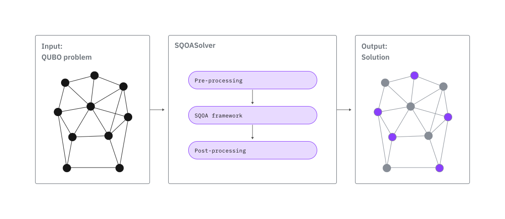

{/* cspell:ignore SQOA QRAO QRAC QUBO QSCI JijModeling OMMX ommx jijmodeling QOBLIB MaxCut Matsuyama Yamashiro Sloane Hadfield Imamichi Itoko Jiao Kagele Schieber Robledo Moreno Motta Jurcevic Kanno Kohda Mitarai Mizukami Nakagawa sciadv eadu Blom Imai */}

*See the [API reference](https://docs.quantum.ibm.com/functions/jij-sqoa-solver/api-reference).*

<Admonition type="note">
  IBM Quantum&reg; Functions are a beta feature available only to IBM Quantum Premium Plan, Flex Plan, and On-Prem (through the IBM Quantum Platform API) Plan users. Beta features are subject to change.
</Admonition>
## Overview

With SQOA Solver by JIJ, you can solve large combinatorial optimization problems on IBM&reg; quantum computers. The solver is based on the Sampling-based Quantum Optimization Algorithm with Quantum Relaxation (SQOA-QR) [\[1\]](#references). Unlike quantum algorithms that use a one-to-one mapping between classical decision variables and qubits, SQOA Solver can handle optimization problems with more variables than the number of qubits available on current quantum devices. Its sampling-based design also makes it less sensitive to the physical noise on current quantum hardware. Together, these features make SQOA Solver well suited to optimization problems at this stage of quantum computing.

The solver handles Quadratic Unconstrained Binary Optimization (QUBO) problems given as a classical mathematical formulation, and it automatically maps the classical formulation into the quantum setting. You can also convert constrained problems into unconstrained ones by using the penalty method.

The following sections describe the solver's workflow and benchmark results. The [get started guide](https://docs.quantum.ibm.com/functions/jij-sqoa-solver/get-started) shows end-to-end examples that model problems with [qiskit-addon-opt-mapper](https://github.com/Qiskit/qiskit-opt-mapper) and, optionally, Open Mathematical prograMming eXchange (OMMX). [OMMX](https://ommx-en-book.readthedocs.io/en/latest/) is an open data format and SDK that simplifies the exchange of optimization problems between software tools.
## Description

SQOA Solver implements the Sampling-based Quantum Optimization Algorithm with Quantum Relaxation (SQOA-QR) and surrounds it with classical preprocessing and postprocessing. This section explains the SQOA framework and how it differs from the Quantum Approximate Optimization Algorithm (QAOA).

The following figure shows a schematic of the SQOA Solver workflow.

### The SQOA framework

SQOA is a sampling-based framework for combinatorial optimization [\[1\]](#references). It combines two techniques: Quantum Random Access Optimization (QRAO) [\[2\]](#references), which encodes the problem in a quantum relaxation, and sample-based quantum diagonalization (SQD) [\[3\]](#references), also known as quantum-selected configuration interaction (QSCI) [\[4\]](#references), which uses the quantum computer only to sample bitstrings and finds the low-energy state on a classical computer. SQOA is a framework in the sense that it fixes this combination but leaves the details to each implementation, such as how the variables are assigned to qubits and which circuits generate the samples.

- **Quantum relaxation with QRAO.** QAOA and other Ising-based approaches represent each binary variable by the $Z$ operator of its qubit. QRAO also uses the $X$ and $Y$ operators. With a (3,1) quantum random access code (QRAC), up to three binary variables share one qubit, and each variable is represented by a different Pauli operator.

  The QUBO then becomes a relaxed Hamiltonian that needs fewer qubits than the Ising Hamiltonian. Variables that interact in the QUBO must be placed on different qubits. If they shared a qubit, the product of their Pauli operators would reduce to a single operator on that qubit (for example, $XY = iZ$), and the relaxed Hamiltonian would no longer represent their interaction.

  The assignment of variables to qubits therefore determines both the number of qubits and the quality of the relaxation, and SQOA Solver designs this assignment in its preprocessing.
- **Sample-based quantum diagonalization (SQD).** The quantum computer first prepares a quantum state that overlaps with low-energy states of the relaxed Hamiltonian and then samples bitstrings from it. A classical computer projects the relaxed Hamiltonian onto the subspace spanned by the sampled bitstrings and diagonalizes it to approximate the ground state.

  Because the relaxed Hamiltonian is non-diagonal, the diagonalization combines the sampled bitstrings into a superposition. With a diagonal Ising Hamiltonian, every bitstring is already an eigenstate, and the diagonalization would only select the best sample. The same approach has been applied to large-scale problems in quantum chemistry.

The approximate ground state obtained by SQD does not directly correspond to a classical solution of the original problem, so the classical solution must be decoded from it. Because this state is computed on a classical computer, the decoding, called rounding, is classical postprocessing. SQOA Solver uses decoding techniques designed to obtain better classical solutions heuristically.

The following table compares SQOA with QAOA, a common variational approach to the same class of problems.

| &nbsp; | QAOA | SQOA |
|---|---|---|
| Qubits for $n$ binary variables | $n$ | One qubit holds up to three of the variables. The exact number depends on the problem structure |
| Use of the QPU | Repeatedly estimates the energy of parameterized circuits inside a classical optimization loop | Only samples bitstrings. No circuit parameters are trained on the QPU |
| From samples to a solution | Selects the best measured bitstring | Diagonalizes the relaxed Hamiltonian in the sampled subspace on a classical computer and rounds the resulting state |

Around SQOA-QR, SQOA Solver adds classical processing. Its preprocessing fixes variables whose optimal values can be determined in advance and designs the assignment of variables to qubits. Its postprocessing refines the rounded solution with a local search, which you can turn off with `postprocessing_level=0`.
## Benchmarks

<Admonition type="caution" title="Disclaimer">
  Performance can depend on both the problem instance and subsequent processing steps. In some cases, classical samples and quantum-generated samples might achieve similar final solution quality after equivalent postprocessing. Evaluation should therefore consider the complete optimization workflow.
</Admonition>

The following benchmark metrics provide a general indication of solution quality, qubit compression, and execution time across selected problem sizes and structures. The table lists a selection of [Maximum Independent Set instances](https://github.com/ZIB-AOPT/QOBLIB/tree/main/07-independentset) from the Quantum Optimization Benchmarking Library (QOBLIB) and two 3-regular MaxCut instances. You can load the QOBLIB instances as `ommx.v1.Instance` objects, together with their optimal solutions, by using the [ommx-quantum-benchmarks](https://jij-inc.github.io/OmmxQuantumBenchmarks/) package.

Each instance was run 10 times on an IBM Heron r2 processor. `Number of qubits` counts the qubits actually used on hardware after preprocessing and QRAC encoding. The compression ratio is instance-dependent. `Approximation ratio` (AR) reports the quality of the best solution found over the 10 runs:

$$
\mathrm{AR} = \frac{C_{\textrm{best}}}{C_{\textrm{opt}}},
$$

where $C_{\textrm{best}}$ is the best objective value found and $C_{\textrm{opt}}$ is the known optimal objective value. All instances are maximization problems with a positive optimal value, so AR is at most 100%, and 100% in the `Approximation ratio` column indicates that the solver found an optimal solution. `Total time` is the average combined QPU and CPU time per run. `QPU time` is the average IBM Quantum Compute usage per run.

| Instance | Number of variables | Number of qubits | Approximation ratio | Total time (seconds) | QPU time (seconds) |
|---|:---:|:---:|:---:|:---:|:---:|
| maxcut_384_nodes | 384 | 129 | 98.5% | 62.1 | 12.0 |
| gen200_p0-9_44 | 200 | 67 | 100% | 38.0 | 12.0 |
| es60fst02 | 186 | 42 | 100% | 24.7 | 12.0 |
| es60fst04 | 162 | 29 | 100% | 17.9 | 12.0 |
| maxcut_150_nodes | 150 | 51 | 100% | 23.1 | 12.0 |
| sloane_1dc_128 | 128 | 37 | 93.8% | 19.1 | 12.0 |
| sloane_2dc_128 | 128 | 8 | 100% | 12.3 | 11.5 |
| C125-9 | 125 | 43 | 100% | 22.3 | 12.0 |
| es60fst01 | 123 | 12 | 100% | 13.6 | 12.0 |
| es60fst03 | 113 | 26 | 100% | 14.9 | 12.0 |
| sloane_1dc_64 | 64 | 16 | 100% | 13.4 | 11.9 |
| chesapeake | 39 | 13 | 100% | 13.1 | 12.0 |
| football | 35 | 6 | 100% | 12.5 | 12.0 |
| karate | 34 | 2 | 100% | 6.2 | 6.0 |
| ibm32 | 32 | 11 | 100% | 12.9 | 12.0 |
| farm | 17 | 4 | 100% | 8.5 | 8.0 |
## Get support

For support, email [info@j-ij.com](mailto:info@j-ij.com).
## Next steps

<Admonition type="tip" title="Recommendations">
  - Request a free trial of SQOA Solver by completing this [form](https://www.j-ij.com/en/qiskit-function-access).
  - Run your first workload with the [get started guide](https://docs.quantum.ibm.com/functions/jij-sqoa-solver/get-started).
  - Review the [functions overview](/guides/functions), includes cost per execution.
  - Understand [resource units (RUs)](/guides/plans-overview#rus).
  - Review the [IBM Quantum Platform plans](/guides/plans-overview).

</Admonition>
## References

[1] Matsuyama, H., & Yamashiro, Y. (2025). Sampling-based quantum optimization algorithm with quantum relaxation. 2025 IEEE International Conference on Quantum Computing and Engineering (QCE), 1, 2323–2333. [DOI](https://doi.org/10.1109/QCE65121.2025.00253), [arXiv:2504.12629](https://arxiv.org/abs/2504.12629)

[2] Fuller, B., Hadfield, C., Glick, J. R., Imamichi, T., Itoko, T., Thompson, R. J., Jiao, Y., Kagele, M. M., Blom-Schieber, A. W., Raymond, R., et al. (2024). Approximate solutions of combinatorial problems via quantum relaxations. IEEE Transactions on Quantum Engineering, 5, 1–15. [DOI](https://doi.org/10.1109/TQE.2024.3421294), [arXiv:2111.03167](https://arxiv.org/abs/2111.03167)

[3] Robledo-Moreno, J., Motta, M., Haas, H., Javadi-Abhari, A., Jurcevic, P., Kirby, W., et al. (2025). Chemistry beyond the scale of exact diagonalization on a quantum-centric supercomputer. Science Advances, 11(25), eadu9991. [DOI](https://doi.org/10.1126/sciadv.adu9991), [arXiv:2405.05068](https://arxiv.org/abs/2405.05068)

[4] Kanno, K., Kohda, M., Imai, R., Koh, S., Mitarai, K., Mizukami, W., & Nakagawa, Y. O. (2026). Quantum-selected configuration interaction: Classical diagonalization of Hamiltonians in subspaces selected by quantum computers. Physical Review Research, 8(2), 023268. [DOI](https://doi.org/10.1103/dmn4-snfx), [arXiv:2302.11320](https://arxiv.org/abs/2302.11320)