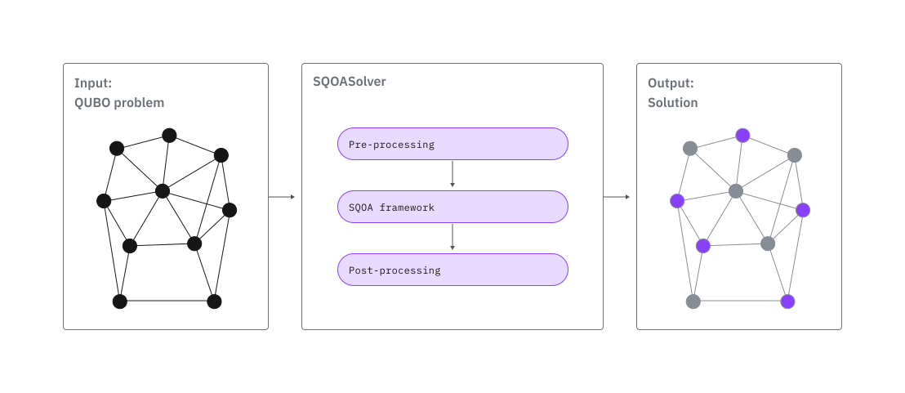

<OpenInLabBanner notebookPath="guides/jij-sqoa-solver.ipynb" />


{/* cspell:ignore SQOASolver SQOA QRAO QRAC QUBO QSCI JijModeling OMMX ommx jijmodeling QOBLIB MaxCut Matsuyama Yamashiro networkx Sloane Hadfield Imamichi Itoko Jiao Kagele Schieber Robledo Moreno Motta Jurcevic Kanno Kohda Mitarai Mizukami Nakagawa sciadv eadu Blom Imai */}

*See the [API reference](https://docs.quantum.ibm.com/api/functions/jij-sqoa-solver).*

<Admonition type="note">
  Qiskit Functions are an experimental feature available only to IBM Quantum&reg; Premium Plan, Flex Plan, and On-Prem (via IBM Quantum Platform API) Plan users. They are in preview release status and subject to change.
</Admonition>

## Overview

With SQOA Solver by JIJ, you can solve large combinatorial optimization problems on IBM&reg; quantum computers. The solver is based on the Sampling-based Quantum Optimization Algorithm with Quantum Relaxation (SQOA-QR) [\[1\]](#references). Unlike quantum algorithms that use a one-to-one mapping between classical decision variables and qubits, SQOA Solver can handle optimization problems with more variables than the number of qubits available on current quantum devices. Its sampling-based design also makes it less sensitive to the physical noise on current quantum hardware. Together, these features make SQOA Solver well suited to optimization problems at this stage of quantum computing.

The solver handles Quadratic Unconstrained Binary Optimization (QUBO) problems given as a classical mathematical formulation, and it automatically maps the classical formulation into the quantum setting. You can also convert constrained problems into unconstrained ones by using the penalty method.

The following sections describe the solver's workflow, benchmark results, and end-to-end examples that model problems with [qiskit-addon-opt-mapper](https://github.com/Qiskit/qiskit-opt-mapper) and, optionally, Open Mathematical prograMming eXchange (OMMX). [OMMX](https://ommx-en-book.readthedocs.io/en/latest/) is an open data format and SDK that simplifies the exchange of optimization problems between software tools.
## Description

SQOA Solver implements the Sampling-based Quantum Optimization Algorithm with Quantum Relaxation (SQOA-QR) and surrounds it with classical preprocessing and postprocessing. This section explains the SQOA framework and how it differs from the Quantum Approximate Optimization Algorithm (QAOA).

The following figure shows a schematic of the SQOA Solver workflow.

### The SQOA framework

SQOA is a sampling-based framework for combinatorial optimization [\[1\]](#references). It combines two techniques: Quantum Random Access Optimization (QRAO) [\[2\]](#references), which encodes the problem in a quantum relaxation, and sample-based quantum diagonalization (SQD) [\[3\]](#references), also known as quantum-selected configuration interaction (QSCI) [\[4\]](#references), which uses the quantum computer only to sample bitstrings and finds the low-energy state on a classical computer. SQOA is a framework in the sense that it fixes this combination but leaves the details to each implementation, such as how the variables are assigned to qubits and which circuits generate the samples.

- **Quantum relaxation with QRAO.** QAOA and other Ising-based approaches represent each binary variable by the $Z$ operator of its qubit. QRAO also uses the $X$ and $Y$ operators. With a (3,1) quantum random access code (QRAC), up to three binary variables share one qubit, and each variable is represented by a different Pauli operator.

  The QUBO then becomes a relaxed Hamiltonian that needs fewer qubits than the Ising Hamiltonian. Variables that interact in the QUBO must be placed on different qubits. If they shared a qubit, the product of their Pauli operators would reduce to a single operator on that qubit (for example, $XY = iZ$), and the relaxed Hamiltonian would no longer represent their interaction.

  The assignment of variables to qubits therefore determines both the number of qubits and the quality of the relaxation, and SQOA Solver designs this assignment in its preprocessing.
- **Sample-based quantum diagonalization (SQD).** The quantum computer first prepares a quantum state that overlaps with low-energy states of the relaxed Hamiltonian and then samples bitstrings from it. A classical computer projects the relaxed Hamiltonian onto the subspace spanned by the sampled bitstrings and diagonalizes it to approximate the ground state.

  Because the relaxed Hamiltonian is non-diagonal, the diagonalization combines the sampled bitstrings into a superposition. With a diagonal Ising Hamiltonian, every bitstring is already an eigenstate, and the diagonalization would only select the best sample. The same approach has been applied to large-scale problems in quantum chemistry.

The approximate ground state obtained by SQD does not directly correspond to a classical solution of the original problem, so the classical solution must be decoded from it. Because this state is computed on a classical computer, the decoding, called rounding, is classical postprocessing. SQOA Solver uses decoding techniques designed to obtain better classical solutions heuristically.

The following table compares SQOA with QAOA, a common variational approach to the same class of problems.

| &nbsp; | QAOA | SQOA |
|---|---|---|
| Qubits for $n$ binary variables | $n$ | One qubit holds up to three of the variables. The exact number depends on the problem structure |
| Use of the QPU | Repeatedly estimates the energy of parameterized circuits inside a classical optimization loop | Only samples bitstrings. No circuit parameters are trained on the QPU |
| From samples to a solution | Selects the best measured bitstring | Diagonalizes the relaxed Hamiltonian in the sampled subspace on a classical computer and rounds the resulting state |

Around SQOA-QR, SQOA Solver adds classical processing. Its preprocessing fixes variables whose optimal values can be determined in advance and designs the assignment of variables to qubits. Its postprocessing refines the rounded solution with a local search, which you can turn off with `postprocessing_level=0`.
## Benchmarks

<Admonition type="caution" title="Disclaimer">
  Performance can depend on both the problem instance and subsequent processing steps. In some cases, classical samples and quantum-generated samples might achieve similar final solution quality after equivalent postprocessing. Evaluation should therefore consider the complete optimization workflow.
</Admonition>

The following benchmark metrics provide a general indication of solution quality, qubit compression, and execution time across selected problem sizes and structures. The table lists a selection of [Maximum Independent Set instances](https://github.com/ZIB-AOPT/QOBLIB/tree/main/07-independentset) from the Quantum Optimization Benchmarking Library (QOBLIB) and two 3-regular MaxCut instances. You can load the QOBLIB instances as `ommx.v1.Instance` objects, together with their optimal solutions, by using the [ommx-quantum-benchmarks](https://jij-inc.github.io/OmmxQuantumBenchmarks/) package.

Each instance was run 10 times on an IBM Heron r2 processor. `Number of qubits` counts the qubits actually used on hardware after preprocessing and QRAC encoding. The compression ratio is instance-dependent. `Approximation ratio` (AR) reports the quality of the best solution found over the 10 runs:

$$
\mathrm{AR} = \frac{C_{\textrm{best}}}{C_{\textrm{opt}}},
$$

where $C_{\textrm{best}}$ is the best objective value found and $C_{\textrm{opt}}$ is the known optimal objective value. All instances are maximization problems with a positive optimal value, so AR is at most 100%, and 100% in the `Approximation ratio` column indicates that the solver found an optimal solution. `Total time` is the average combined QPU and CPU time per run. `QPU time` is the average IBM Quantum Compute usage per run.

| Instance | Number of variables | Number of qubits | Approximation ratio | Total time (seconds) | QPU time (seconds) |
|---|:---:|:---:|:---:|:---:|:---:|
| maxcut_384_nodes | 384 | 129 | 98.5% | 62.1 | 12.0 |
| gen200_p0-9_44 | 200 | 67 | 100% | 38.0 | 12.0 |
| es60fst02 | 186 | 42 | 100% | 24.7 | 12.0 |
| es60fst04 | 162 | 29 | 100% | 17.9 | 12.0 |
| maxcut_150_nodes | 150 | 51 | 100% | 23.1 | 12.0 |
| sloane_1dc_128 | 128 | 37 | 93.8% | 19.1 | 12.0 |
| sloane_2dc_128 | 128 | 8 | 100% | 12.3 | 11.5 |
| C125-9 | 125 | 43 | 100% | 22.3 | 12.0 |
| es60fst01 | 123 | 12 | 100% | 13.6 | 12.0 |
| es60fst03 | 113 | 26 | 100% | 14.9 | 12.0 |
| sloane_1dc_64 | 64 | 16 | 100% | 13.4 | 11.9 |
| chesapeake | 39 | 13 | 100% | 13.1 | 12.0 |
| football | 35 | 6 | 100% | 12.5 | 12.0 |
| karate | 34 | 2 | 100% | 6.2 | 6.0 |
| ibm32 | 32 | 11 | 100% | 12.9 | 12.0 |
| farm | 17 | 4 | 100% | 8.5 | 8.0 |
## Get started

Find access information for this Qiskit Function in the [Qiskit Functions Catalog](https://quantum.cloud.ibm.com/functions).

This section shows how to authenticate and load the function, and how to prepare a problem in the dictionary format that SQOA Solver accepts by using `OptimizationProblem` from [qiskit-addon-opt-mapper](https://github.com/Qiskit/qiskit-opt-mapper). The examples that follow run the function and read the result.
### Authenticate and load the function

First, authenticate with your [IBM Quantum API key](https://quantum.cloud.ibm.com/). (The following code assumes that you already [saved your account](/guides/functions-get-started#install-qiskit-functions-catalog-client) to your local environment.) Then, create a catalog client as follows:

```python
# Added by doQumentation — installs the packages this notebook needs if they are missing
import importlib.util

_needed = {"jijmodeling": "jijmodeling", "networkx": "networkx", "ommx": "ommx", "qiskit_addon_opt_mapper": "qiskit-addon-opt-mapper", "qiskit_ibm_catalog": "qiskit-ibm-catalog"}
_missing = [pip for module, pip in _needed.items()
            if importlib.util.find_spec(module) is None]
# One at a time, so a package that fails to install does not block the others
for _pip in _missing:
    %pip install -q {_pip}
if not _missing:
    print("\u2713 All required packages are installed")
```

```python
from qiskit_ibm_catalog import QiskitFunctionsCatalog

catalog = QiskitFunctionsCatalog(channel="ibm_quantum_platform")

# verify that you have access to the function
catalog.list()
```

```text
[QiskitFunction(jij/sqoa-solver)]
```

```python
solver = catalog.load("jij/sqoa-solver")
```

### Prepare the input with `qiskit-addon-opt-mapper`

This guide models problems with the `OptimizationProblem` class of [qiskit-addon-opt-mapper](https://github.com/Qiskit/qiskit-opt-mapper). SQOA Solver accepts a QUBO problem as a coefficient dictionary in the tuple-string format used by IBM optimization functions, so every example in this guide follows the same client-side preparation pattern:

1. **Write the model.** Create an `OptimizationProblem`, add binary decision variables, and set the objective and any constraints.
2. **Convert to QUBO.** Convert the problem with `OptimizationProblemToQubo`, which adds any constraints to the objective as penalty terms and returns an equivalent unconstrained minimization problem.
3. **Convert to a dictionary.** Pass the QUBO to the `to_problem_dict()` helper function defined in the next section, and pass the result to `solver.run()` as `problem`, together with `variable_type="binary"`.

SQOA Solver always minimizes a dictionary problem, which matches the minimization problem that `OptimizationProblemToQubo` returns. For a maximization problem, the returned `objective_value` is therefore the negative of the original objective. To read the result in terms of the original problem, evaluate the returned assignment with `OptimizationProblem`, as the examples show. For the dictionary format details, see [Accepted problem formats](https://docs.quantum.ibm.com/api/functions/jij-sqoa-solver#accepted-problem-formats) in the API reference.

```python
# %pip install qiskit-addon-opt-mapper
```

Define the following helper function once and reuse it in every example. It converts the QUBO returned by `OptimizationProblemToQubo` into the dictionary format. The keys use the variable indices of the QUBO, so the solution keys `x_0`, `x_1`, and so on in the result correspond to those indices. Every variable receives a linear entry, even with a zero coefficient, so that the returned solution covers all variables.

```python
from qiskit_addon_opt_mapper import OptimizationProblem
from qiskit_addon_opt_mapper.converters import OptimizationProblemToQubo

def to_problem_dict(qubo: OptimizationProblem) -> dict[str, float]:
    """Convert a QUBO from OptimizationProblemToQubo to the SQOA Solver dictionary format."""
    objective = qubo.objective
    payload = {"()": objective.constant}
    # Keep every variable in the problem, even with a zero linear coefficient.
    payload.update({f"({i},)": 0.0 for i in range(qubo.get_num_vars())})
    for i, coefficient in objective.linear.to_dict().items():
        payload[f"({i},)"] += coefficient
    for (i, j), coefficient in objective.quadratic.to_dict().items():
        # Fold a binary diagonal term x_i * x_i = x_i into the linear term.
        key = f"({i},)" if i == j else f"({i}, {j})"
        payload[key] = payload.get(key, 0.0) + coefficient
    return {key: float(value) for key, value in payload.items()}
```

## Example 1: MaxCut on a 3-regular graph

Many graph problems, such as MaxCut, are NP-hard and are natural candidates for quantum optimization. Install `networkx` as an additional dependency to run this example:

```python
# %pip install networkx
```

### 1. Write the model

Assign a binary variable $x_v \in \{0, 1\}$ to each vertex of a graph $G = (V, E)$ to indicate its side of the cut. An edge is cut when its endpoints are on different sides, so the cut size is:

$$
\mathrm{Cut}(x) = \sum_{(u,v) \in E} \left(x_u + x_v - 2 x_u x_v\right).
$$

This objective is already a QUBO without constraints, so `OptimizationProblemToQubo` only turns the maximization into the equivalent minimization and keeps the variables unchanged. The `Maxcut` application class in `qiskit_addon_opt_mapper.applications` builds the same model with `Maxcut(G).to_optimization_problem()`.

```python
import networkx as nx

G = nx.random_regular_graph(3, 40, seed=42)

linear = {v: 0 for v in G.nodes}
quadratic = {}
for u, v in G.edges:
    linear[u] += 1
    linear[v] += 1
    quadratic[(u, v)] = -2

maxcut = OptimizationProblem("MaxCut")
maxcut.binary_var_list(G.number_of_nodes(), name="x")
maxcut.maximize(linear=linear, quadratic=quadratic)
```

### 2. Run the solver

Convert the model to a QUBO and then to a dictionary, and submit it. `problem` and `variable_type` are required. `backend_name` is optional. When it is omitted or `None`, the function selects the least busy operational QPU available to your instance.

The `options` dictionary accepts `shots`, `seed`, `session`, `postprocessing_level`, and `job_tags`. For descriptions and defaults, see the [API reference](https://docs.quantum.ibm.com/api/functions/jij-sqoa-solver).

```python
qubo = OptimizationProblemToQubo().convert(maxcut)

job = solver.run(
    problem=to_problem_dict(qubo),
    variable_type="binary",
    backend_name="ibm_fez",
    options={
        "shots": 4096,
        "seed": 42,
    },
)
```

### 3. Retrieve the result

`job.result()` returns a dictionary with four keys:

- `solution` is the complete variable assignment, keyed by `x_i`, where `i` is the variable index (for example, `x_3`).
- `objective_value` and `feasible` are the objective and feasibility of that assignment, evaluated on the submitted dictionary.
- `metadata` holds `solver_info` and `resource_usage`.

Because the QUBO is the minimization form of MaxCut, `objective_value` is the negative of the cut size. Evaluate the assignment on the original `OptimizationProblem` to read the cut size directly.

```python
result = job.result()

x = [result["solution"][f"x_{i}"] for i in range(maxcut.get_num_vars())]
print(f"Cut value: {maxcut.objective.evaluate(x)}")
print(f"Nodes on side 1: {[v for v, value in enumerate(x) if value > 0.5]}")
```

```text
Cut value: 55.0
Nodes on side 1: [5, 7, 9, 11, 14, 16, 17, 19, 21, 23, 24, 26, 30, 31, 33, 34, 36, 37, 38]
```

### 4. Check the resource usage

`result["metadata"]["resource_usage"]` reports the time spent in each execution phase. Phases other than `RUNNING: EXECUTING_QPU` report `CPU_TIME`, the wall-clock time of the phase in seconds, when it is available.

The `RUNNING: EXECUTING_QPU` phase reports `QPU_TIME`, the QPU usage of all Quantum Compute jobs of the run, if the final usage is available for every job. For details, see the [API reference](https://docs.quantum.ibm.com/api/functions/jij-sqoa-solver).

```python
for phase, metrics in result["metadata"]["resource_usage"].items():
    line = f"{phase:36s}"
    if "CPU_TIME" in metrics:
        line += f" CPU {metrics['CPU_TIME']:8.1f} s"
    if "QPU_TIME" in metrics:
        line += f" QPU {metrics['QPU_TIME']:8.1f} s"
    print(line)
```

```text
RUNNING: MAPPING                     CPU      3.2 s
RUNNING: OPTIMIZING_FOR_HARDWARE     CPU      5.0 s
RUNNING: WAITING_FOR_QPU             CPU      1.1 s
RUNNING: EXECUTING_QPU               QPU      3.0 s
RUNNING: POST_PROCESSING             CPU      0.9 s
```

## Example 2: Convert a constrained problem to QUBO

SQOA Solver accepts unconstrained problems. This example shows how to convert a constrained problem into a QUBO with `OptimizationProblemToQubo` and map the result back to the variables of the original problem.

```python
selection = OptimizationProblem("ConstrainedExample")
selection.binary_var_list(2, name="x")
selection.maximize(linear={"x0": 1, "x1": 1})
selection.linear_constraint({"x0": 1, "x1": 1}, "<=", 1, name="at_most_one")

print(selection.prettyprint())
```

```text
Problem name: ConstrainedExample

Maximize
  x0 + x1

Subject to
  Linear constraints (1)
    x0 + x1 <= 1  'at_most_one'

  Binary variables (2)
    x0 x1
```

`OptimizationProblemToQubo` adds the constraints to the objective as penalty terms and converts the problem to minimization. The appropriate penalty weight is problem-dependent.

After the run, `interpret()` maps the QUBO assignment back to the variables of the original problem.

Evaluate the objective and the feasibility on the original problem. For a dictionary problem, the `feasible` field of the result refers only to the variable domain, because the dictionary has no constraints.

```python
converter = OptimizationProblemToQubo(penalty=4.0)
qubo = converter.convert(selection)

job = solver.run(
    problem=to_problem_dict(qubo),
    variable_type="binary",
    backend_name="ibm_fez",
)
result = job.result()

x_qubo = [result["solution"][f"x_{i}"] for i in range(qubo.get_num_vars())]
x = converter.interpret(x_qubo)
print("Objective:", selection.objective.evaluate(x))
print("Feasible:", selection.is_feasible(x))
print("x values:", x)
```

```text
Objective: 1.0
Feasible: True
x values: [1. 0.]
```

## Example 3: Submit an OMMX instance

SQOA Solver also accepts an `ommx.v1.Instance` from the [OMMX](https://ommx-en-book.readthedocs.io/en/latest/) SDK, which keeps variable names, subscripts, and conversion metadata together with the problem. Compared with a dictionary, an OMMX input has the following advantages:

- The result also contains the canonical `ommx.v1.Solution` in `solver_info["ommx_solution"]`.
- `objective_value` is evaluated in the sense of the instance, so the objective of a maximization problem is not negated.
- For an instance converted in place with [`Instance.to_qubo()`](https://jij-inc.github.io/ommx/python/ommx/autoapi/ommx/v1/index.html#ommx.v1.Instance.to_qubo), `feasible` is evaluated against the original constraints.

This example builds the MaxCut model from Example 1 with [JijModeling](https://jij-inc-jijmodeling-tutorials-en.readthedocs-hosted.com/en/latest/introduction.html), a mathematical optimization modeler that compiles models into OMMX instances. Install JijModeling, which also installs the `ommx` package:

```python
# %pip install "jijmodeling~=2.8.0"
```

SQOA Solver exchanges OMMX data as standard padded Base64 strings. Define the following helper functions for this conversion:

- `to_problem_payload()` serializes an `ommx.v1.Instance` into the string that you pass as `problem`.
- `to_ommx_solution()` decodes the canonical `ommx.v1.Solution` from the result.

```python
import base64

from ommx.v1 import Instance, Solution

def to_problem_payload(instance: Instance) -> str:
    """Serialize an OMMX instance into the `problem` string for SQOA Solver."""
    return base64.b64encode(instance.to_bytes()).decode()

def to_ommx_solution(result: dict) -> Solution:
    """Decode the canonical OMMX solution from a SQOA Solver result."""
    payload = result["metadata"]["solver_info"]["ommx_solution"]
    return Solution.from_bytes(base64.b64decode(payload, validate=True))
```

### 1. Write the model with JijModeling

The usual spin formulation of MaxCut on a graph $G = (V, E)$ assigns
$s_v \in \{-1, +1\}$ to each vertex. An edge is cut when $s_u s_v = -1$, so the cut size is:

$$
\operatorname{Cut}(s) = \sum_{(u,v) \in E} \frac{1 - s_u s_v}{2}.
$$

JijModeling does not provide a native spin decision variable, and SQOA Solver accepts binary QUBO
variables. Therefore, declare $b_v \in \{0, 1\}$ and define the spin-valued expression
$s_v = 1 - 2b_v$ inside the model. With this expression, the objective stays in the standard spin form, and the
compiled instance remains a binary QUBO.

```python
import jijmodeling as jm

@jm.Problem.define("MaxCut", sense=jm.ProblemSense.MAXIMIZE)
def maxcut_model(problem: jm.DecoratedProblem):
    V = problem.Natural()  # number of nodes
    E = problem.Graph(dtype=V)  # edge list
    b = problem.BinaryVar(shape=(V,))
    s = 1 - 2 * b  # spin-valued expression

    problem += jm.sum((1 - s[u] * s[v]) / 2 for u, v in E)
```

If you display `maxcut_model` in a notebook, it shows the following formulation:

$$
\begin{array}{rl}
\text{Problem}\colon &\text{MaxCut}\\
\displaystyle \max &\displaystyle \sum _{\left\langle u,v\right\rangle \in E}{\frac{1-{\left(1-2\cdot b\right)}_{u}\cdot {\left(1-2\cdot b\right)}_{v}}{2}}\\
&\\
\text{where}&\\
&\text{Decision Variables:}\\
&\qquad \begin{alignedat}{2}{b}_{i}&\in \left\{0,1\right\}&\qquad &\text{a }1\text{-dim array of }\text{binary}\text{ decision variables}\\
&\forall i\in \left\{0,\ldots ,V-1\right\}&&\\
\end{alignedat}\\
&\\
&\text{Placeholders:}\\
&\qquad \begin{alignedat}{2}{E}_{i}&\in V\times V&\qquad &\text{a }1\text{-dim array of placeholders with elements in }V\times V\\
&\forall i\in \left\{0,\ldots ,\mathop{\mathtt{len\_{}at}}\left(E,0\right)-1\right\}&&\\
&&&\\
V&\in \mathbb{N}&\qquad &\text{a scalar placeholder in }\mathbb{N}\\
\end{alignedat}\end{array}
$$
### 2. Compile the instance and run the solver

Bind the graph from Example 1 to compile an `ommx.v1.Instance`, and submit it with `variable_type="binary"`. An OMMX instance is always submitted as a binary problem.

```python
instance = maxcut_model.eval(
    {"V": G.number_of_nodes(), "E": [list(edge) for edge in G.edges]}
)

job = solver.run(
    problem=to_problem_payload(instance),
    variable_type="binary",
    backend_name="ibm_fez",
)
```

### 3. Retrieve the result

For an OMMX input, `objective_value` is the cut size, and `to_ommx_solution()` decodes the canonical solution so that you can read the assignment by variable name.

```python
result = job.result()
print(f"Cut value: {result['objective_value']}")

solution = to_ommx_solution(result)
b_values = solution.extract_decision_variables("b")
print(
    f"Nodes on side 1: {sorted(v for (v,), value in b_values.items() if value > 0.5)}"
)
```

```text
Cut value: 55.0
Nodes on side 1: [5, 7, 9, 11, 14, 16, 17, 19, 21, 23, 24, 26, 30, 31, 33, 34, 36, 37, 38]
```

## Get support

For support, email [info@j-ij.com](mailto:info@j-ij.com).
## Next steps

<Admonition type="tip" title="Recommendations">
  - Request a free trial of SQOA Solver by completing this [form](https://www.j-ij.com/en/qiskit-function-access).
  - Visit the [API reference](https://docs.quantum.ibm.com/api/functions/jij-sqoa-solver) for this Qiskit Function.
  - Try an end-to-end example in the [maximum independent set problem](/tutorials/maximum-independent-set-jij-sqoa) tutorial.
  - Learn how to model optimization problems with [qiskit-addon-opt-mapper](https://github.com/Qiskit/qiskit-opt-mapper).
  - Learn how to model and exchange optimization problems with [JijModeling](https://jij-inc-jijmodeling-tutorials-en.readthedocs-hosted.com/en/latest/introduction.html) and [OMMX](https://ommx-en-book.readthedocs.io/en/latest/).
  - Read the SQOA-QR paper [\[1\]](#references) to learn more about the SQOA framework.
</Admonition>
## References

[1] Matsuyama, H., & Yamashiro, Y. (2025). Sampling-based quantum optimization algorithm with quantum relaxation. 2025 IEEE International Conference on Quantum Computing and Engineering (QCE), 1, 2323–2333. [DOI](https://doi.org/10.1109/QCE65121.2025.00253), [arXiv:2504.12629](https://arxiv.org/abs/2504.12629)

[2] Fuller, B., Hadfield, C., Glick, J. R., Imamichi, T., Itoko, T., Thompson, R. J., Jiao, Y., Kagele, M. M., Blom-Schieber, A. W., Raymond, R., et al. (2024). Approximate solutions of combinatorial problems via quantum relaxations. IEEE Transactions on Quantum Engineering, 5, 1–15. [DOI](https://doi.org/10.1109/TQE.2024.3421294), [arXiv:2111.03167](https://arxiv.org/abs/2111.03167)

[3] Robledo-Moreno, J., Motta, M., Haas, H., Javadi-Abhari, A., Jurcevic, P., Kirby, W., et al. (2025). Chemistry beyond the scale of exact diagonalization on a quantum-centric supercomputer. Science Advances, 11(25), eadu9991. [DOI](https://doi.org/10.1126/sciadv.adu9991), [arXiv:2405.05068](https://arxiv.org/abs/2405.05068)

[4] Kanno, K., Kohda, M., Imai, R., Koh, S., Mitarai, K., Mizukami, W., & Nakagawa, Y. O. (2026). Quantum-selected configuration interaction: Classical diagonalization of Hamiltonians in subspaces selected by quantum computers. Physical Review Research, 8(2), 023268. [DOI](https://doi.org/10.1103/dmn4-snfx), [arXiv:2302.11320](https://arxiv.org/abs/2302.11320)