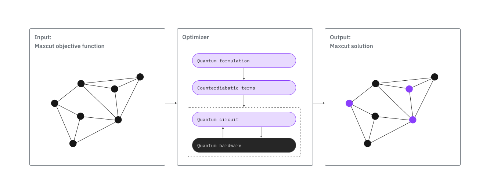

<OpenInLabBanner notebookPath="guides/kipu-optimization.ipynb" />


{/* cspell:ignore Kipu, DCQO, QUBO, HUBO, counterdiabatic, Iskay, bitflips, Cadavid, Chandarana, Weidenfeller, vCPU */}
*See the [API reference](https://docs.quantum.ibm.com/functions/kipu-optimization/api-reference)*

<Admonition type="note" title="Note">
* IBM Quantum&reg; Functions are a beta feature available only to IBM Quantum Premium Plan, Flex Plan, and On-Prem (through the IBM Quantum Platform API) Plan users. Beta features are subject to change.
</Admonition>

## Overview

With the Iskay Quantum Optimizer by Kipu Quantum, you can tackle complex optimization problems using IBM&reg; quantum computers. This solver leverages Kipu's cutting-edge [bf-DCQO algorithm](https://doi.org/10.48550/arXiv.2409.04477) requiring only the objective function as input to automatically deliver problem solutions. It can handle optimization problems involving up to 156 qubits, enabling the use of all qubits of the IBM quantum devices. The Optimizer uses a 1-to-1 mapping between classical variables and qubits, which allows you to tackle optimization problems with up to 156 binary variables.

The Optimizer enables the solving of unconstrained binary optimization problems. In addition to the commonly used QUBO (Quadratic Unconstrained Binary Optimization) formulation, it also supports higher-order (HUBO) optimization problems. The solver utilizes a non-variational quantum algorithm, performing most of the computation on quantum devices.

The following provides more details about the used algorithm and a brief guide on how to use the function, as well as benchmarking results on various problem instances of different sizes and complexities.
## Description

The Optimizer is a ready-to-use implementation of cutting-edge quantum optimization algorithms. It solves optimization problems by running highly-compressed quantum circuits on quantum hardware. This compression is achieved by introducing counterdiabatic terms into the underlying time evolution of the quantum system. The algorithm executes several iterations of hardware runs to obtain the final solutions and combines it with post-processing. These steps are seamlessly integrated into the Optimizer's workflow and are executed automatically.

### How does the Quantum Optimizer work?
This section outlines the basics of the implemented bf-DCQO algorithm. An introduction to the algorithm can also be found on the [Qiskit YouTube channel](https://www.youtube.com/watch?v=33QmsXhIlpU&t=1223s).

The algorithm is based on the time evolution of a quantum system which is transformed over time, where the problem solution is encoded in the ground state of the quantum system at the end of the evolution. According to the [adiabatic theorem](https://en.wikipedia.org/wiki/Adiabatic_theorem), this evolution has to be slow to ensure the system remains in its ground state. Digitizing this evolution is the basis of digitized quantum adiabatic computation (DQA) and the infamous QAOA algorithm. However, the required slow evolution is not feasible for increasing problem sizes since it results in an increasing circuit depth. By using counterdiabatic protocols, you can suppress unwanted excitations occurring during short evolution times while remaining in the ground state. Here, digitizing this shorter evolution time results in quantum circuits with shorter depth and fewer entangling gates.

The circuits of the bf-DCQO algorithms typically use up to ten times fewer entangling gates than DQA, and three to four times fewer entangling gates than standard QAOA implementations. Because of the smaller number of gates, fewer errors occur during the circuit execution on hardware. Hence, the optimizer does not require using techniques like error suppression or error mitigation. Implementing them in future versions can enhance the solution quality even further.

Although the bf-DCQO algorithm uses iterations, it is non-variational. After each iteration of the algorithm, the distribution of states is measured. The obtained distribution is used to calculate a so-called bias-field. The bias-field allows starting the next iteration from an energy state near the previously found solution. In this way, the algorithm moves with each iteration to solutions of lower energy. Typically, approximately ten iterations are sufficient to converge to a solution, in total requiring a much lower number of iterations than variational algorithms, which is on the order of  approximately 100 iterations.

The optimizer combines the bf-DCQO algorithm with classical post-processing. After measuring the distribution of states, a local search is performed. During the local search, the bits of the measured solution are randomly flipped. After the flip, the energy of the new bitstring is evaluated. If the energy is lower, the bitstring is kept as the new solution. The local search only scales linearly with the number of qubits; hence, it is computationally cheap. Since the post-processing corrects local bitflips, it compensates for bit-flip errors that often are the result of hardware imperfections and readout errors.

### Workflow

A schematic of the workflow of the Quantum Optimizer follows.



By using the Quantum Optimizer, solving an optimization problem on quantum hardware can be reduced to
* Formulate the objective function of the problem
* Access the Optimizer through quantum functions
* Run the Optimizer and collect the result
## Benchmarks

<Admonition type="caution" title="Disclaimer">
Performance can depend on both the problem instance and subsequent processing steps. In some cases, classical samples and quantum-generated samples might achieve similar final solution quality after equivalent post-processing. Evaluation should therefore consider the complete optimization workflow.
</Admonition>

The benchmark metrics below show that the Optimizer effectively addresses problems involving up to 156 qubits and offer a general overview of the optimizer's accuracy and scalability across different problem types. Note that actual performance metrics may vary depending on specific problem characteristics, such as the number of variables, the density and locality of terms in the objective function, and the polynomial order.

The following table includes the approximation ratio (AR), a metric defined as follows:
$$
AR = \frac{C^{*} - C_\textrm{max}}{C_{\textrm{min}} - C_{\textrm{max}}},
$$
where $C$ is the objective function, $C_{\textrm{min}}$, $C_{\textrm{max}}$ are its minimum and maximum values, and $C^{*}$ is the cost of the best solution found, respectively. Therefore, AR=100\% means that the ground state of the problem has been obtained.

| Example           | Number of qubits | Approximation Ratio | Total time (s) | Runtime usage (s) | Total Number of shots | Number of iterations |
| ----------------- | :--------------: | :------: | :------------: | :---------------: | :-------------------: | :------------------: |
| Unweighted MaxCut |        28        |   100%   |      180       |        30         |          30k          |          5           |
| Unweighted MaxCut |        30        |   100%   |      180       |        30         |          30k          |          5           |
| Unweighted MaxCut |        32        |   100%   |      180       |        30         |          30k          |          5           |
| Unweighted MaxCut |        80        |   100%   |      480       |        60         |          90k          |          9           |
| Unweighted MaxCut |       100        |   100%   |      330       |        60         |          60k          |          6           |
| Unweighted MaxCut |       120        |   100%   |      370       |        60         |          60k          |          6           |
| HUBO 1            |       156        |   100%   |      600       |        70         |         100k          |          10          |
| HUBO 2            |       156        |   100%   |      600       |        70         |         100k          |          10          |

- The MaxCut instances with 28, 30, and 32 qubits were run on ibm_sherbrooke. Instances with 80, 100, and 120 were run  on a Heron r2 processor.
- The HUBO instances were also run  on a Heron r2 processor.

The instances in this table are available on GitHub at [Kipu benchmark instances, commit 5cf5ce4](https://github.com/Kipu-Quantum-GmbH/benchmark-instances/tree/5cf5ce4516386606d4809aa682a7721436eedd21). The current instances for [Example 3: Benchmark instances](#example-3-benchmark-instances) are on the [main branch](https://github.com/Kipu-Quantum-GmbH/benchmark-instances).
## Get started

In this documentation, we will go through the steps of using the Iskay Quantum Optimizer. In the process we will quickly show how to load the function from the catalog and how to convert your problem to a valid input, all while showing how you can experiment with different optional parameters.

For a more detailed example, please check out the tutorial [Solve the Market Split problem with Kipu Quantum's Iskay Quantum Optimizer](/tutorials/solve-market-split-problem-with-iskay-quantum-optimizer), where we work through the whole process of using Iskay Solver to address the Market Split problem, which represents a real-world resource allocation challenge where markets must be partitioned into balanced sales regions to meet exact demand targets.

Authenticate using your API key, found on the [IBM Quantum Platform dashboard](http://quantum.cloud.ibm.com/), and select the quantum function as follows:

```python
# Added by doQumentation — installs the packages this notebook needs if they are missing
import importlib.util

_needed = {"github": "PyGithub", "networkx": "networkx", "qiskit_addon_opt_mapper": "qiskit-addon-opt-mapper", "qiskit_ibm_catalog": "qiskit-ibm-catalog"}
_missing = [pip for module, pip in _needed.items()
            if importlib.util.find_spec(module) is None]
# One at a time, so a package that fails to install does not block the others
for _pip in _missing:
    %pip install -q {_pip}
if not _missing:
    print("\u2713 All required packages are installed")
```

```python
# ruff: noqa: F821, E402, F404
```

<Admonition type="note">
The following code assumes that you have saved your credentials. If you have not, follow the instructions in [save your IBM Cloud&reg; account](/guides/functions-get-started#install-qiskit-functions-catalog-client) to authenticate with your API key.
</Admonition>

```python
from qiskit_ibm_catalog import FunctionsCatalog

catalog = FunctionsCatalog(
    channel="ibm_quantum_platform",
    instance="INSTANCE_CRN",
    # For `token`, use the 44-character API_KEY you created
    # and saved from the IBM Quantum Platform Home dashboard
    token="YOUR_API_KEY",
)

# verify that you have access to the function
catalog.list()
```

```text
[QiskitFunction(qunova/hivqe-chemistry),
 QiskitFunction(global-data-quantum/quantum-portfolio-optimizer),
 QiskitFunction(algorithmiq/tem),
 QiskitFunction(qedma/qesem),
 QiskitFunction(multiverse/singularity),
 QiskitFunction(ibm/circuit-function),
 QiskitFunction(q-ctrl/optimization-solver),
 QiskitFunction(colibritd/quick-pde),
 QiskitFunction(q-ctrl/performance-management),
 QiskitFunction(kipu-quantum/iskay-quantum-optimizer)]
```

```python
# Access Function
optimizer = catalog.load("kipu-quantum/iskay-quantum-optimizer")
```

## Custom configuration example

Here's how you might configure Iskay with different settings:

```python
custom_options = {
    "shots": 15_000,  # Higher shot count for better statistics
    "num_iterations": 12,  # More iterations for solution refinement
    "preprocessing_level": 1,  # Light preprocessing for problem simplification
    "postprocessing_level": 2,  # Maximum postprocessing for solution quality
    "transpilation_level": 2,  # Improved transpiler (default)
    "seed_transpiler": 42,  # Fixed seed for reproducible results, which skips the seed search
    "job_tags": ["custom_config"],  # Custom tracking tags
}
```

**Seed optimization**: By default, `seed_transpiler` is `None`, and transpilation level 2 searches over transpiler seeds to find the circuit with the best depth. If you set a seed, the function skips that search and the transpilation is reproducible.

**Transpilation levels (1-3)**: The `transpilation_level` option selects the transpilation method.
- **Level 1**: Standard Qiskit transpiler.
- **Level 2** (default): Improved transpiler that searches over 15 transpiler seeds and keeps the best circuit. If you set `seed_transpiler`, the function skips the search.
- **Level 3**: Line routing with the swap strategy for a linear coupling map that is described in Section 2.2.1 of [Weidenfeller et al.](https://arxiv.org/abs/2202.03459) Line routing follows a fixed swap schedule, so its circuit depth grows linearly with the number of variables. For densely connected problems, line routing typically produces shallower circuits than levels 1 and 2 and transpiles faster. Level 3 supports at most 127 variables on Heron r2 and r3 processors, 112 variables on Heron r1, and 120 variables on Nighthawk.

Version 3.0.0 removed levels 0, 4, and 5. A job that requests one of them fails with error `1221`.
## Function sizes

Every job runs at one size, `S`, `M`, or `L`. If the size is too small, the platform rejects the job. If the size is larger than the job needs, the job runs on a bigger compute profile than the work requires. See [Function sizes](/guides/managed-workflow-compute-profiles#best-practice-match-sizes-to-problem-sizes) for how sizes work in general.

The size depends on two properties of your model, the number of variables and the interaction density. The interaction density is the fraction of all variable pairs that appear together in a term of the objective or of a constraint.

| Size | Variables and interaction density | Compute profile | vCPU | RAM |
|---|---|---|---|---|
| `S` | At most 50 variables and a density of at most 0.1 | `8x32` | 8 | 32 GB |
| `M` | At most 100 variables and a density of at most 0.25 | `16x128` | 16 | 128 GB |
| `L` | Any model above either `M` bound | `48x768` | 48 | 768 GB |

A model must fit both bounds of a size. For this reason, a small model with many interactions might need `L`. For example, 10 variables that are all coupled to each other have a density of 1.0. Every optimization function uses the same bounds, so a size means the same model difficulty in every function.

Two features of a model raise the density more than you might expect.

- A term over more than two variables couples every pair of them. For example, a term in four variables contributes all six pairs.
- A constraint counts as the penalty that replaces it on hardware. The squared constraint couples every pair of variables in it, so a one-hot constraint over four variables also contributes all six pairs.

If a job does not request a size, it runs at the default size, `M`.

To read the sizes from the function itself, call `optimizer.sizes()`. To read the default size, call `optimizer.get_default_size()`.
### Calculate the size before you submit a job

The calculator reads your model and nothing else. It submits no job and reserves nothing, so you can call it as often as you need while you reduce a model to a smaller size.

The calculator requires the `qiskit-addon-opt-mapper` package. To install it, run the following command.

```python
# %pip install qiskit-addon-opt-mapper
```

```python
"""
Size calculator for the Kipu Quantum ``iskay-quantum-optimizer`` Quantum Function.

IBM's reference ``optimization_size_calculator.py``, with ``to_optimization_problem``
implemented for the ``problem`` dict the function accepts. Everything below that function
is IBM's sizing logic and limits, unchanged, so a size means the same thing across
vendors.

Input:  the ``problem`` dict -- string-encoded index tuples to coefficients, exactly as
        ``validate_problem`` in the function parses them -- plus the other function inputs
        as ``**kwargs``::

            {"()": 1.0, "(0,)": 1.5, "(0, 3)": 2.5, "(0, 1, 2)": 4.0}

Output: ``"S"``, ``"M"`` or ``"L"``, from the number of variables and the interaction
        density: the fraction of variable pairs that appear together in a term of the
        objective or of a constraint.

``problem_type`` ("spin" or "binary") does not change which variables interact, so the
sizing is the same for both.

Constraints are sized as the penalties that replace them on hardware -- see
``_interactions``. Slack variables for inequality penalties are not counted, so a heavily
inequality-constrained model is sized slightly low on the variable count.
https://qiskit.github.io/qiskit-addon-opt-mapper/
"""
from __future__ import annotations

import ast
from collections.abc import Iterator
from itertools import combinations
from typing import Any, Literal

from qiskit_addon_opt_mapper.problems import OptimizationProblem

Size = Literal["S", "M", "L"]

# Limits are provided by IBM
_SMALL_NUMVARS, _SMALL_DENSITY = 50, 0.1
_MEDIUM_NUMVARS, _MEDIUM_DENSITY = 100, 0.25

def calculate_function_size(problem: Any, **kwargs: Any) -> Size:
    """Return the size ("S", "M" or "L") needed to run ``problem``."""
    metrics = _measure(problem, **kwargs)
    if _is_small(metrics):
        return "S"
    if _is_medium(metrics):
        return "M"
    return "L"

def to_optimization_problem(problem: Any) -> OptimizationProblem:
    """Convert the function's ``problem`` dict into an ``OptimizationProblem``.

    Keys are parsed with ``ast.literal_eval``, the same parse the function itself applies,
    so anything the function would reject raises here too rather than being sized on a
    guess. A term is classified by its distinct indices: none is the constant, one linear,
    two quadratic, three or more a higher-order term of that order.

    Indices are remapped to a dense ``0..k-1`` range, because an index that never appears
    is not a variable and gaps in the numbering must not dilute the interaction density.
    """
    if isinstance(problem, OptimizationProblem):
        return problem
    if not isinstance(problem, dict):
        raise NotImplementedError(
            f"cannot size a {type(problem).__name__}: iskay-quantum-optimizer takes a "
            "dict of string-encoded index tuples to coefficients"
        )

    terms = _parse_terms(problem)
    indices = sorted({i for support in terms for i in support})
    index_of = {index: position for position, index in enumerate(indices)}

    linear: dict[int, float] = {}
    quadratic: dict[tuple[int, int], float] = {}
    higher_order: dict[int, dict[tuple[int, ...], float]] = {}
    for support, coefficient in terms.items():
        mapped = tuple(index_of[i] for i in support)
        if len(mapped) == 1:
            linear[mapped[0]] = coefficient
        elif len(mapped) == 2:
            quadratic[mapped] = coefficient
        elif len(mapped) >= 3:
            higher_order.setdefault(len(mapped), {})[mapped] = coefficient

    converted = OptimizationProblem()
    converted.binary_var_list(len(indices), name="x")
    converted.minimize(
        constant=terms.get((), 0.0),
        linear=linear or None,
        quadratic=quadratic or None,
        higher_order=higher_order or None,
    )
    return converted

def _parse_terms(problem: dict) -> dict[tuple[int, ...], float]:
    """Map each term's sorted, distinct indices to its coefficient.

    Repeated supports (for example, "(0, 1)" and "(1, 0)") are summed; for sizing only the
    presence of the term matters.
    """
    terms: dict[tuple[int, ...], float] = {}
    for key, coefficient in problem.items():
        parsed = ast.literal_eval(key) if isinstance(key, str) else key
        if not isinstance(parsed, tuple):
            raise ValueError(f"problem key {key!r} is not a tuple")
        support = tuple(sorted(set(parsed)))
        if any(not isinstance(i, int) for i in support):
            raise ValueError(f"problem key {key!r} holds non-integer indices")
        terms[support] = terms.get(support, 0.0) + float(coefficient)
    return terms

def _measure(problem: Any, **kwargs: Any) -> dict[str, float]:  # pylint: disable=unused-argument
    """Return the number of variables and the interaction density."""
    model = to_optimization_problem(problem)
    num_vars = model.get_num_vars()

    pairs = set()
    for term in _interactions(model):
        pairs.update(frozenset(pair) for pair in combinations(set(term), 2))

    max_pairs = num_vars * (num_vars - 1) // 2
    return {
        "num_vars": num_vars,
        "density": len(pairs) / max_pairs if max_pairs else 0.0,
    }

def _interactions(problem: OptimizationProblem) -> Iterator[tuple[int, ...]]:
    """Yield the variable tuple of every term that couples two or more variables.

    Objective terms contribute their own variables; a linear objective term couples
    nothing.

    A constraint contributes the whole support of its left-hand side, because the
    unconstrained form of the model replaces it with a penalty ``w * lhs**2``, and
    squaring a sum couples every pair of variables in it -- a one-hot constraint over four
    variables becomes a clique on those four. Neither the penalty weight nor the
    right-hand side changes which pairs exist, so neither is needed here. This holds
    whether or not the function handles constraints natively, because a size has to mean
    the same thing across every optimization function.
    """
    objective = problem.objective
    yield from objective.quadratic.to_dict()
    for expression in objective.higher_order.values():
        yield from expression.to_dict()

    for constraint in problem.linear_constraints:
        yield _constraint_support(constraint)
    for constraint in problem.quadratic_constraints:
        yield _constraint_support(constraint)
    for constraint in problem.higher_order_constraints:
        yield _constraint_support(constraint)

def _constraint_support(constraint: Any) -> tuple[int, ...]:
    """Return every variable appearing in a constraint's left-hand side."""
    variables = set(constraint.linear.to_dict())
    if hasattr(constraint, "quadratic"):
        for term in constraint.quadratic.to_dict():
            variables.update(term)
    if hasattr(constraint, "higher_order"):
        for expression in constraint.higher_order.values():
            for term in expression.to_dict():
                variables.update(term)
    return tuple(variables)

def _is_small(metrics: dict[str, float]) -> bool:
    """Determine if the metrics fit T-size 'S'."""
    return (
        metrics["num_vars"] <= _SMALL_NUMVARS
        and metrics["density"] <= _SMALL_DENSITY
    )

def _is_medium(metrics: dict[str, float]) -> bool:
    """Determine if the metrics fit T-size 'M'."""
    return (
        metrics["num_vars"] <= _MEDIUM_NUMVARS
        and metrics["density"] <= _MEDIUM_DENSITY
    )
```

### Size a sparse problem

Consider a ring of 40 spins, where each spin interacts only with its two neighbors. The ring has 40 interacting pairs out of 780, which is a density of about 0.05, so it fits both bounds of `S`.

```python
ring = {f"({i}, {(i + 1) % 40})": 1.0 for i in range(40)}

size = calculate_function_size(ring)
print(size)
```

The output is `S`. Pass the result to `run`.

```python
job = optimizer.run(
    problem=ring,
    problem_type="spin",
    backend_name=backend_name,  # such as "ibm_fez"
    options={"shots": 5000, "num_iterations": 5},
    function_size=size,
)
print(job.job_id)
```

If the size is too small, the job fails with error `4600`, and the error message names the size to use. If the size is larger than the job needs, the job runs normally and records a `4601` advisory event. See [Function sizes](/guides/managed-workflow-compute-profiles#best-practice-match-sizes-to-problem-sizes) to learn more.
## Example 1: Simple cost function

Consider the cost function in spin formulation:
$$
C(x_0, ..., x_6) = 3 + x_0 - x_1 + 2x_2 + x_3 - 2x_4 + x_5 - x_6 + 2x_0x_1 - x_1x_2
$$

where $(x_0, ..., x_6) \in \{-1, 1\}^7$.

The solution to this simple cost function is
$$
(x_0, x_1, x_2, x_3, x_4, x_5, x_6) = (-1, 1, -1, -1, 1, -1, 1)
$$
with minimum value $C^{*} = -7$
### 1. Create the objective function

We start by creating a dictionary with the coefficients of the objective function as follows:

```python
objective_func = {
    "()": 3,
    "(0,)": 1,
    "(1,)": -1,
    "(2,)": 2,
    "(3,)": 1,
    "(4,)": -2,
    "(5,)": 1,
    "(6,)": -1,
    "(0, 1)": 2,
    "(1, 2)": -1,
}
```

Calculate the function size for this problem.

```python
size = calculate_function_size(objective_func)
print(size)
```

The output is `S`. The problem has seven variables, and only 2 of its 21 variable pairs interact. This density of about 0.095 is within the `S` bound of 0.1.
### 2. Run the Optimizer

We solve the problem by running the optimizer. Since $(x_0, ..., x_6) \in \{-1, 1\}^7$ we must set `problem_type=spin`.

```python
# Setup options to run the optimizer
options = {"shots": 5000, "num_iterations": 5, "use_session": True}

arguments = {
    "problem": objective_func,
    "problem_type": "spin",
    "backend_name": backend_name,  # such as "ibm_fez"
    "options": options,
    "function_size": size,
}

job = optimizer.run(**arguments)

# Print the ID so you can use it later, if necessary
print(job.job_id)
```

### 3. Retrieve the result

The solution of the optimization problem is provided directly from the optimizer.

```python
print(job.result())
```

This will show a dictionary of the form:

```json
{'solution': {'0': -1, '1': 1, '2': -1, '3': -1, '4': 1, '5': -1, '6': 1},
 'solution_info': {'bitstring': '1011010',
  'cost': -7,
  'seed_transpiler': 0,
  'mapping': {'0': 0, '1': 1, '2': 2, '3': 3, '4': 4, '5': 5, '6': 6},
  'qpu_time': 15.0},
 'prob_type': 'spin'}
```

Notice that the dictionary `solution` displays the result vector $(x_0, x_1, x_2, x_3, x_4, x_5, x_6) = (-1, 1, -1, -1, 1, -1, 1)$.
## Example 2: MaxCut

Many graph problems like MaxCut or Maximum independent set are NP-hard problems and ideal candidates for testing quantum algorithms and hardware. This example demonstrates solving the MaxCut problem of a 3-regular graph with the Quantum Optimizer.

To run this example you must install the `networkx` package in addition to the `qiskit-ibm-catalog`. To install it, run the following command:

```python
# %pip install networkx numpy
```

### 1. Create the objective function

Start by generating a random 3-regular graph. For this graph, we define the objective function of the MaxCut problem.

```python
import networkx as nx

# Create a random 3-regular graph
G = nx.random_regular_graph(3, 10, seed=42)

# Create the objective function for MaxCut in Ising formulation
def graph_to_ising_maxcut(G):
    """
    Convert a NetworkX graph to an Ising Hamiltonian for the max-cut problem.
    Args:
        G (networkx.Graph): The input graph.
    Returns:
        dict: The objective function of the Ising model
    """
    # Initialize the linear and quadratic coefficients
    objective_func = {}
    # Populate the coefficients
    for i, j in G.edges:
        objective_func[f"({i}, {j})"] = 0.5
    return objective_func

objective_func = graph_to_ising_maxcut(G)
```

Calculate the function size for this problem.

```python
size = calculate_function_size(objective_func)
print(size)
```

The output is `L`. The graph has 10 nodes and 15 edges, so 15 of the 45 variable pairs interact. This density of about 0.33 is higher than the `M` bound.
### 2. Run the Optimizer

Solve the problem by running the optimizer.

```python
options = {"shots": 5000, "num_iterations": 5, "use_session": True}

arguments = {
    "problem": objective_func,
    "problem_type": "spin",
    "backend_name": backend_name,  # such as "ibm_fez"
    "options": options,
    "function_size": size,
}

job = optimizer.run(**arguments)
```

### 3. Retrieve the result

Retrieve the result and map the solution bitstring back to the original graph nodes.

```python
print(job.result())
```

The solution to the Maxcut problem is directly contained in the `solution` sub-dictionary of the result object

```python
maxcut_solution = job.result()["solution"]
```

## Example 3: Benchmark instances
The benchmark instances are available on GitHub: [Kipu benchmark instances](https://github.com/Kipu-Quantum-GmbH/benchmark-instances).

The instances can be loaded using the `pygithub` library. To install it, run the following command:

```python
# %pip install pygithub
```

The paths for the benchmark instances are:

**Maxcut:**
- `'maxcut/maxcut_regular_3_100_nodes_weighted.json'`
- `'maxcut/maxcut_regular_3_140_nodes_weighted.json'`
- `'maxcut/maxcut_regular_3_150_nodes_weighted.json'`
- `'maxcut/maxcut_regular_4_130_nodes_weighted.json'`

**HUBO:**
- `'HUBO/hubo1_marrakesh.json'`
- `'HUBO/hubo2_marrakesh.json'`

To reproduce the performance of the benchmark for the HUBO instances, select the backend `ibm_marrakesh` and set `direct_qubit_mapping` to `True` in the `options` sub-dictionary.
The following example runs the Maxcut instance with 150 nodes.

```python
from github import Github
import urllib
import json

repo = "Kipu-Quantum-GmbH/benchmark-instances"
path = "maxcut/maxcut_regular_3_150_nodes_weighted.json"
gh = Github()
repo = gh.get_repo(repo)
branch = "main"
file = repo.get_contents(urllib.parse.quote(path), ref=branch)

# load json file with benchmark problem
problem_json = json.loads(file.decoded_content)

# convert objective function to compatible format
objective_func = {
    key: ast.literal_eval(value) for key, value in problem_json.items()
}

# Calculate the function size. The problem has 150 variables,
# more than the M bound allows, so the size is "L".
size = calculate_function_size(objective_func)

# Setup configuration to run the optimizer
options = {
    "shots": 5_000,
    "num_iterations": 5,
    "use_session": True,
    "direct_qubit_mapping": False,
}

arguments = {
    "problem": objective_func,
    "problem_type": "spin",
    "backend_name": "<BACKEND-NAME>",
    "options": options,
    "function_size": size,
}

job = optimizer.run(**arguments)

result = job.result()
```

## Use cases

Typical use cases for the Optimization solver are combinatorial optimization problems. You can solve problems from many industries like finance, pharmaceutics, or logistics. Some examples follow.
* Portfolio optimization (QUBO): [scientific publication](https://doi.org/10.1103/PhysRevApplied.22.054037) and [white paper](https://kipu-quantum.com/zope64/kipu_2024/content/e3915/e3916/e4187/White-Paper-2-Financial-modeling-on-quantum-computers-using-digitally-compressed-algorithms-1.pdf)
* Protein folding (HUBO): [scientific publication](https://doi.org/10.1103/PhysRevApplied.20.014024)
* Logistics scheduling (QUBO): [scientific publication](https://doi.org/10.1103/PhysRevApplied.22.064068)
* Network optimization: [webinar](https://www.youtube.com/watch?v=w5SrCIK88No)
* Market split (QUBO): [tutorial](/tutorials/solve-market-split-problem-with-iskay-quantum-optimizer)

If you are interested in tackling a specific use case and develop a dedicated mapping, we can assist you. [Contact us](https://share-eu1.hsforms.com/2Ff8cgWvTR9ukT_fPoaNhDw2dqpz5).
## Get support

For support, contact support@kipu-quantum.com.
## Next steps

- [Request access to the Quantum Optimizer by Kipu Quantum](https://share-eu1.hsforms.com/2Ff8cgWvTR9ukT_fPoaNhDw2dqpz5).
- Visit the [API reference](https://docs.quantum.ibm.com/functions/kipu-optimization/api-reference) for this quantum function.
- Try the [Solve the Market Split problem with Kipu Quantum's Iskay Quantum Optimizer](/tutorials/solve-market-split-problem-with-iskay-quantum-optimizer) tutorial.
- Review [Romero, S. V., et al. (2025).  Bias-Field Digitized Counterdiabatic Quantum Algorithm for Higher-Order Binary Optimization. arXiv preprint arXiv:2409.04477](https://arxiv.org/abs/2409.04477).
- Review [Cadavid, A. G., et al. (2024).  Bias-field digitized counterdiabatic quantum optimization. arXiv preprint arXiv:2405.13898](https://arxiv.org/abs/2405.13898).
- Review [Chandarana, P., et al. (2025).  Runtime Quantum Advantage with Digital Quantum Optimization. arXiv preprint arXiv:2505.08663](https://arxiv.org/abs/2505.08663).
- Review the [functions overview](/guides/functions).
- Learn about [managed workflows](/guides/managed-workflows).
- Learn how to choose [problem sizes and compute profiles](/guides/managed-workflow-compute-profiles).
## Additional information
Iskay, like our company name Kipu Quantum, is a Peruvian word. Although we are a startup from Germany, these words come from the native country of one of our co-founders, where the Quipu was one of the very first calculation machines developed by mankind 2000 years BCE.