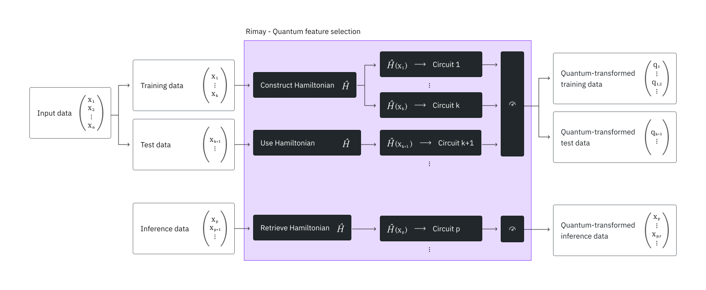
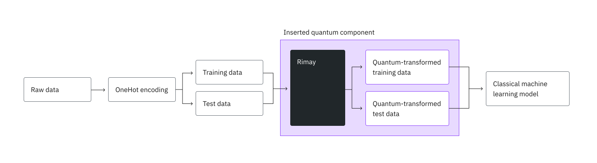

<OpenInLabBanner notebookPath="guides/kipu-rimay.ipynb" />


{/* cspell:ignore Rimay, Kipu, counterdiabatic, OpenML, CatBoost, XGBoost, LightGBM, Quechua, Simen, Hofmann, Statlog, xq */}

*See the [API reference](https://docs.quantum.ibm.com/api/functions/kipu-rimay).*

<Admonition type="note">
  Qiskit Functions are an experimental feature available only to IBM Quantum&reg; Premium Plan, Flex Plan, and On-Prem (through the IBM Quantum Platform API) Plan users. They are in preview release status and subject to change.
</Admonition>

## Overview

Rimay augments classical machine learning pipelines with features generated on quantum hardware. The function takes classical tabular data and returns a set of quantum-transformed features. When a quantum system processes the data, it generates rich features that capture nonlinear relationships between the inputs. You can use the generated features on their own, or combined with your original features, to train any classical model. On small- and medium-sized datasets, quantum-transformed features can improve the prediction quality compared to purely classical baselines.

This function is built for the following users:

- Data science teams with an existing machine learning pipeline on small- and medium-sized tabular datasets, where prediction quality has plateaued. You add Rimay as one additional preprocessing step, without building any quantum circuits yourself.
- Researchers who explore quantum methods for machine learning tasks.
## Description

The quantum feature extraction algorithm [\[1\]](#references) combines two principles of quantum machine learning. The first is quantum feature maps, which embed data into a high-dimensional Hilbert space and therefore produce more expressive representations. The second is quantum reservoir computing, which uses the dynamics of a quantum many-body system as a nonlinear transformation of the input.

Rimay encodes the feature values and the mutual information between the features into the local fields and the coupling coefficients of a spin-glass Hamiltonian. Counterdiabatic quantum dynamics evolve the system toward its low-energy states, which contain nonlinear mixtures of the correlations in the input data. Rimay extracts these correlations by measuring single- and two-body expectation values. The expectation values are the quantum-transformed features that you feed into your machine learning model.

### Workflow



1. Preprocess your tabular data as you would for classical machine learning. Rimay needs numerical features, so convert categorical features into numerical ones, for example with scikit-learn's [`OneHotEncoder`](https://scikit-learn.org/stable/modules/generated/sklearn.preprocessing.OneHotEncoder.html).
2. Split the data into a training set and a test set, and upload both to the function, as shown in the [Example](#example) section.
3. Rimay uses the training data to construct the Hamiltonian that represents the data. Every feature corresponds to one qubit, and the full training set decides which features, and therefore which qubits, interact. Rimay stores this structure so that it maps the test data and later inference data with the same Hamiltonian.
4. For every sample, the feature values set the local fields of the Hamiltonian, and the mutual information between the features sets the coupling coefficients of the structure from step 3. Rimay digitizes the counterdiabatic evolution of this Hamiltonian into a circuit, and runs the circuits on the QPU.
5. Rimay measures the resulting bitstrings, then computes the single-body expectation values and the two-body expectation values of physically coupled qubits.
6. You download the expectation values in a form that you can feed directly into your model, or combine with your original features.

<Admonition type="note">
Because of this structure, the number of qubits that a run needs equals the number of features, and the number of circuits that it submits equals the number of samples.
</Admonition>

After you fit a mapping, you can map new data through it, for example for inference. Rimay then retrieves the Hamiltonian that it created during the fit and builds the circuits for the new samples from it.

### Integrate Rimay into your machine learning pipeline



As in a classical pipeline, you start by preprocessing the raw data, for example by one-hot encoding the categorical features, and split it into a training set and a test set. Instead of feeding both sets into your model directly, you feed them into Rimay first, and train your model on the quantum-transformed features.
## Benchmarks

Kipu Quantum benchmarked Rimay on the German credit dataset from OpenML [\[2\]](#references), which classifies 1000 credit applicants as good or bad credit risks. It has 13 categorical and seven numerical attributes. One-hot encoding of the categorical attributes results in 48 numerical features. The benchmark holds out 20% of the samples as the test set.

As a baseline, several classical models were trained on the classical features. With Rimay, a random forest was trained in two ways: on the quantum-transformed features alone (Random forest Q), and on the quantum-transformed features combined with the classical ones (Random forest H, for hybrid). The table reports only the random forest, because it performed best on the quantum-transformed features.

| Model | Features | Accuracy | AUC | F1 score | Precision | Recall |
| :-- | :-- | --: | --: | --: | --: | --: |
| [CatBoost](https://catboost.ai/) | Classical | 0.775 | 0.781 | 0.850 | 0.795 | 0.914 |
| [Random forest](https://scikit-learn.org/stable/modules/generated/sklearn.ensemble.RandomForestClassifier.html) | Classical | 0.765 | 0.781 | 0.846 | 0.782 | 0.921 |
| [XGBoost](https://xgboost.readthedocs.io/en/stable/) | Classical | 0.760 | 0.758 | 0.835 | 0.803 | 0.871 |
| [LightGBM](https://lightgbm.readthedocs.io/en/stable/) | Classical | 0.770 | 0.751 | 0.840 | 0.818 | 0.864 |
| Random forest Q | Quantum | 0.750 | 0.793 | 0.840 | 0.762 | 0.936 |
| Random forest H | Hybrid | 0.770 | 0.798 | 0.854 | 0.770 | 0.957 |

The hybrid features improve all metrics of the random forest except the precision, and the hybrid random forest reaches a higher AUC, F1 score, and recall than CatBoost on the classical features. The largest effect is on the recall, which rises from 0.921 to 0.957. The quantum-transformed features alone do not reach the precision of the classical models.

<Admonition type="caution">
  The test set holds only 200 samples, so predicting one more sample correctly moves the accuracy by 0.005. Read the differences as a trend that needs further verification, not as a significant effect. The prediction accuracy can also depend on the hardware-induced noise of the extracted features. Therefore, use enough shots that shot noise does not limit the result.
</Admonition>

The benchmark used the following resources:

| Example | Number of qubits | Number of samples | Number of shots | Total time (min) | QPU usage (min) | Processor |
| :-- | --: | --: | --: | --: | --: | :-- |
| German credit | 48 | 1000 | 5000 | 23 | 22 | ibm_boston |
| German credit | 48 | 1000 | 5000 | 3 |  2 | ibm_phoenix |

The number of samples, which is the number of circuits, drives the QPU time. Use the Nighthawk r2 processor type, because it greatly reduces the required QPU time.
## Inputs

The `mode` determines which parameters a run needs. For a description of every input parameter, see the [API reference](https://docs.quantum.ibm.com/api/functions/kipu-rimay#inputs).

### Input files

- Upload every file with `catalog.file_upload()` before you run the function.
- An upload replaces any earlier file of the same name, even for a job that you submitted but that has not started yet. To run several jobs at the same time, give the files of each job their own names, for example `run1_x_train.csv` and `run2_x_train.csv`.
- Every file is a CSV file with a header row. Every column of a feature file is one feature, and every value must be numeric.
- `y_train` holds exactly one numeric column, with one label per row of `x_train`. Map categorical labels to numbers, for example good and bad to 1 and 0.
- `x_test` and `x_inference` must have the same columns as `x_train`, in the same order.

<Admonition type="caution" title="Keep the mapping_id and backend_name">
  The `mapping_id` is the only way to reach the mapping that your fit produced, and it cannot be looked up or recovered. It authorizes the use of that mapping, so treat it like a credential and do not share it. If you lose it, you must fit a new mapping, which costs another run on quantum hardware. Also record the `backend_name` of the fit, because the mapping runs only on that processor.
</Admonition>

### Limits

- Every feature is mapped to one qubit, so the processor must have at least as many qubits as your data has features. If you have more features than that, reduce them with a feature selection technique first.
- Every sample becomes one circuit, and a run counts training and test samples together. A run can hold at most 15,000 samples.
- A single job can request at most 10 million executions, so the number of samples times `shots` must not exceed 10 million.
- A job must finish within 24 hours, including the time its circuits wait in the processor's queue. A job that runs longer is stopped without a result. On a busy processor, keep large datasets well below these limits.
## Outputs

`job.result()` returns a dictionary. The quantum-transformed features themselves are written to CSV files that you download with `catalog.file_download()`. For a description of every key of the dictionary, see the [API reference](https://docs.quantum.ibm.com/api/functions/kipu-rimay#output). For the time that each execution phase took, see [Run metadata](#run-metadata).

Every output file holds one row per input row, in the order of the input file, and one column per quantum-transformed feature. The columns whose names start with `corr_` are the two-body expectation values. The files hold no label column. The labels of your training data stay in your `y_train` file.

### Run metadata

`resource_usage` holds one entry for each execution phase that the run went through: `"RUNNING: MAPPING"`, `"RUNNING: POST_PROCESSING"`, and, on a QPU, usually `"RUNNING: WAITING_FOR_QPU"`. Each entry holds `CPU_TIME`, the wall-clock time of the phase in seconds, and `QPU_TIME`, the QPU time in seconds. On a QPU, the QPU time that IBM billed is recorded under `"RUNNING: MAPPING"`, the phase in which the circuits ran.

`"RUNNING: WAITING_FOR_QPU"` is the time your jobs waited in the IBM queue. The run takes this time from the IBM job timestamps, and does not count it in `"RUNNING: MAPPING"`. If IBM does not report those timestamps for every job, the entry is absent, and the wait is part of `"RUNNING: MAPPING"`.

IBM&reg; finishes its usage calculation some time after a job finishes. The run waits up to about a minute for it. Usage that is still being calculated after that time is not included in `QPU_TIME`, and the final usage is shown on IBM Quantum Platform. If the run cannot read the usage from IBM, `QPU_TIME` is `None`.

For example:

```python noexec
"metadata": {
    "version": "0.3.0",
    "resource_usage": {
        "RUNNING: MAPPING": {"CPU_TIME": 12.4, "QPU_TIME": 6.0},
        "RUNNING: WAITING_FOR_QPU": {"CPU_TIME": 28.8, "QPU_TIME": 0.0},
        "RUNNING: POST_PROCESSING": {"CPU_TIME": 0.3, "QPU_TIME": 0.0},
    },
}
```
## Get started

Authenticate using your [IBM Quantum Platform API key](https://quantum.cloud.ibm.com/), and select the Qiskit Function as follows:

<Admonition type="note">
  The following code assumes that you have saved your credentials. If you have not, follow the instructions in [Install the Qiskit Functions Catalog client](/guides/functions-get-started#install-qiskit-functions-catalog-client) to save your account with your API key.
</Admonition>

```python
# Added by doQumentation — installs the packages this notebook needs if they are missing
import importlib.util

_needed = {"pandas": "pandas", "qiskit_ibm_catalog": "qiskit-ibm-catalog"}
_missing = [pip for module, pip in _needed.items()
            if importlib.util.find_spec(module) is None]
# One at a time, so a package that fails to install does not block the others
for _pip in _missing:
    %pip install -q {_pip}
if not _missing:
    print("\u2713 All required packages are installed")
```

```python
from qiskit_ibm_catalog import QiskitFunctionsCatalog

catalog = QiskitFunctionsCatalog(channel="ibm_quantum_platform")

# Verify that you have access to the function
catalog.list()
```

```text
[QiskitFunction(kipu-quantum/rimay)]
```

```python
# Access function
rimay = catalog.load("kipu-quantum/rimay")
```

## Function sizes

Every job runs at one size — `S`, `M`, or `L`. If the specified size is too small, the job is rejected. If the size is larger than needed, it runs on a bigger compute profile than the work requires.

The size of a Rimay job depends on the number of samples it maps: the rows of `x_train` and `x_test` for `fit-transform`, and the rows of `x_inference` for `transform`. The labels in `y_train` do not count, and a `delete` run maps no samples.

| Size | Samples per job | Compute profile | vCPU | RAM |
| :-- | :-- | :-- | :-- | :-- |
| `S` | Up to 2,999 | `8x32` | 8 | 32 GB |
| `M` | 3,000 to 9,999 | `8x32` | 8 | 32 GB |
| `L` | 10,000 to 15,000 | `16x128` | 16 | 128 GB |

The number of samples is the only criterion. A size changes nothing but the compute profile: the [limits](#limits) on features, samples, and shots are the same for every size. `S` and `M` run on the same compute profile and differ in the number of samples each covers.

The default is `M`, used when a job does not request a size. A job of more than 9,999 samples must therefore request `L`.

You can also read the mapping off the function itself with `rimay.sizes_map`, and the size that a job runs at when it does not request one with `rimay.default_size`.
### Calculate the size before submitting

Run this on your own inputs. It reads them and does nothing else: no job is submitted and nothing is reserved, so you can call it as often as you like.

Pass the data sets themselves, not their file names, in the same order as `input_file`, together with the `mode` of the run. [Step 2 of the example](#2-run-the-function) shows the call.

```python
from os import PathLike
from typing import Any, Literal, Sequence, Sized

Size = Literal["S", "M", "L"]

# Upper bounds (inclusive) in samples.
_SMALL = 2_999
_MEDIUM = 9_999

FIT_TRANSFORM, TRANSFORM, DELETE = "fit-transform", "transform", "delete"

# Which positions of input_file hold samples, per mode. The labels in
# y_train submit no circuits of their own, so they are not counted.
SAMPLE_POSITIONS = {FIT_TRANSFORM: (0, 2), TRANSFORM: (0,)}

def calculate_function_size(problem: Sequence[Sized], **kwargs: Any) -> Size:
    """Return the size ("S", "M" or "L") required to run the function."""
    metrics = _measure(problem, **kwargs)
    if _is_small(metrics):
        return "S"
    if _is_medium(metrics):
        return "M"
    return "L"

def _measure(problem: Sequence[Sized], **kwargs: Any) -> dict:
    """The samples the job submits."""
    return {"samples": count_samples(problem, kwargs.get("mode"))}

def count_samples(problem: Sequence[Sized], mode: Any) -> int:
    """Rows across the data sets of ``problem`` that carry samples."""
    if mode == DELETE:
        return 0
    if mode not in SAMPLE_POSITIONS:
        raise ValueError(f"cannot size mode {mode!r}")
    if _is_name(problem) or (
        isinstance(problem, (list, tuple))
        and any(_is_name(data) for data in problem)
    ):
        raise TypeError(
            "pass the data, not the file name: read each input_file, e.g. with "
            "pandas.read_csv, and pass the data sets in input_file order"
        )
    if not isinstance(problem, (list, tuple)):
        raise TypeError(
            "pass a list of data sets in input_file order, e.g. [x_train, y_train], "
            f"not a single {type(problem).__name__}"
        )
    return sum(
        len(problem[i]) for i in SAMPLE_POSITIONS[mode] if i < len(problem)
    )

def _is_name(value: Any) -> bool:
    """A file name or path rather than data."""
    return isinstance(value, (str, bytes, PathLike))

def _is_small(metrics: dict) -> bool:
    """Determine if the metrics fit T-size 'S'."""
    return metrics["samples"] <= _SMALL

def _is_medium(metrics: dict) -> bool:
    """Determine if the metrics fit T-size 'M'."""
    return metrics["samples"] <= _MEDIUM
```

If the size is too small, the job fails with error `4600` and the message names the size to use instead. If it is larger than needed, the job runs normally and records a `4601` advisory event.
## Example

This example shows how to upload data, run the function, and retrieve the quantum-transformed features. For an end-to-end example that includes the preprocessing and the training of the classical model, see the [tutorial](/tutorials/classify-credit-risk-with-rimay-quantum-feature-extraction).

### 1. Upload the data

This example uses a small synthetic dataset with four numeric features and a binary label, so that a run needs only four qubits and finishes quickly. The next cell writes it to four CSV files: the training features, the training labels, the test features, and the features for step 4 of this example. To use your own data, write your preprocessed training and test sets to files with the same layout instead.

```python
from pathlib import Path

Path("x_train.csv").write_text("""f0,f1,f2,f3
0.7227,1.3355,1.9595,2.5562
0.2731,0.5779,0.8983,1.1624
0.1139,0.1817,0.2163,0.2426
0.0341,0.1311,0.0854,0.09
0.8996,1.6951,2.497,3.3407
0.9669,1.8906,2.7705,3.6569
0.6366,1.2821,1.8793,2.4602
0.7718,1.4979,2.2223,2.933
0.5465,1.1008,1.67,2.2195
0.9475,1.9423,2.8942,3.8199
0.8829,1.6842,2.4703,3.2865
0.0675,0.0365,0.0705,0.0162
""")
Path("y_train.csv").write_text("label\n1\n0\n0\n0\n1\n1\n0\n1\n0\n1\n1\n0\n")
Path("x_test.csv").write_text("""f0,f1,f2,f3
0.543,1.0786,1.5684,2.0607
0.9928,1.9037,2.9302,3.8422
0.2269,0.3637,0.4628,0.597
0.9896,1.9511,2.8913,3.8208
""")
Path("x_inference.csv").write_text("""f0,f1,f2,f3
0.2708,0.542,0.8506,1.0897
0.3585,0.6025,0.9517,1.2609
0.8871,1.6559,2.4577,3.2992
""")
```

```text
95
```

Upload the training and test files. You upload `x_inference.csv` in step 4.

```python
for file_name in ("x_train.csv", "y_train.csv", "x_test.csv"):
    catalog.file_upload(file_name, rimay)
```

### 2. Run the function

Calculate the size of the run from the data that you uploaded, with the calculator from [Function sizes](#calculate-the-size-before-submitting).

```python
import pandas as pd

x_train = pd.read_csv("x_train.csv")
y_train = pd.read_csv("y_train.csv")
x_test = pd.read_csv("x_test.csv")

size = calculate_function_size(
    [x_train, y_train, x_test], mode="fit-transform"
)
print(size)
```

```text
S
```

Select a processor with at least as many qubits as your data has features, and run the function in `fit-transform` mode with that size. The sample data has four features, so any IBM Quantum processor can run it.

```python
backend = catalog.least_busy(operational=True, simulator=False)

job = rimay.run(
    mode="fit-transform",
    input_file=["x_train.csv", "y_train.csv", "x_test.csv"],
    backend_name=backend.name,
    shots=5000,
    function_size=size,
)
print(job.job_id)
```

```text
85dabc9f-a769-4f4a-8e92-f3be73f85ca2
```

Check the workload's [status](/guides/functions-get-started#check-job-status) or return [results](/guides/functions-get-started#retrieve-results) as follows:

```python
# Monitor the job status
job.status()
```

```text
'DONE'
```

```python
result = job.result()

# Keep both: the mapping_id is the only handle on the mapping this run
# fitted, and the mapping runs only on the processor it was fitted on.
mapping_id = result["mapping_id"]
fit_backend_name = result["backend_name"]
```

### 3. Retrieve the results

Download the quantum-transformed features. Pass `target_name` so that each file is saved under its own name.

```python
for file_name in result["output_files"]:
    catalog.file_download(file_name, rimay, target_name=file_name)
```

```text
693iB [00:00, 171kiB/s]
254iB [00:00, 111kiB/s]
```

### 4. Map new data

After you train your model, map new data with the fitted mapping, for example to run inference. This example maps `x_inference.csv`, which the first cell of this example wrote. Pass the `mapping_id` that the fit returned, so that the new rows are mapped with the same mapping instead of a new one.

A mapping is built for the qubit layout of one processor, so pass the same `backend_name` as the fit, which the fit returned in `result["backend_name"]`. Do not use `least_busy()` to choose the processor, because it might return a different one. Rimay rejects any other processor before it submits anything. The shot count also comes from the fit.

```python
catalog.file_upload("x_inference.csv", rimay)

x_inference = pd.read_csv("x_inference.csv")
size = calculate_function_size([x_inference], mode="transform")

job = rimay.run(
    mode="transform",
    input_file=["x_inference.csv"],
    # The processor the mapping was fitted on
    backend_name=fit_backend_name,
    shots=5000,
    mapping_id=mapping_id,
    function_size=size,
)
```

```python
# Monitor the job status
job.status()
```

```text
'DONE'
```

```python
result = job.result()

for file_name in result["output_files"]:
    catalog.file_download(file_name, rimay, target_name=file_name)
```

```text
202iB [00:00, 73.5kiB/s]
```

### 5. Delete a mapping

When you no longer need a fitted mapping, delete it. A `delete` run does no quantum work, so it needs no processor, no shots, and no function size. You cannot undo a deletion. After deletion, the `mapping_id` no longer refers to anything, and a `transform` run with it fails.

```python
job = rimay.run(mode="delete", mapping_id=mapping_id)
job.result()
```

```text
{'output_files': [],
 'mode': 'delete',
 'deleted': True,
 'mapping_id': '30L40joyUPYfnvgwo2d7MXXSzqvHkggR-Kzn81wfIYw',
 'metadata': {'version': '0.6.0', 'resource_usage': {}}}
```

## Fetch error messages

If your workload status is `ERROR`, use `job.error_message()` to fetch the error message, as follows:

```python
job = rimay.run(
    mode="fit-transform",
    input_file=["x_train.csv", "y_train.csv"],
    backend_name=backend.name,
    shots=0,
)
job.error_message()
```

Every error that Rimay reports carries a code from the [IBM Quantum error codes](https://docs.quantum.ibm.com/errors), a message, and a solution that names the value that you passed and the value that is allowed. The following table lists the most common errors:

| Code | Cause |
| :-- | :-- |
| `1221` | A parameter is missing or has the wrong type, `mode` is not valid, a file named in `input_file` was not uploaded, the files do not match each other, a feature is not numeric, or the `mapping_id` does not match a stored mapping. |
| `1221` | A `"transform"` run names a different `backend_name` than the fit that produced its mapping. |
| `1216` | Your instance has no processor with the `backend_name` that you passed. The solution lists the processors it does have. |
| `1200` | Your API key does not have access to the instance that the job runs under. |
| `3200` | `backend_name` does not start with `ibm_`. |
| `4500` | The data has more features than the processor has qubits. |
| `6000` | The number of samples times `shots` exceeds 10 million executions. |
| `6001` | `shots` is smaller than 1. |
| `6002` | The data has more samples than a run allows. |
## Use cases

In tabular classification on small- and medium-sized datasets, Kipu Quantum has applied quantum feature extraction to the following:

- [Credit risk classification](https://www.openml.org/search?type=data&sort=runs&id=31&status=active)
- [Molecular toxicity classification](https://arxiv.org/abs/2510.13807)

Beyond tabular data, frozen neural networks can transform images into numerical features, which quantum feature extraction then maps into quantum-transformed features:

- [Satellite image classification](https://arxiv.org/abs/2602.18350) [\[3\]](#references)

## Get support

For support, contact [support@kipu-quantum.com](mailto:support@kipu-quantum.com).
## Next steps

- Visit the [API reference](https://docs.quantum.ibm.com/api/functions/kipu-rimay) for this Qiskit Function.
- Try the [Classify credit risk with Kipu Quantum's Rimay quantum feature extraction](/tutorials/classify-credit-risk-with-rimay-quantum-feature-extraction) tutorial.
- Review [Simen, A., et al. (2025). Digitized Counterdiabatic Quantum Feature Extraction. arXiv preprint arXiv:2510.13807](https://arxiv.org/abs/2510.13807).
- Review [Zhang, Q., et al. (2026). Quantum-enhanced satellite image classification. arXiv preprint arXiv:2602.18350](https://arxiv.org/abs/2602.18350).

## References

[1] Simen, A., et al. (2025). Digitized Counterdiabatic Quantum Feature Extraction. arXiv preprint [arXiv:2510.13807](https://arxiv.org/abs/2510.13807).

[2] Hofmann, H. (1994). Statlog (German Credit Data). [OpenML dataset 31](https://www.openml.org/search?type=data&sort=runs&id=31&status=active).

[3] Zhang, Q., et al. (2026). Quantum-enhanced satellite image classification. arXiv preprint [arXiv:2602.18350](https://arxiv.org/abs/2602.18350).

## Additional information

Rimay is a Quechua word that means "to explain".