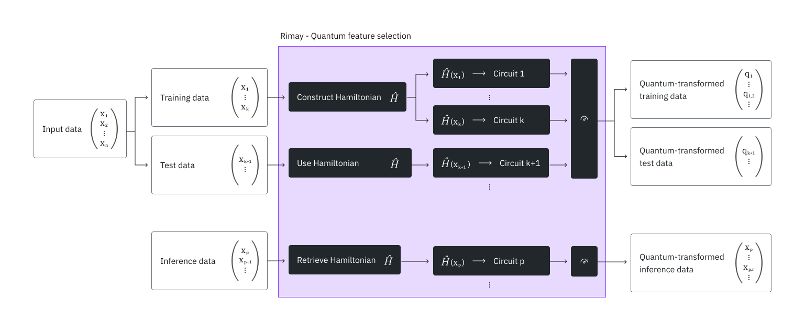
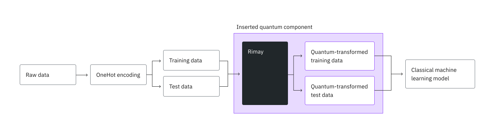

{/* cspell:ignore Rimay, Kipu, counterdiabatic, OpenML, CatBoost, XGBoost, LightGBM, Quechua, Simen, Hofmann, Statlog */}

*See the [API reference](https://docs.quantum.ibm.com/functions/kipu-rimay/api-reference).*

<Admonition type="note">
  IBM Quantum&reg; Functions are a beta feature available only to IBM Quantum Premium Plan, Flex Plan, and On-Prem (through the IBM Quantum Platform API) Plan users. Beta features are subject to change.
</Admonition>
## Overview

Rimay augments classical machine learning pipelines with features generated on quantum hardware. The function takes classical tabular data and returns a set of quantum-transformed features. When a quantum system processes the data, it generates rich features that capture nonlinear relationships between the inputs. You can use the generated features on their own, or combined with your original features, to train any classical model. On small- and medium-sized datasets, quantum-transformed features can improve the prediction quality compared to purely classical baselines.

This function is built for the following users:

- Data science teams with an existing machine learning pipeline on small- and medium-sized tabular datasets, where prediction quality has plateaued. You add Rimay as one additional preprocessing step, without building any quantum circuits yourself.
- Researchers who explore quantum methods for machine learning tasks.
## Description

The quantum feature extraction algorithm [\[1\]](#references) combines two principles of quantum machine learning. The first is quantum feature maps, which embed data into a high-dimensional Hilbert space and therefore produce more expressive representations. The second is quantum reservoir computing, which uses the dynamics of a quantum many-body system as a nonlinear transformation of the input.

Rimay encodes the feature values and the mutual information between the features into the local fields and the coupling coefficients of a spin-glass Hamiltonian. Counterdiabatic quantum dynamics evolve the system toward its low-energy states, which contain nonlinear mixtures of the correlations in the input data. Rimay extracts these correlations by measuring single- and two-body expectation values. The expectation values are the quantum-transformed features that you feed into your machine learning model.

### Workflow

1. Preprocess your tabular data as you would for classical machine learning. Rimay needs numerical features, so convert categorical features into numerical ones, for example with scikit-learn's [`OneHotEncoder`](https://scikit-learn.org/stable/modules/generated/sklearn.preprocessing.OneHotEncoder.html).
2. Split the data into a training set and a test set, and upload both to the function, as shown in the [Example](https://docs.quantum.ibm.com/functions/kipu-rimay/get-started#example) section.
3. Rimay uses the training data to construct the Hamiltonian that represents the data. Every feature corresponds to one qubit, and the full training set decides which features, and therefore which qubits, interact. Rimay stores this structure so that it maps the test data and later inference data with the same Hamiltonian.
4. For every sample, the feature values set the local fields of the Hamiltonian, and the mutual information between the features sets the coupling coefficients of the structure from step 3. Rimay digitizes the counterdiabatic evolution of this Hamiltonian into a circuit, and runs the circuits on the QPU.
5. Rimay measures the resulting bitstrings, then computes the single-body expectation values and the two-body expectation values of physically coupled qubits.
6. You download the expectation values in a form that you can feed directly into your model, or combine with your original features.

<Admonition type="note">
Because of this structure, the number of qubits that a run needs equals the number of features, and the number of circuits that it submits equals the number of samples.
</Admonition>

After you fit a mapping, you can map new data through it, for example for inference. Rimay then retrieves the Hamiltonian that it created during the fit and builds the circuits for the new samples from it.

### Integrate Rimay into your machine learning pipeline

As in a classical pipeline, you start by preprocessing the raw data, for example by one-hot encoding the categorical features, and split it into a training set and a test set. Instead of feeding both sets into your model directly, you feed them into Rimay first, and train your model on the quantum-transformed features.
## Benchmarks

Kipu Quantum benchmarked Rimay on the German credit dataset from OpenML [\[2\]](#references), which classifies 1000 credit applicants as good or bad credit risks. It has 13 categorical and seven numerical attributes. One-hot encoding of the categorical attributes results in 48 numerical features. The benchmark holds out 20% of the samples as the test set.

As a baseline, several classical models were trained on the classical features. With Rimay, a random forest was trained in two ways: on the quantum-transformed features alone (Random forest Q), and on the quantum-transformed features combined with the classical ones (Random forest H, for hybrid). The table reports only the random forest, because it performed best on the quantum-transformed features.

| Model | Features | Accuracy | AUC | F1 score | Precision | Recall |
| :-- | :-- | --: | --: | --: | --: | --: |
| [CatBoost](https://catboost.ai/) | Classical | 0.775 | 0.781 | 0.850 | 0.795 | 0.914 |
| [Random forest](https://scikit-learn.org/stable/modules/generated/sklearn.ensemble.RandomForestClassifier.html) | Classical | 0.765 | 0.781 | 0.846 | 0.782 | 0.921 |
| [XGBoost](https://xgboost.readthedocs.io/en/stable/) | Classical | 0.760 | 0.758 | 0.835 | 0.803 | 0.871 |
| [LightGBM](https://lightgbm.readthedocs.io/en/stable/) | Classical | 0.770 | 0.751 | 0.840 | 0.818 | 0.864 |
| Random forest Q | Quantum | 0.750 | 0.793 | 0.840 | 0.762 | 0.936 |
| Random forest H | Hybrid | 0.770 | 0.798 | 0.854 | 0.770 | 0.957 |

The hybrid features improve all metrics of the random forest except the precision, and the hybrid random forest reaches a higher AUC, F1 score, and recall than CatBoost on the classical features. The largest effect is on the recall, which rises from 0.921 to 0.957. The quantum-transformed features alone do not reach the precision of the classical models.

<Admonition type="caution">
  The test set holds only 200 samples, so predicting one more sample correctly moves the accuracy by 0.005. Read the differences as a trend that needs further verification, not as a significant effect. The prediction accuracy can also depend on the hardware-induced noise of the extracted features. Therefore, use enough shots that shot noise does not limit the result.
</Admonition>

The benchmark used the following resources:

| Example | Number of qubits | Number of samples | Number of shots | Total time (min) | QPU usage (min) | Processor |
| :-- | --: | --: | --: | --: | --: | :-- |
| German credit | 48 | 1000 | 5000 | 23 | 22 | ibm_boston |
| German credit | 48 | 1000 | 5000 | 3 |  2 | ibm_phoenix |

The number of samples, which is the number of circuits, drives the QPU time. Use the Nighthawk r2 processor type, because it greatly reduces the required QPU time.
## Use cases

In tabular classification on small- and medium-sized datasets, Kipu Quantum has applied quantum feature extraction to the following:

- [Credit risk classification](https://www.openml.org/search?type=data&sort=runs&id=31&status=active)
- [Molecular toxicity classification](https://arxiv.org/abs/2510.13807)

Beyond tabular data, frozen neural networks can transform images into numerical features, which quantum feature extraction then maps into quantum-transformed features:

- [Satellite image classification](https://arxiv.org/abs/2602.18350) [\[3\]](#references)

## Get support

For support, contact [support@kipu-quantum.com](mailto:support@kipu-quantum.com).
## Next steps

- Run your first workload with the [get started guide](https://docs.quantum.ibm.com/functions/kipu-rimay/get-started).
- Understand [resource units (RUs)](/guides/plans-overview#rus).
- Review the [IBM Quantum Platform plans](/guides/plans-overview).

## References

[1] Simen, A., et al. (2025). Digitized Counterdiabatic Quantum Feature Extraction. arXiv preprint [arXiv:2510.13807](https://arxiv.org/abs/2510.13807).

[2] Hofmann, H. (1994). Statlog (German Credit Data). [OpenML dataset 31](https://www.openml.org/search?type=data&sort=runs&id=31&status=active).

[3] Zhang, Q., et al. (2026). Quantum-enhanced satellite image classification. arXiv preprint [arXiv:2602.18350](https://arxiv.org/abs/2602.18350).

## Additional information

Rimay is a Quechua word that means "to explain".