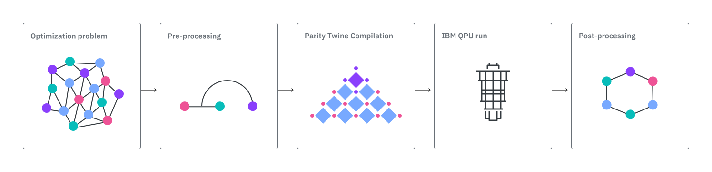

<OpenInLabBanner notebookPath="guides/parity-twine-optimizer.ipynb" />


{/* cspell:ignore parityqc QOBLIB  */}
*See the [API reference](https://docs.quantum.ibm.com/functions/parity-twine-optimizer/api-reference)*

<Admonition type="note">
  IBM Quantum&reg; Functions are a beta feature available only to IBM Quantum Premium Plan, Flex Plan, and On-Prem (through the IBM Quantum Platform API) Plan users. Beta features are subject to change.
</Admonition>

## Overview

The Parity Twine Optimizer allows users to solve optimization problems with quantum computers using the [Parity Twine method](https://arxiv.org/abs/2501.14020).
This approach, built on the Parity Architecture, uses the ParityQC compiler to minimize the gate counts and circuit depth required to run a quantum algorithm while accounting for device connectivity.

This resource reduction enables solving industry-relevant optimization problems for sizes that are unfeasible with standard, SWAP-heavy, transpilation methods.
The Parity Twine Optimizer automates transpilation steps and can be used with minimal user input.

The Parity Twine approach outperforms all other compilation methods in terms of reducing gate counts and circuit depths for quantum algorithms such as the
[quantum approximate optimization algorithm (QAOA)](https://arxiv.org/abs/2501.14020) and [quantum Fourier transform (QFT)](https://arxiv.org/abs/2604.12465).
By abstracting quantum information away from the physical qubits, non-local interactions are implemented without SWAP gates. Instead, Parity Twine chains (sequences of CNOT gates) systematically distribute logical
parity information between qubits.

The optimizer uses the QAOA to minimize the energy of a given cost function. QAOA is a hybrid quantum-classical variational algorithm designed to solve combinatorial optimization problems by approximating the ground state
of a cost Hamiltonian ($H_C$). A mixing term ($H_B$) drives transitions between states to explore the solution space. An alternating sequence of these terms, controlled by parameters $\gamma$ and $\beta$, defines the unitary
$U(\gamma, \beta) = \Pi_{i=1}^p e^{-i \beta_i H_B} e^{-i \gamma_i H_C}$, which acts on the initial state.

Encoding of the problem unitary, exp($-i \beta H_C$), requires encoding of all logical $n$-body rotation operators (exp($-i \beta J_{i,j,...n}Z_iZ_j...Z_n$)).
This can be accomplished using $n$-body generators (Parity Twine Networks), which reduce the QAOA circuit depth and two-qubit gate count.

## Description

The Parity Twine Optimizer input consists of an optimization problem, the chosen IBM Quantum hardware name, and additional optional arguments to tailor the transpilation and hardware execution settings. The optimizer
function routes the problem definition to the Parity Twine Compiler. Figure 1 shows a summary of the function workflow.



The input optimization problem is pre-processed into a (normalized) Hamiltonian. The ParityQC compiler then constructs a parameterized Parity Twine ansatz circuit, which is transpiled to a logical ansatz matching the native
gate set of the chosen hardware.

QAOA circuit parameters are classically optimized using the ["efficient depth one"](https://github.com/qiskit-community/qaoa_training_pipeline/blob/main/how_tos/efficient_depth_one.ipynb) approach and assigned to the transpiled circuit.
As one round of QAOA is used, optimal $\gamma$ and $\beta$ parameters are obtained using a grid search on a CPU without the need for costly iterative optimization
over many circuit calls. This greatly minimizes the required QPU runtime of the optimizer. Execution time per circuit is mostly determined by the constant overhead to run a job on the QPU.
With the circuit parameters set, the job is submitted to the specified IBM&reg; QPU.

Raw results are then post-processed. This step uses a local greedy search that iterates randomly through the solution string and flips bit values if this reduces the value of the cost function.
## Benchmarks

<Admonition type="caution" title="Disclaimer">
Performance can depend on both the problem instance and subsequent processing steps. In some cases, classical samples and quantum-generated samples might achieve similar final solution quality after equivalent post-processing. Evaluation should therefore consider the complete optimization workflow.
</Admonition>

### Sherrington-Kirkpatrick model

Figure 2 demonstrates the effectiveness of the Parity Twine Optimizer. This compares results obtained using the optimizer against random sampling for the Sherrington-Kirkpatrick model
with increasing qubits.

Post-processing of both the random and optimizer results leads to exact ground states, but the raw minimum energy output from Twine QAOA is always better than random
values. For the largest qubit numbers considered (90 and 100), hardware noise degrades the optimizer result where it reverts to raw values matching random sampling.


See this [tutorial](/tutorials/parity-twine-optimizer-sk) for an introduction to the Sherrington-Kirkpatrick model and details on how to solve it with the Parity Twine Optimizer.

### Market split problem

Table 1 shows specific performance metrics for the Parity Twine Optimizer applied to various instances of the market split (MS) problem.
These were obtained from the [QOBLIB - Quantum Optimization Benchmarking Library](https://github.com/ZIB-AOPT/QOBLIB) and correspond to
[submissions](https://github.com/ZIB-AOPT/QOBLIB/tree/main/01-marketsplit/submissions/20260728_Parity_Twine_Optimizer) made to the
library using the Parity Twine Optimizer.

MS violation is an accuracy metric that measures how far the solution is from satisfying all constraints, defined as $\sum_i ((Ax - b)_i)^2$. Lower values of this metric indicate more accurate solutions.
Table 1 reports averaged values for five runs of each instance using the Parity Twine Optimizer with the `ibm_boston` device as a backend and 100,000 shots.
The minimum MS violation obtained from the runs of each instance is reported.

| Instance      | Qubits | Two-qubit gates | Two-qubit depth | MS violation | Mapping time (s) | QPU runtime (s) | Post-process time (s) |
|:--------------|:-------|:----------------|:----------------|:-------------|:-----------------|:----------------|:----------------------|
| ms_03_050_002 | 20     | 399             | 76              | 0          | 45               | 29              | 71                    |
| ms_03_100_022 | 20     | 399             | 76              | 0          | 30               | 29              | 77                    |
| ms_03_200_177 | 20     | 399             | 76              | 0          | 33               | 29              | 63                    |
| ms_04_050_001 | 30     | 899             | 116             | 1          | 68               | 29              | 216                   |
| ms_04_100_003 | 30     | 899             | 116             | 2          | 89               | 29              | 187                   |
| ms_04_200_030 | 30     | 899             | 116             | 3          | 89               | 29              | 219                   |
| ms_05_100_003 | 40     | 1599            | 156             | 3          | 237              | 30              | 364                   |
| ms_06_050_001 | 50     | 2499            | 196             | 4          | 499              | 30              | 464                   |
| ms_07_050_001 | 60     | 3599            | 236             | 17         | 858              | 31              | 637                   |
| ms_08_050_001 | 70     | 4899            | 276             | 36         | 1561             | 31              | 773                   |

<p align="center"><i>Table 1: Performance metrics for different instances of the market split problem. Instance names are for corresponding examples in the [QOBLIB](https://github.com/ZIB-AOPT/QOBLIB) problem library. As mentioned previously in the description section, the QPU time is minimal and almost constant, as only one round of QAOA is used with optimal circuit parameters obtained on a CPU.</i></p>

See this [tutorial](/tutorials/parity-twine-optimizer-ms) for an introduction to the market split problem and details on how to solve it with the Parity Twine Optimizer.

### Maximum independent set problem

Figure 3 compares results obtained using the Parity Twine optimizer against random sampling for the maximum independent set problem for selected instances
obtained from the [QOBLIB - Quantum Optimization Benchmarking Library](https://github.com/ZIB-AOPT/QOBLIB). These range from 18 (mammalia-kangaroo-interactions) to
114 (es60fst03) qubits.

For small instances, the raw maximum independent set size results from the optimizer and random sampling are similar, but for larger instances, the optimizer gives far better results.
Post-processing of both the random-sampled and optimizer results again leads to set sizes in agreement with exact values.


## Get started

Authenticate using your [IBM Quantum Platform API token](/guides/functions-get-started) and select the quantum function as:

```python
# Added by doQumentation — installs the packages this notebook needs if they are missing
import importlib.util

_needed = {"qiskit_addon_opt_mapper": "qiskit-addon-opt-mapper", "qiskit_ibm_catalog": "qiskit-ibm-catalog"}
_missing = [pip for module, pip in _needed.items()
            if importlib.util.find_spec(module) is None]
# One at a time, so a package that fails to install does not block the others
for _pip in _missing:
    %pip install -q {_pip}
if not _missing:
    print("\u2713 All required packages are installed")
```

```python
from qiskit_ibm_catalog import FunctionsCatalog

# Authenticate and load the quantum function
catalog = FunctionsCatalog(
    channel="ibm_quantum_platform",
)
function = catalog.load("parityqc/parity-twine-optimizer")
```

## Function sizes

Every job runs at one size: `S`, `M`, or `L`. If the size is too small, the job is rejected. If it is larger than needed, the job runs on a bigger compute profile than the work requires. See [Function sizes](/guides/managed-workflow-compute-profiles#best-practice-match-sizes-to-problem-sizes) for how sizes work in general.

The size comes from two properties of your model: how many variables it has, and
how densely they interact, that is, the fraction of all variable pairs that appear together
in a term of the objective or of a constraint.

| Size | Smallest size for variables and interaction density | Compute profile | vCPU | RAM |
|---|---|---|---|---|
| `S` | At most 50 variables and density at most 0.1 | `8x32` | 8 | 32 GB |
| `M` | At most 100 variables and density at most 0.25 | `16x128` | 16 | 128 GB |
| `L` | Either above the `M` bound | `16x128` | 16 | 128 GB |

A model must fit **both** bounds of a size, which is why a small but tightly coupled
model can be `L`: ten variables all coupled to each other is a density of 1.0. These
are the same bounds for every optimization function, so a size means the same
difficulty of model whichever one you call.

Two things raise the density more than they appear to:

- **A term over more than two variables couples every pair of them.** A term in
  four variables contributes all six pairs.
- **A constraint counts as the penalty that replaces it on hardware.** Squaring the
  constraint couples every pair of variables in it, so a one-hot constraint over
  four variables also contributes all six pairs.

The default is `M`, used when a job does not request a size.

You can also read the mapping from the function itself with `function.sizes_map`, and the default size with `function.default_size`.
For the Parity Twine Optimizer, every variable that appears in `problem` counts once,
and every quadratic term such as `"(0, 1)"` contributes one pair. The model in the
[example](#example) has five variables and one of the ten possible pairs, a density
of 0.1, so it needs `S`. Fully connected models, such as the
[Sherrington-Kirkpatrick model](/tutorials/parity-twine-optimizer-sk) or the QUBO
form of the [market split problem](/tutorials/parity-twine-optimizer-ms), have a
density of 1.0 and always need `L`.
### Calculate the size before submitting

Run the following calculator on your own model. It reads the model and nothing else: no job is submitted and nothing is reserved, so you can call it as often as you like while you reduce a model to a smaller size.

```python
# Calculate the function size a model needs, before submitting it.
# Call ``calculate_function_size(problem)``: it returns "S", "M" or "L" and submits
# nothing. The size comes from the number of variables and how densely they interact.

import ast

from collections.abc import Iterator
from itertools import combinations
from typing import Any, Literal

from qiskit_addon_opt_mapper.problems import OptimizationProblem

Size = Literal["S", "M", "L"]
VariableType = Literal["spin", "binary"]
_ORDER = {"S": 0, "M": 1, "L": 2}

# Limits are provided by IBM
_SMALL_NUMVARS, _SMALL_DENSITY = 50, 0.1
_MEDIUM_NUMVARS, _MEDIUM_DENSITY = 100, 0.25

def calculate_function_size(
    problem: dict[str, float] | OptimizationProblem, **kwargs: Any
) -> Size:
    """Return the size ("S", "M" or "L") needed to run ``problem``."""
    metrics = _measure(problem, **kwargs)
    if _is_small(metrics):
        return "S"
    if _is_medium(metrics):
        return "M"
    return "L"

def to_optimization_problem(
    problem: dict[str, float] | OptimizationProblem,
    problem_type: str = "",
    variable_type: VariableType = "binary",
) -> OptimizationProblem:
    """Convert the Parity Twine Optimizer ``problem`` input into an
    ``OptimizationProblem``.

    Args:
        problem: A dictionary {term: coefficient} where each term is a string
            version of a tuple of variable ids, for example
            {"()": 3, "(0,)": 1, "(0, 1)": 2}. An ``OptimizationProblem`` is
            returned unchanged.
        problem_type: The ``problem_type`` passed to the function, for
            example "mis".
        variable_type: Type of all variables, either "spin" or "binary".

    Returns:
        The parsed problem, as a minimization without constraints.
    """
    if isinstance(problem, OptimizationProblem):
        return problem

    if variable_type not in ("spin", "binary"):
        raise ValueError(
            f"Invalid variable type {variable_type!r}, expected 'spin' or 'binary'."
        )

    constant: float = 0
    linear_terms: dict[str, float] = {}
    quadratic_terms: dict[tuple[str, str], float] = {}
    variables: set[str] = set()

    for raw_term, coefficient in problem.items():
        try:
            parsed = ast.literal_eval(raw_term)
        except (ValueError, SyntaxError) as exc:
            raise ValueError(
                f"Invalid problem term {raw_term!r}: expected a tuple literal like '(0, 1)'."
            ) from exc
        if not isinstance(parsed, tuple):
            raise ValueError(
                f"Invalid problem term {raw_term!r}: expected a tuple literal like '(0, 1)'."
            )
        term = tuple(map(str, parsed))
        if len(term) == 0:
            constant = coefficient
        elif len(term) == 1:
            linear_terms[term[0]] = coefficient
        elif len(term) == 2:
            quadratic_terms[term] = coefficient
        else:
            raise ValueError(
                "Invalid problem term, only quadratic problems are "
                f"supported, higher-order term: {term}"
            )
        variables.update(term)

    model = OptimizationProblem()
    model.name = problem_type
    for variable in sorted(variables):
        if variable_type == "spin":
            model.spin_var(variable)
        else:
            model.binary_var(variable)

    model.minimize(
        constant=constant, linear=linear_terms, quadratic=quadratic_terms
    )
    return model

def _measure(
    problem: dict[str, float] | OptimizationProblem, **kwargs: Any
) -> dict[str, float]:
    """Return the number of variables and the interaction density."""
    model = to_optimization_problem(
        problem,
        problem_type=kwargs.get("problem_type", ""),
        variable_type=kwargs.get("variable_type", "binary"),
    )
    num_vars = model.get_num_vars()

    pairs = set()
    for term in _interactions(model):
        pairs.update(frozenset(pair) for pair in combinations(set(term), 2))

    max_pairs = num_vars * (num_vars - 1) // 2
    return {
        "num_vars": num_vars,
        "density": len(pairs) / max_pairs if max_pairs else 0.0,
    }

def _interactions(problem: OptimizationProblem) -> Iterator[tuple[int, ...]]:
    """Yield the variables of every term that couples two or more of them.

    A constraint contributes every variable in it, because on hardware it becomes
    a penalty whose square couples them all.
    """
    objective = problem.objective
    yield from objective.quadratic.to_dict()
    for expression in objective.higher_order.values():
        yield from expression.to_dict()

    for constraint in problem.linear_constraints:
        yield _constraint_support(constraint)
    for constraint in problem.quadratic_constraints:
        yield _constraint_support(constraint)
    for constraint in problem.higher_order_constraints:
        yield _constraint_support(constraint)

def _constraint_support(constraint: Any) -> tuple[int, ...]:
    """Return every variable appearing in a constraint's left-hand side."""
    variables = set(constraint.linear.to_dict())
    if hasattr(constraint, "quadratic"):
        for term in constraint.quadratic.to_dict():
            variables.update(term)
    if hasattr(constraint, "higher_order"):
        for expression in constraint.higher_order.values():
            for term in expression.to_dict():
                variables.update(term)
    return tuple(variables)

def _is_small(metrics: dict[str, float]) -> bool:
    """Determine if the metrics fit T-size 'S'."""
    return (
        metrics["num_vars"] <= _SMALL_NUMVARS
        and metrics["density"] <= _SMALL_DENSITY
    )

def _is_medium(metrics: dict[str, float]) -> bool:
    """Determine if the metrics fit T-size 'M'."""
    return (
        metrics["num_vars"] <= _MEDIUM_NUMVARS
        and metrics["density"] <= _MEDIUM_DENSITY
    )
```

If the size is too small, the job fails with error `4600` and the message names the
size to use instead. If it is larger than needed, the job runs normally and records a
`4601` advisory event. See [Function sizes](/guides/managed-workflow-compute-profiles#best-practice-match-sizes-to-problem-sizes) to learn more.
## Example

The Parity Twine Optimizer can be applied to a simple QUBO example as follows. The problem is first defined by using a dictionary:

```python
problem = {"()": 3.0, "(2,)": -1.0, "(3,)": 1.0, "(4,)": 1.0, "(0, 1)": 2.0}
```

Then, the variable type has to be defined as `binary` or `spin`:

```python
variable_type = "spin"
```

This defines the objective function $3 - s_2 + s_3 + s_4 + 2 s_0s_1$ where $s_i \in \{-1, 1\}$.

Choose a backend. For example:

```python
backend_name = "ibm_phoenix"
```

```python
size = calculate_function_size(problem)
print(size)
```

Use `catalog.backends()` to see a list of available backends from the user account/instance.

If no backend is specified, the least-busy backend (the one with the least number of pending jobs) is automatically selected.

Once the optimizer is loaded (see the previous section), you can run it on the problem using default options. This model needs function size `S` (see [Function sizes](#function-sizes)):

```python
function_job = function.run(
    problem=problem,
    variable_type=variable_type,
    backend_name=backend_name,
    function_size=size,
)
print(f"Job ID: {function_job.job_id}")
```

Check the job status as follows:

```python
# Monitor the job status
function_job.status()
```

Retrieve results as follows:

```python
# Retrieve the job result if the status is DONE
result = function_job.result()

result
```

Printing the results gives the following:
```json
{
    'solution': {'0': -1, '1': 1, '2': 1, '3': -1, '4': -1},
    'objective_value': -2.0,
    'solution_bitstring': '10011',
    'metadata': {
        'circuit_metrics': {
            'depth': 14,
            'gate_count': 161,
            'two_qubit_gate_depth': 2,
            'two_qubit_gate_count': 2,
            'num_qubits': 5,
            'operations': {'delay': 121, 'rz': 18, 'sx': 14, 'measure': 5, 'cz': 2, 'x': 1}
        },
        'solver_info': {
            'variable_mapping': {'0': 0, '1': 1, '2': 2, '3': 3, '4': 4},
            'bitstring_distributions': {
                'before_postprocessing': {'01011': 53621, ... },
                'after_postprocessing': {'01011': 59534, '10011': 40466}
            },
            'best_parameters': {
                'beta': [-0.4428884125402417],
                'gamma': [9.483682763002278]
            }
        },
        'resource_usage': {
            'RUNNING: MAPPING': {'CPU_TIME': 44.128},
            'RUNNING: OPTIMIZING_FOR_HARDWARE': {'CPU_TIME': 0.03},
            'RUNNING: WAITING_FOR_QPU': {'CPU_TIME': 790.623},
            'RUNNING: EXECUTING_QPU': {'QPU_TIME': 6.0},
            'RUNNING: POST_PROCESSING': {'CPU_TIME': 0.738}
        }
    }
}
```
The `solution` dictionary corresponds to the qubits defined in the problem ($s_0, s_1$, $s_2$, $s_3$ and $s_4$) and gives their optimized spin values.

The `objective_value` is the cost or energy of the optimization problem. It quantifies the `solution` quality.

`metadata` gives information on the transpilation (two-qubit gate counts/depth, gates used, active qubits) and various runtimes for both quantum and classical compute time.

Additionally, `metadata` provides a glimpse into the internal workings of the algorithm. You can see the optimized variational parameters (beta and gamma) and review how the distribution of measured bitstrings improved after classical post-processing was applied to the raw quantum results.

All bitstrings in the result output can be mapped to the problem variables by using the `variable_mapping`.
For example, you can map the `'solution_bitstring': '10011'` with the `'variable_mapping': {'0': 0, '1': 1, '2': 2, '3': 3, '4': 4}` to the binary solution: `{'0': 1, '1': 0, '2': 0, '3': 1, '4': 1}`.
Since you are solving the problem in terms of spin variables, you need to apply the binary to spin transformation  (`0` -> `1`, `1` -> `-1` ).
You then arrive at the final solution `'solution': {'0': -1, '1': 1, '2': 1, '3': -1, '4': -1}`.

Refer to the [API reference](https://docs.quantum.ibm.com/functions/parity-twine-optimizer/api-reference) for full details of the input to and output from the Parity Twine Optimizer function.
## Changelog

### [1.1.4] - 2026-11-10
**Features**
- Improved solution quality achieved by advancements in post-processing
- function size profiles submitted via `function_size`

**Maintenance**:
- update of dependencies
- input schema validation checked upon submitting a request

### [1.0.2] - 2026-09-15
**Notes**

This release marks the first stable production version of the Parity Twine Optimizer quantum function. Future releases are expected to introduce the following:
- higher-order problem compilation,
- additional optimization algorithms, and
- improvements in pre- and post-processing.

**Features**
- Solve sparse and dense QUBO problems with the efficient Parity Twine Compiler.

**Documentation**
- Getting started user guide.
- Tutorials with examples for market split and Sherrington-Kirkpatrick problems.
- API documentation.
## Get support

Contact [ParityQC](mailto:support@parityqc.com) with any questions or issues.
## Next steps

<Admonition type="tip" title="Recommendations">
- Request access to the function by completing this [form](https://parityqc.com/products/parity-twine-optimizer/free-trial).
- Visit the [API reference](https://docs.quantum.ibm.com/functions/parity-twine-optimizer/api-reference) for this quantum function.
- Try the [Solve the market split problem with the ParityQC Parity Twine Optimizer](/tutorials/parity-twine-optimizer-ms) tutorial.
- Try the [Solve the Sherrington-Kirkpatrick model with the ParityQC Parity Twine Optimizer](/tutorials/parity-twine-optimizer-sk) tutorial.
- Review the [Connectivity-aware Synthesis of Quantum Algorithms, Drier et al. (2025)](https://arxiv.org/abs/2501.14020) ArXiv preprint.
- Review the [functions overview](/guides/functions), includes cost per execution.
- Learn about [managed workflows](/guides/managed-workflows).
- Understand [resource units (RUs)](/guides/plans-overview#rus).
- Learn how to choose [problem sizes and compute profiles](/guides/managed-workflow-compute-profiles).
- Review the [IBM Quantum Platform plans](/guides/plans-overview).
</Admonition>