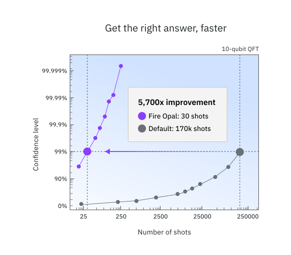
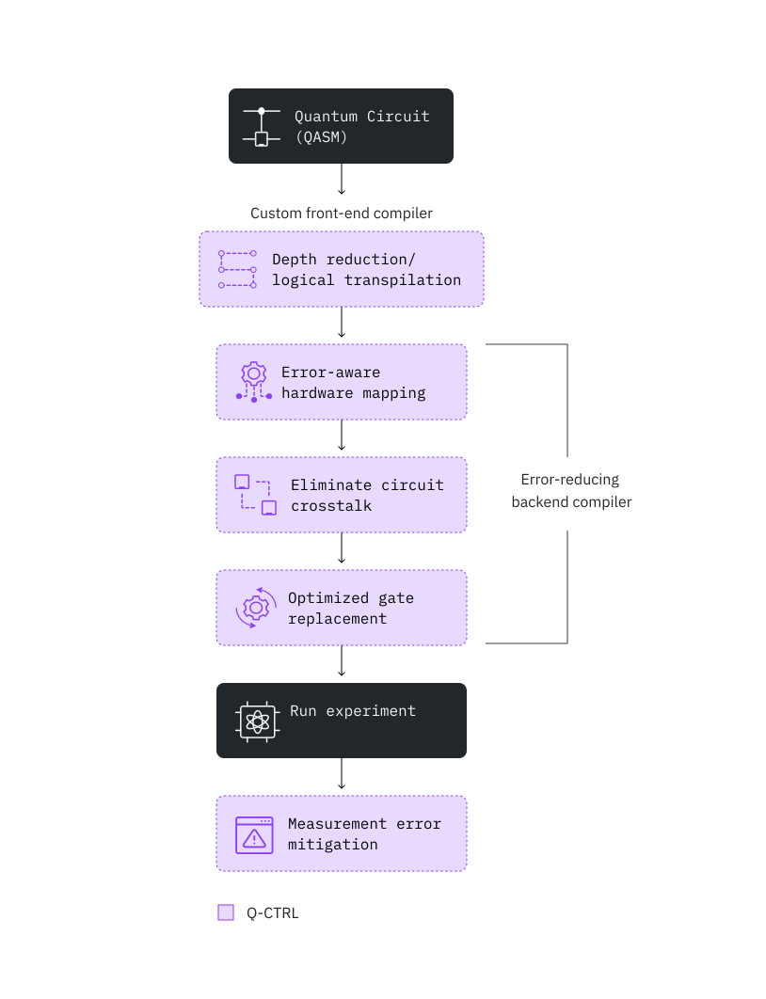

<OpenInLabBanner notebookPath="guides/q-ctrl-performance-management.ipynb" />


{/* cspell:ignore fontsize, Mundada, Yamauchi, supersymmetric, Paterakis, Gharibyan */}

*See the [API reference](https://docs.quantum.ibm.com/functions/q-ctrl-performance-management/api-reference)*

<Admonition type="note" title="Note">
   IBM Quantum&reg; Functions are a beta feature available only to IBM Quantum Premium Plan, Flex Plan, and On-Prem (through the IBM Quantum Platform API) Plan users. Beta features are subject to change.
</Admonition>
{/*
  DO NOT EDIT THIS CELL!!!
  This cell's content is generated automatically by a script. Anything you add
  here will be removed next time the notebook is run. To add new content, create
  a new cell before or after this one.
*/}

<Accordion>
<AccordionItem title="Package versions">

The code on this page was developed using the following requirements.
We recommend using these versions or newer.

```
qiskit[all]~=2.3.1
qiskit-ibm-runtime~=0.45.1
```
</AccordionItem>
</Accordion>
## Overview

Fire Opal Performance Management makes it simple for anyone to achieve meaningful results from quantum computers at scale without needing to be quantum hardware experts. When running circuits with Fire Opal Performance Management, AI-driven error suppression techniques are automatically applied, enabling the scaling of larger problems with more gates and qubits. This approach reduces the number of shots required to reach the correct answer, with no added overhead — resulting in significant savings in both compute time and cost.

Performance Management suppresses errors and increases the probability of getting the correct answer on noisy hardware. In other words, it increases the signal-to-noise ratio. The following image shows how increased accuracy enabled by Performance Management can reduce the need for additional shots in the case of a 10-qubit Quantum Fourier Transform algorithm. With only 30 shots, Q-CTRL reaches the 99% confidence threshold, whereas the default (`QiskitRuntime` Sampler, `optimization_level`=3 and `resilience_level`=1, `ibm_sherbrooke`) requires 170,000 shots. By getting the right answer faster, you save significant compute runtime.



The Performance Management function can be used with any algorithm, and you can easily use it in place of the standard [IBM Quantum primitives](/guides/qiskit-runtime-primitives). Behind the scenes, multiple error suppression techniques work together to prevent errors from happening at runtime. All Fire Opal pipeline methods are pre-configured and algorithm-agnostic, meaning you always get the best performance out of the box.

To get access to Performance Management, [contact Q-CTRL](https://form.typeform.com/to/uOAVDnGg?typeform-source=q-ctrl.com).
## Description

Fire Opal Performance Management has two options for execution that are similar to the IBM Quantum primitives, so you can easily swap in the Q-CTRL Sampler and Estimator. The general workflow for using the Performance Management function is:
1. Define your circuit (and operators in the case of the Estimator).
2. Run the circuit.
3. Retrieve the results.

To reduce hardware noise, Fire Opal employs a range of AI-driven error suppression techniques depicted in the following image. With Fire Opal, the entire pipeline is completely automated with zero need for configuration.

Fire Opal's pipeline eliminates the need for additional overhead, such as increased quantum runtime or extra physical qubits. Note that classical processing time remains a factor (refer to the [Benchmarks](#benchmarks) section for estimates, where "Total time" reflects both classical and quantum processing). In contrast to error mitigation, which requires overhead in the form of sampling, Fire Opal's error suppression works at both the gate and pulse levels to address various sources of noise and to prevent the likelihood of an error occurring. By preventing errors, the need for expensive post-processing is eliminated.

The following image depicts the error suppression methods automated by Fire Opal Performance Management.



The function offers two primitives, Sampler and Estimator, and the inputs and outputs of both extend the implemented spec for [IBM Quantum V2 primitives](/guides/primitive-input-output#pubs). To access results from previous runs, see [how to retrieve previous quantum function jobs](/guides/functions-get-started#list-previously-run-functions-jobs).
## Benchmarks

[Published algorithmic benchmarking](https://journals.aps.org/prapplied/abstract/10.1103/PhysRevApplied.20.024034) results demonstrate significant performance improvement across various algorithms, including Bernstein-Vazirani, quantum Fourier transform, Grover’s search, quantum approximate optimization algorithm, and variational quantum eigensolver. The rest of this section provides more details about types of algorithms you can run, as well as the expected performance and runtimes.

The following independent studies demonstrate how Q-CTRL's Performance Management enables algorithmic research at record-breaking scale:
- [Parametrized Energy-Efficient Quantum Kernels for Network Service Fault Diagnosis](https://arxiv.org/abs/2405.09724v1) - up to 50-qubit quantum kernel learning
- [Tensor-based quantum phase difference estimation for large-scale demonstration](https://arxiv.org/abs/2408.04946) - up to 33-qubit quantum phase estimation
- [Hierarchical Learning for Quantum ML: Novel Training Technique for Large-Scale Variational Quantum Circuits](https://arxiv.org/abs/2311.12929) - up to 21-qubit quantum data loading

The following table provides a rough guide on accuracy and runtimes from prior benchmarking runs on `ibm_fez`. Performance on other devices may vary. The usage time is based on an assumption of 10,000 shots per circuit. The "Number of qubits" indicated is not a hard limitation but represents rough thresholds where you can expect extremely consistent solution accuracy. Larger problem sizes have been successfully solved, and testing beyond these limits is encouraged.

| Example    | Number of qubits | Accuracy | Measure of accuracy | Total time (s) | Runtime usage (s) | Primitive (Mode) |
| ---------  | ---------------- | -------------------------- | -------- | ---------- | ------------- |------------- |
| Bernstein–Vazirani  |  50Q    | 100%  | Success Rate (Percentage of runs where the correct answer is the highest count bitstring)     | 10    | 8         | Sampler |
| Quantum Fourier Transform | 30Q              | 100% | Success Rate (Percentage of runs where the correct answer is the highest count bitstring)      | 10    | 8        | Sampler |
| Quantum Phase Estimation  | 30Q   | 99.9998%  | Accuracy of the angle found: `1- abs(real_angle - angle_found)/pi`  | 10  | 8  | Sampler |
| Quantum simulation: Ising model (15 steps) | 20Q  | 99.775%   |  $A$ (defined below)  |  60 (per step)  | 15 (per step)   | Estimator |
| Quantum simulation 2: molecular dynamics (20 time points) | 34Q  |  96.78%  |  $A_{mean}$ (defined below)   | 10 (per time point)    | 6 (per time point)  | Estimator |

Defining the accuracy of the measurement of an expectation value - the metric $A$ is defined as follows:
$$
A = 1 - \frac{|\epsilon^{ideal} - \epsilon^{meas}|}{\epsilon^{ideal}_{max} - \epsilon^{ideal}_{min}},
$$
where $ \epsilon^{ideal} $ = ideal expectation value,  $ \epsilon^{meas} $ = measured expectation value, $\epsilon^{ideal}_{max} $ = ideal maximum value, and $\epsilon^{ideal}_{min}$ = ideal minimum value. $A_{mean}$ is simply the average of the value of $A$ across multiple measurements.

This metric is used because it is invariant to global shifts and scaling in the range of attainable values. In other words, regardless of whether you shift the range of possible expectation values higher or lower or increase the spread, the value of $A$ should remain consistent.
## Get started

Fire Opal Performance Management uses Qiskit v`2.0.0`, which is the recommended version. Supported versions are Qiskit >=v`2.0.0`.
Authenticate using your [IBM Quantum Platform API key](http://quantum.cloud.ibm.com/), and select the quantum function as follows. (This snippet assumes you've already [saved your account](/guides/functions-get-started#install-qiskit-functions-catalog-client) to your local environment.)

```python
# Added by doQumentation — installs the packages this notebook needs if they are missing
import importlib.util

_needed = {"matplotlib": "matplotlib", "numpy": "numpy", "qiskit": "qiskit", "qiskit_ibm_catalog": "qiskit-ibm-catalog", "qiskit_ibm_runtime": "qiskit-ibm-runtime"}
_missing = [pip for module, pip in _needed.items()
            if importlib.util.find_spec(module) is None]
# One at a time, so a package that fails to install does not block the others
for _pip in _missing:
    %pip install -q {_pip}
if not _missing:
    print("\u2713 All required packages are installed")
```

```python
# This cell is hidden from users. It hides the "...You have imported samplomatic..." warning.
import warnings

warnings.filterwarnings("ignore", message=".*You have imported samplomatic*")
```

```python
from qiskit_ibm_catalog import FunctionsCatalog

catalog = FunctionsCatalog(channel="ibm_quantum_platform")
```

```python
# Access Function
perf_mgmt = catalog.load("q-ctrl/performance-management")
```

<Admonition type="note" title="Does this function support all IBM backends?">
If you want to use a backend that this function does not currently support, [reach out to Q-CTRL](https://form.typeform.com/to/iuujEAEI?typeform-source=q-ctrl.com) to add support.
</Admonition>
## Function sizes

Every job runs at one size: `S`, `M`, or `L`. If the size is too small, the job is rejected. If it is larger than needed, the job runs on a bigger compute profile than the work requires. See [Function sizes](/guides/managed-workflow-compute-profiles#best-practice-match-sizes-to-problem-sizes) for how sizes work in general.

Pass the size to `perf_mgmt.run()` with the `function_size` argument. The same sizing rules apply to both Sampler and Estimator.

For Performance Management, the size depends on the number of active physical qubits and the two-qubit gate depth after the circuit is mapped and routed to the selected backend. The sizing calculation uses mapping and routing equivalent to Qiskit's `optimization_level=0`.

Active qubits are the physical qubits used by circuit operations, excluding barriers. The two-qubit gate depth counts only two-qubit operations, also excluding barriers. Routing can increase both values, so the required size depends on the selected backend as well as the input circuit.

| Size | Active qubits | Two-qubit gate depth | Rule |
| --- | --- | --- | --- |
| `S` | ≤ 40 | ≤ 40 | Both metrics must satisfy the Small limits. |
| `M` | ≤ 100 | ≤ 100 | At least one metric exceeds its Small limit, but both remain within the Medium limits. |
| `L` | > 100 | > 100 | Either active qubits or two-qubit gate depth exceeds its Medium limit. |

If you submit multiple PUBs, select the largest size required by any circuit in the workload. For example, a mapped circuit with 30 active qubits and a two-qubit gate depth of 60 requires `"M"`.
### Calculate the size before submitting

Use the following helper to calculate the size for your PUB tuples. No job is submitted. It maps and routes each circuit to the selected backend with `optimization_level=0`, then checks the active qubits and two-qubit gate depth, excluding barriers. For multiple PUBs, it returns the largest required size.

```python
from qiskit import transpile

def calculate_function_size(pubs, backend):
    size = "S"

    for pub in pubs:
        mapped = transpile(
            pub[0],
            backend=backend,
            optimization_level=0,
            seed_transpiler=1234,
        )
        active_qubits = {
            q
            for inst in mapped.data
            if inst.operation.name != "barrier"
            for q in inst.qubits
        }
        two_qubit_depth = mapped.depth(
            lambda inst: len(inst.qubits) == 2
            and inst.operation.name != "barrier"
        )

        if len(active_qubits) > 100 or two_qubit_depth > 100:
            return "L"
        if len(active_qubits) > 40 or two_qubit_depth > 40:
            size = "M"

    return size
```

If the size is too small, the job fails with error `4600`, and the message names the size to use instead. If it is larger than needed, the job runs normally and records a `4601` advisory event. See [Function sizes](/guides/managed-workflow-compute-profiles#best-practice-match-sizes-to-problem-sizes) to learn more.
## Estimator primitive
### Estimator example

Use Fire Opal Performance Management's Estimator primitive to determine the expectation value of a single circuit-observable pair.
In addition to the `qiskit-ibm-catalog` and `qiskit` packages, you will also use the `numpy` package to run this example. You can install this package by uncommenting the following cell if you are running this example in a notebook using the IPython kernel.

```python
# %pip install numpy
```

**1. Create the circuit**

As an example, generate a random Hermitian operator and an observable to input to the Performance Management function.

```python
import numpy as np
from qiskit.circuit.library import iqp
from qiskit.quantum_info import random_hermitian, SparsePauliOp

n_qubits = 37

# Generate a random circuit
mat = np.real(random_hermitian(n_qubits, seed=1234))
circuit = iqp(mat)
circuit.measure_all()

# Define observables as a string
observable = SparsePauliOp("Z" * n_qubits)
```

```python
# Create PUB tuple
estimator_pubs = [(circuit, observable)]
```

**2. Run the circuit**

Calculate the function size for `estimator_pubs` on the selected backend, then pass the returned value to `perf_mgmt.run` through `function_size`. For the sizing rules, see [Function sizes](#function-sizes). You can also specify the number of shots.

```python
# This cell is hidden from users
from qiskit_ibm_runtime import QiskitRuntimeService

service = QiskitRuntimeService()
backend_name = service.least_busy().name
```

```python
backend = catalog.backend(backend_name)
estimator_size = calculate_function_size(estimator_pubs, backend)
print(f"Workload size: {estimator_size}")
```

```text
Workload size: M
```

```python
# Run the circuit using Estimator
qctrl_estimator_job = perf_mgmt.run(
    primitive="estimator",
    pubs=estimator_pubs,
    backend_name=backend_name,
    function_size=estimator_size,
)
```

Check your quantum function workload's status:

```python
qctrl_estimator_job.status()
```

```text
'DONE'
```

**3. Retrieve the result**

```python
# Retrieve the counts from the result list
result = qctrl_estimator_job.result()
```

The results have the same format as an [Estimator result](/guides/estimator-input-output):

```python
import numpy

result_str = str(result)

with numpy.printoptions(threshold=200):
    print(
        f"The result of the submitted job had {len(result)} PUB "
        f"and has a value:\n {result[0]}\n"
    )

print("The associated PubResult of this job has the following DataBins:")
print(f"{result[0].data}\n")

print(f"And this DataBin has attributes: {result[0].data.keys()}")

print("The expectation values measured from this PUB are:")
print(f"{result[0].data.evs}")
```

```text
The result of the submitted job had 1 PUB and has a value:
 PubResult(data=DataBin(evs=np.ndarray(<shape=(1,), dtype=float64>), stds=np.ndarray(<shape=(1,), dtype=float64>)), metadata={'precision': None})

The associated PubResult of this job has the following DataBins:
DataBin(evs=np.ndarray(<shape=(1,), dtype=float64>), stds=np.ndarray(<shape=(1,), dtype=float64>))

And this DataBin has attributes: dict_keys(['evs', 'stds'])
The expectation values measured from this PUB are:
[0.00252317]
```

## Sampler primitive
### Sampler example

Use Fire Opal Performance Management's Sampler primitive to run a Bernstein–Vazirani circuit. This algorithm, used to find a hidden string from the outputs of a black box function, is a common benchmarking algorithm because there is a single correct answer.
**1. Create the circuit**

Define the correct answer to the algorithm, the hidden bitstring, and the Bernstein–Vazirani circuit. You can adjust the width of the circuit by simply changing the `circuit_width`.

```python
import qiskit

circuit_width = 14
hidden_bitstring = "1" * circuit_width

# Create circuit, reserving one qubit for BV oracle
bv_circuit = qiskit.QuantumCircuit(circuit_width + 1, circuit_width)
bv_circuit.x(circuit_width)
bv_circuit.h(range(circuit_width + 1))
for input_qubit, bit in enumerate(reversed(hidden_bitstring)):
    if bit == "1":
        bv_circuit.cx(input_qubit, circuit_width)
bv_circuit.barrier()
bv_circuit.h(range(circuit_width + 1))
bv_circuit.barrier()
for input_qubit in range(circuit_width):
    bv_circuit.measure(input_qubit, input_qubit)

# Create PUB tuple
sampler_pubs = [(bv_circuit,)]
```

**2. Run the circuit**

Calculate the function size for `sampler_pubs` on the selected backend, then pass the returned value to `perf_mgmt.run` through `function_size`. You can also specify the number of shots.

```python
# Calculate the workload size for the selected backend
backend = catalog.backend(backend_name)
sampler_size = calculate_function_size(sampler_pubs, backend)
print(f"Workload size: {sampler_size}")
```

```text
Workload size: M
```

```python
# Run the circuit using Sampler
qctrl_sampler_job = perf_mgmt.run(
    primitive="sampler",
    pubs=sampler_pubs,
    backend_name=backend_name,
    function_size=sampler_size,
)
```

Check your quantum function workload's [status](/guides/functions-get-started#check-job-status) or return [results](/guides/functions-get-started#retrieve-results) as follows:

```python
# Print the ID so you can use it later, if necessary
print(qctrl_sampler_job.job_id)

qctrl_sampler_job.status()
```

```text
d35c9efc-1542-461d-ae19-5485cab3fd80
```

```text
'DONE'
```

**3. Retrieve the result**

```python
# Retrieve the job results
sampler_result = qctrl_sampler_job.result()
```

```python
# Get results for the first (and only) PUB
pub_result = sampler_result[0]
counts = pub_result.data.c.get_counts()

print("Counts for the meas output register (limited to 30 results):")
for i, (bitstring, count) in enumerate(counts.items()):
    if i >= 50:
        print(f"  ... ({len(counts) - 30} more items)")
        break
    print(f"  {bitstring}: {count}")
```

```text
Counts for the meas output register (limited to 30 results):
  11111111111111: 2715
  11111101111111: 134
  11111111110111: 102
  11111011111111: 73
  11111111111110: 66
  00000000000111: 60
  11111111111101: 59
  11111110111111: 50
  11110111111111: 48
  11111111101111: 47
  11111111011111: 34
  11011111111111: 30
  10111111111111: 27
  00111111111111: 24
  00011111111111: 23
  01111111111111: 22
  00000000010111: 20
  00000001110111: 19
  00000000000001: 18
  11111110011111: 18
  00000011111111: 16
  11101111111111: 15
  00000001111111: 14
  00001011111111: 11
  00000000111111: 11
  00001111111111: 10
  00000000000010: 9
  00000000001111: 9
  00000000000011: 8
  01011111111111: 8
  00000011110111: 8
  10011111111111: 7
  00000000011111: 7
  00000000000000: 7
  11111110000111: 6
  11111011110111: 5
  11111001111111: 5
  01111011111111: 5
  00000010000111: 5
  11111111010111: 4
  00000111111111: 4
  00111101111111: 4
  11111110010111: 4
  11010111111111: 4
  11111110110111: 4
  01111111111101: 3
  11110011111111: 3
  11111110101111: 3
  00000000000101: 3
  11111101110111: 3
  ... (195 more items)
```

**3. Plot the top bitstrings**

Plot the bitstring with the highest counts to see if the hidden bitstring was the mode.

```python
import matplotlib.pyplot as plt

def plot_top_bitstrings(counts_dict, hidden_bitstring=None):
    # Sort and take the top 100 bitstrings
    top_100 = sorted(counts_dict.items(), key=lambda x: x[1], reverse=True)[
        :100
    ]
    if not top_100:
        print("No bitstrings found in the input dictionary.")
        return

    # Unzip the bitstrings and their counts
    bitstrings, counts = zip(*top_100)

    # Assign colors: purple if the bitstring matches hidden_bitstring,
    # otherwise gray
    colors = [
        "#680CE9" if bit == hidden_bitstring else "gray" for bit in bitstrings
    ]

    # Create the bar plot
    plt.figure(figsize=(15, 8))
    plt.bar(
        range(len(bitstrings)), counts, tick_label=bitstrings, color=colors
    )

    # Rotate the bitstrings for better readability
    plt.xticks(rotation=90, fontsize=8)
    plt.xlabel("Bitstrings")
    plt.ylabel("Counts")
    plt.title("Top 100 Bitstrings by Counts")

    # Show the plot
    plt.tight_layout()
    plt.show()
```

The hidden bitstring is highlighted in purple, and it should be the bitstring with the highest number of counts.

```python
plot_top_bitstrings(counts, hidden_bitstring)
```


## Changelog

- 2026-02-20: Deprecation Notice - the `provider_job_ids` metadata field will be deprecated in 30 days in version 0.13.0. Users can access the job ID through `job_id()` method of the runtime service.
- 2026-02-11: We now have support for `ibm_miami`, and added execution metadata to the `PubResult`.
## Get support

For any questions or issues, [contact Q-CTRL](https://form.typeform.com/to/iuujEAEI).
## Next steps

<Admonition type="tip" title="Recommendations">

- Request access to [Q-CTRL Performance Management](https://quantum.cloud.ibm.com/functions?id=q-ctrl-performance-management).
- Visit the [API reference](https://docs.quantum.ibm.com/functions/q-ctrl-performance-management/api-reference) for this quantum function.
- Try the [Transverse-Field Ising Model with Q-CTRL's Performance Management](/tutorials/transverse-field-ising-model) tutorial.
- Try the [Quantum Phase Estimation with Q-CTRL's quantum functions](/tutorials/quantum-phase-estimation-qctrl) tutorial
- Review the [functions overview](/guides/functions), includes cost per execution.
- Learn about [managed workflows](/guides/managed-workflows).
- Learn how to choose [problem sizes and compute profiles](/guides/managed-workflow-compute-profiles).
- Understand [resource units (RUs)](/guides/plans-overview#rus).
- Review the [IBM Quantum Platform plans](/guides/plans-overview).
- Review [Mundada P. S., et al. (2023). Experimental Benchmarking of an Automated Deterministic Error-Suppression Workflow for Quantum Algorithms. Physical Review Applied, 20, 2](https://quantum-journal.org/papers/q-2023-07-25-1067/).
- Review [Kanno, S., et al. (2025). Tensor-based quantum phase difference estimation for large-scale demonstration. arXiv preprint arXiv:2408.04946](https://arxiv.org/abs/2408.04946).
- Review [SoftBank Corp, Demonstration Experiment of a Communication Service Fault Diagnosis System Using Quantum Machine Learning (blog), 30 August, 2024](https://www.softbank.jp/en/corp/technology/research/topics/102/).
- Review [Yamauchi, H., et al. (2024). Parametrized Energy-Efficient Quantum Kernels for Network Service Fault Diagnosis. arXiv preprint arXiv:2405.09724v1](https://arxiv.org/abs/2405.09724v1).
- Review [Yamauchi, H., et al. (2025). Quantum spectroscopy of topological dynamics via a supersymmetric Hamiltonian. arXiv preprint arXiv:2511.23169v1](https://arxiv.org/abs/2511.23169v1).
- Review [Wang, Y., et al. (2025).  Δ-Motif: Subgraph Isomorphism at Scale via Data-Centric Parallelism. arXiv preprint arXiv:2508.21287](https://arxiv.org/abs/2508.21287).
- Review [Paterakis, N. G., et al. (2025).  Quantum Computing in the Computational Landscape of Power Electronics: Vision and Reality. arXiv preprint arXiv:2507.02577](https://arxiv.org/abs/2507.02577).
- Review [Gharibyan, H., et al. (2023).  Hierarchical Learning for Quantum ML: Novel Training Technique for Large-Scale Variational Quantum Circuits. arXiv preprint arXiv:2311.12929](https://arxiv.org/abs/2311.12929).
- Review the [Mitsubishi Chemical Corp case study](https://q-ctrl.com/case-study/unlocking-new-performance-capability-in-quantum-chemistry).
- Review the [Redacted bank case study](https://q-ctrl.com/case-study/reducing-quantum-compute-costs-2-500x-with-fire-opal).
- Review the [BlueQubit case study](https://q-ctrl.com/case-study/enabling-data-loading-for-quantum-machine-learning-with-fire-opal).

</Admonition>