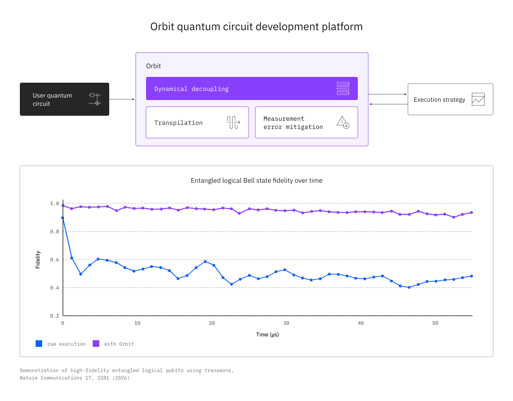

<OpenInLabBanner notebookPath="guides/quantum-elements-orbit.ipynb" />


{/* cspell:ignore QAOA, MEM, Bernstein, Vazirani, bitstring, bitstrings, transpiler, transpilation, decoupling, mid-circuit, QEC, Mitiq, M3, vCPU, alap */}
*See the [API reference](https://docs.quantum.ibm.com/functions/quantum-elements-orbit/api-reference)*

<Admonition type="note" title="Note">
IBM Quantum&reg; Functions are a beta feature available only to IBM Quantum Premium Plan, Flex Plan, and On-Prem (through the IBM Quantum Platform API) Plan users. Beta features are subject to change.
</Admonition>

## Overview

Quantum hardware continues to advance, but noise and decoherence still constrain the depth and reliability of practical quantum circuits. Among the available approaches, three complementary techniques can substantially mitigate these limitations: dynamical decoupling (DD), optimized transpilation, and measurement error mitigation (MEM). Optimized transpilation reduces circuit depth and better aligns circuits with the target hardware connectivity, DD suppresses idle-time noise through carefully designed control sequences, and MEM reduces the effects of readout errors and can be applied during post-processing.

Selecting an effective DD strategy is particularly nontrivial because numerous sequence families are available, and a sequence that performs well for one circuit or noise environment may not perform well for another. The benefits of transpilation, DD, and MEM depend on the problem, hardware, and workload; used individually or in combination, they can improve performance, but they are not universally beneficial in every configuration.

Orbit, a quantum function developed by Quantum Elements, seamlessly combines all three components into a unified workflow, making them easy to use for improving circuit execution on IBM Quantum hardware. In its primary form, Orbit automatically applies active error-suppression strategies that protect quantum states during idle periods, while preserving the original circuit logic. Notably, it does so without introducing any additional quantum or classical pre-processing time, thereby avoiding unnecessary additional costs or wait time within the workflow.

Rather than operating as a black box, Orbit allows users to evaluate and fine-tune its optimization components for a specific experiment. Users can independently enable or disable optimized transpilation, DD, and MEM; compare automated DD selection with user-specified sequences; and execute multiple configurations within the same workflow. By comparing each configuration with the raw circuit, users can determine which techniques provide measurable benefits for their circuit and backend, identify interactions among the different optimization methods, and select the configuration that best supports their experimental objective. This process guides users in understanding where performance gains originate and in making more informed decisions when optimizing quantum circuits for a given workload.
## Description

Orbit is designed to enhance the execution of quantum circuits on IBM Quantum backends. In automated mode, users can seamlessly apply high-order, robust DD sequences without needing to select or configure them manually. Advanced users can instead experiment with available higher-order sequences to identify and optimize the approach that delivers the best performance for a specific circuit.

Orbit also provides instantaneous MEM without requiring the additional jobs typically needed for separate calibration and mitigation workflows. For workloads in which transpilation should not alter the circuit structure, such as quantum error-correction circuits with mid-circuit measurements or dynamic circuits, Orbit can apply DD and MEM without interfering with the user's existing transpilation strategy. For users who do not already have a preferred approach, Orbit also includes a built-in transpiler to optimize circuits for the target hardware before applying error-suppression and readout-mitigation techniques.

Unlike approaches that rely on additional circuit sampling, extrapolation, or extensive classical post-processing, Orbit focuses on suppressing errors during execution. The function is designed to introduce low overhead while preserving the original circuit logic. Users can inspect the resulting circuit and directly compare Orbit-optimized executions with standard executions.

A practical Orbit workflow is:

1. Define a quantum circuit and select Orbit through the [Quantum Functions Catalog](https://quantum.cloud.ibm.com/functions).
2. Include the circuit without Orbit using the 'Raw' mode to establish a raw-circuit baseline.
3. Choose which optimization strategies to apply, including automated or user-selected DD sequences, MEM, and optimized transpilation.
4. Enable or disable individual methods, or submit multiple configurations, to evaluate their separate and combined effects.

Orbit is particularly useful for circuits containing idle periods or scheduling gaps where qubits are not actively participating in gates. It supports static and dynamic circuits, including workflows with mid-circuit measurements and fault-tolerant quantum-computing experiments. Typical applications include quantum error correction, surface-code experiments on square and heavy-hex lattices, oracular algorithms such as Bernstein-Vazirani, Fourier transform circuits, variational quantum algorithms, Hamiltonian simulation, benchmarking experiments, and hardware-aware circuit optimization.

Looking ahead to the era of fault tolerance, Orbit is also compatible with fault-tolerant quantum computing workflows, as it can seamlessly be combined with quantum error correction. In the long term, Orbit points toward logical-level dynamical decoupling [[1]](#references) as a future-facing path for protecting logical qubits. In the example below, two logical qubits were entangled to create a logical Bell state under quantum error detection. Quantum error detection alone led the Bell-state fidelity to decay to approximately 44% over tens of microseconds, while QED combined with Orbit-style protection kept the logical Bell-state fidelity near the top of the scale, reaching approximately 95.3% across the same time window.

## Benchmarks

The following results summarize representative Orbit runs on IBM Quantum hardware. As with other hardware benchmarks, results depend on the selected device, calibration state, circuit, and execution settings.

| Example                                            | Metric                                      | Qubits            | QPU                    | Additional details                                                            | Orbit Improvement          |
|----------------------------------------------------|---------------------------------------------|-------------------|------------------------|-------------------------------------------------------------------------------|----------------------------|
| Bernstein–Vazirani                                 | Hidden-bitstring fidelity                   | 26<br />60<br />70| Heron r3               | Raw versus Full Orbit,<br />Transpilation only versus Full Orbit,<br />Full Orbit Only| 75x<br />66x<br />N/A      |
| QFT (unitary)                                      | Fidelity                                    | 10                | Heron r2<br />Heron r3 | Orbit versus raw:<br /> ~44% versus ~35%<br /> ~67% versus ~61%                        | 1.26x<br />1.09x           |
| QFT (dynamic circuits)                             | Fidelity                                    | 10<br />20        | Heron r3               | Orbit versus raw:<br /> ~55% versus ~2%<br /> ~10% versus ~0%                          | 27.51x<br />N/A            |
| Long-range Bell state (dynamic circuits)           | Fidelity                                    | 30<br />60        | Heron r2               | N/A                                                                           | 1.78x<br />1.11x           |
| Surface code<br />(square lattice)                 | Logical error probability                   | 25                | Nighthawk r1           | 1 round<br /> 5 rounds<br /> 10 rounds                                        | 1.01x<br />1.15x<br />1.12x|
| Surface code<br />(heavy-hex)                      | Logical error probability                   | 65                | Heron r3               | 1 round<br /> 5 rounds<br /> 10 rounds                                        | 4.11x<br />2.04x<br />1.39x|
| VQE                                                | Absolute error relative to the ideal energy | 8                 | Heron r3               | Orbit versus raw:<br /> 56mHa versus 1342 mHa                                       | 24x                        |
| QAOA                                               | Success probability                         | 5                 | Heron r2               | N/A                                                                           | 1.46x                      |
| `[[4,2,2]]` code (logical-level error suppression) | Entangled Bell-state logical fidelity       | 4                 | Heron r2               | Average fidelity over 55 μs                                                   | 1.63x                      |

### Metric definitions

- **Bernstein–Vazirani hidden-bitstring fidelity:** Probability of measuring the correct hidden bitstring. This metric indicates how reliably the algorithm recovers the intended solution as the circuit size increases. The table reports the three largest hidden bitstrings successfully evaluated under three different configurations: (i), raw circuits without Orbit, which reached 26 qubits; (ii), circuits with transpilation only, which reached 60 qubits; and  (iii), circuits using the full Orbit workflow, which reached 70 qubits. For the raw circuits (i), the improvement factor represents the performance gain achieved by DD and MEM relative to the unmodified circuits. For the transpilation-only configuration (ii), it represents the improvement achieved by adding DD and MEM to the optimally transpiled circuits. For the full Orbit configuration (iii), no baseline improvement factor is reported because a nonzero success probability was obtained only when all Orbit components (transpilation, DD, and MEM) were enabled. An illustrative example is provided below.

- **Quantum Fourier transform fidelity:** For both the unitary and dynamic-circuit QFT implementations [[2]](#references), fidelity measures the agreement between the experimentally implemented transformation and the ideal QFT process over 20 different input states. Dynamic circuits contain substantial idle time due to mid-circuit measurements and classical feedforward, during which dynamical decoupling can suppress decoherence. The reported improvement compares the fidelity obtained with Orbit to the raw fidelity.

- **Long-range Bell-state preparation:** Creating a Bell state using dynamic circuits and feedforward operations between two qubits separated by as many as 60 intermediate qubits, thereby demonstrating efficient long-range entanglement on locally connected quantum hardware [[3]](#references). Orbit identifies the best qubit routing, preserves the qubits during feedforward measurements, and applies MEM to mitigate readout errors.

- **Surface-code logical error probability:** For the heavy-hex surface code [[4]](#references) and square-lattice surface code [[5]](#references), quantum-memory experiments were performed in which an encoded logical state was preserved over repeated rounds of error correction. Logical error probability measures the probability that accumulated errors cause the encoded information to be recovered incorrectly (lower error is better). The reported improvement compares the logical error probability from raw circuits to that obtained with Orbit.

- **VQE absolute error:** Using VQE with an optimized unitary coupled-cluster ansatz to estimate the ground-state energy of LiH [[6]](#references). The measured energy is compared with the corresponding ideal energy obtained from the noiseless circuit. The metric is the absolute difference between the measured and ideal energies (lower values are better). The reported improvement is:

$$
\text{Improvement factor}
=
\frac{|E_{\mathrm{raw}}-E_{\mathrm{ideal}}|}
{|E_{\mathrm{Orbit}}-E_{\mathrm{ideal}}|}.
$$

Values greater than one indicate that Orbit reduces the energy error relative to execution without dynamical decoupling.

- **QAOA success probability:** Probability of measuring a bitstring corresponding to an optimal solution of the optimization problem defined on the butterfly graph. The reported improvement compares the success probability obtained with Orbit against that obtained from the raw circuits.

- **Logical fidelity:** In the [[4,2,2]] logical dynamical-decoupling experiment [1], two logical qubits were encoded into four physical qubits and prepared as an entangled logical Bell state. Logical fidelity measures the agreement between the recovered encoded state and the target logical Bell state. The reported improvement compares the average logical fidelity obtained with Orbit and error detection (code's capability) to that obtained when only using the code alone.
## Get started

Authenticate using your [IBM Quantum Platform API key](http://quantum.cloud.ibm.com/), and select the Orbit function as follows. This snippet assumes you've already [saved your account](/guides/functions-get-started#install-qiskit-functions-catalog-client) to your local environment.

```python
# Added by doQumentation — installs the packages this notebook needs if they are missing
import importlib.util

_needed = {"matplotlib": "matplotlib", "qiskit": "qiskit", "qiskit_ibm_catalog": "qiskit-ibm-catalog", "qiskit_ibm_runtime": "qiskit-ibm-runtime"}
_missing = [pip for module, pip in _needed.items()
            if importlib.util.find_spec(module) is None]
# One at a time, so a package that fails to install does not block the others
for _pip in _missing:
    %pip install -q {_pip}
if not _missing:
    print("\u2713 All required packages are installed")
```

```python
from qiskit_ibm_catalog import FunctionsCatalog
from qiskit import QuantumCircuit

catalog = FunctionsCatalog(channel="ibm_quantum_platform")
# Verify that you have access to the function.
catalog.list()
```

```text
[QiskitFunction(quantum-elements/orbit-dev),
 QiskitFunction(quantum-elements/orbit)]
```

```python
# Load the function.
orbit = catalog.load("quantum-elements/orbit")
print("Orbit version:", orbit.version)
```

```text
Orbit version: 0.3.23
```

## Function sizes

Every job runs at one size — `S`, `M`, or `L`. If the specified size is too small, the job is rejected. If it is  larger
than needed, it runs on a bigger compute profile than the work requires. See [Function sizes](/guides/managed-workflow-compute-profiles#best-practice-match-sizes-to-problem-sizes) for how sizes work in general.

The size comes from your circuit **after it is mapped onto the backend you target**:
the number of qubits that carry an operation, and the two-qubit-gate depth. Mapping
can add both, so a circuit is sized as it will run, not as you wrote it.

| Size | Smallest size for active qubits and two-qubit-gate depth | Compute profile | vCPU | RAM |
|---|---|---|---|---|
| `S` | both at most 40 | `8x32` | 8 | 32 GB |
| `M` | both at most 100 | `16x128` | 16 | 128 GB |
| `L` | either above 100 | `48x768` | 48 | 768 GB |

A circuit must fit **both** bounds of a size, so 30 qubits at a two-qubit-gate depth of
120 is `L`, not `S`. These are the same bounds for every circuit function, so a size
means the same difficulty of circuit whichever one you call.

The default is `M`, used when a job does not request a size.

Users can also read the mapping off the function itself with `function.sizes_map`, and
the size used when a job does not ask for one with `function.default_size`.

Orbit checks the size against the backend the job runs on. If you omit `backend_name`,
Orbit picks the least busy backend, so pass `backend_name` explicitly when you size a job
in advance.

Each circuit is measured twice: as you submit it, and as a copy with its delays removed,
laid out with Sabre and routed. The job is checked against the smaller of the two sizes.
So a circuit you have already scheduled (for example with `scheduling_method="alap"`),
which carries a delay on every idle qubit of the device, is sized by the qubits it uses
rather than by the width of the device, and a chain of qubits is not sized by SWAPs that a
better layout avoids. The calculator below runs the same calculation as Orbit, so it
returns the size your job is checked against.
### Calculate the size before submitting

Run this on your own circuits. It reads them and does nothing else; no job is submitted
and nothing is reserved, so you can call it as often as you like while you tune a
circuit down to a smaller size.

It needs the backend as well as the circuits, because the size depends on the
coupling map they are mapped onto. It requires only Qiskit.

```python
# Calculate the function size a circuit needs, before submitting it.
#
# Call ``calculate_function_size(pubs, backend)``: it returns "S", "M" or "L" and submits
# nothing. Pass the whole list of PUBs. A job runs at one size, and the heaviest PUB
# determines the size. The circuit is measured after being mapped onto the ``backend``, since mapping
# can add both qubits and depth.
#
# This is the calculation Orbit runs on every job. Each circuit is measured twice, as given
# and as a copy with its delays removed, laid out with Sabre and routed, and is sized as
# the smaller of the two. The copy keeps a scheduled circuit from being sized by the idle
# qubits its delays cover, and a chain from picking up SWAPs a better layout avoids.

from collections.abc import Iterable
from typing import Any, Literal

from qiskit.circuit import Barrier, Delay
from qiskit.circuit.equivalence_library import SessionEquivalenceLibrary
from qiskit.transpiler import PassManager, generate_preset_pass_manager
from qiskit.transpiler.passes import (
    ApplyLayout,
    BarrierBeforeFinalMeasurements,
    BasisTranslator,
    EnlargeWithAncilla,
    FilterOpNodes,
    FullAncillaAllocation,
    HighLevelSynthesis,
    SabreSwap,
    TrivialLayout,
    UnitarySynthesis,
)

Size = Literal["S", "M", "L"]
_ORDER = {"S": 0, "M": 1, "L": 2}

# Limits are provided by IBM
_SMALL_QUBITS, _SMALL_DEPTH_2Q = 40, 40
_MEDIUM_QUBITS, _MEDIUM_DEPTH_2Q = 100, 100

# Any fixed value works; what matters is that it does not change between calls.
_SEED_TRANSPILER = 42

# Added by BarrierBeforeFinalMeasurements so routing cannot move gates past a measurement,
# then removed again once routing is done.
_PROTECTION_BARRIER = "qiskit.transpiler.internal.routing.protection.barrier"

def calculate_function_size(
    circuit: QuantumCircuit | Iterable[Any], backend, **kwargs: Any
) -> Size:
    """Return the size ("S", "M" or "L") required to run the function."""
    circuits = pub_circuits(circuit)
    if not circuits:
        raise ValueError(
            "No circuit to size: pass a QuantumCircuit or a non-empty list of PUBs."
        )
    prepare = generate_preset_pass_manager(
        optimization_level=0,
        target=backend.target,
        layout_method="sabre",
        seed_transpiler=_SEED_TRANSPILER,
    )
    return max(
        (_smaller_size(qc, backend, prepare, **kwargs) for qc in circuits),
        key=_ORDER.__getitem__,
    )

def _smaller_size(
    circuit: QuantumCircuit, backend, prepare: PassManager, **kwargs: Any
) -> Size:
    """Return the smaller size of ``circuit`` and of its copy without delays, laid out with Sabre.

    Level 0 runs no optimization stage, so the copy keeps every gate of the circuit.
    """
    size = _calculate_circuit_size(circuit, backend, **kwargs)
    if size == "S":
        return size
    prepared = prepare.run(without_delays(circuit))
    return min(
        size,
        _calculate_circuit_size(prepared, backend, **kwargs),
        key=_ORDER.__getitem__,
    )

def without_delays(circuit: QuantumCircuit) -> QuantumCircuit:
    """Return a copy of ``circuit`` with every top-level ``delay`` removed."""
    stripped = circuit.copy_empty_like()
    for instruction in circuit.data:
        if not isinstance(instruction.operation, Delay):
            stripped.append(instruction)
    return stripped

def _calculate_circuit_size(
    circuit: QuantumCircuit, backend, **kwargs: Any
) -> Size:
    """Return the size required to run a single circuit."""
    metrics = _measure(circuit, backend, **kwargs)
    if _is_small(metrics):
        return "S"
    if _is_medium(metrics):
        return "M"
    return "L"

def pub_circuits(problem: Any) -> list[QuantumCircuit]:
    """Return the circuits in ``problem``: one circuit, or one per PUB in a list."""
    if isinstance(problem, QuantumCircuit):
        return [problem]
    circuits: list[QuantumCircuit] = []
    for index, pub in enumerate(problem):
        if isinstance(pub, QuantumCircuit):
            circuit = pub
        elif isinstance(getattr(pub, "circuit", None), QuantumCircuit):
            circuit = pub.circuit
        elif (
            isinstance(pub, (tuple, list))
            and pub
            and isinstance(pub[0], QuantumCircuit)
        ):
            circuit = pub[0]
        else:
            raise ValueError(f"PUB #{index} has no QuantumCircuit to size.")
        circuits.append(circuit)
    return circuits

def _pass_manager(target) -> PassManager:
    """Return the pass manager used to map a circuit onto ``target``.

    Fixed and seeded, so the same circuit always gives the same size.
    """
    basis = list(target.operation_names)
    library = SessionEquivalenceLibrary
    return PassManager(
        [
            UnitarySynthesis(
                basis, approximation_degree=1.0, min_qubits=3, target=target
            ),
            HighLevelSynthesis(
                target=target,
                equivalence_library=library,
                basis_gates=basis,
                min_qubits=3,
            ),
            BasisTranslator(library, basis, target=target, min_qubits=3),
            TrivialLayout(target),
            FullAncillaAllocation(target),
            EnlargeWithAncilla(),
            ApplyLayout(),
            BarrierBeforeFinalMeasurements(label=_PROTECTION_BARRIER),
            SabreSwap(
                target, heuristic="basic", seed=_SEED_TRANSPILER, trials=5
            ),
            FilterOpNodes(lambda node: node.label != _PROTECTION_BARRIER),
            UnitarySynthesis(basis, approximation_degree=1.0, target=target),
            HighLevelSynthesis(
                target=target,
                equivalence_library=library,
                basis_gates=basis,
                use_qubit_indices=True,
            ),
            BasisTranslator(library, basis, target=target),
        ]
    )

def _count(isa: QuantumCircuit) -> dict:
    """Return the active qubits and two-qubit-gate depth of a mapped circuit."""
    active = {
        q
        for instr in isa.data
        if not isinstance(instr.operation, Barrier)
        for q in instr.qubits
    }
    return {
        "num_qubits": len(active),
        "depth_2q": isa.depth(
            filter_function=lambda instr: len(instr.qubits) == 2
            and not isinstance(instr.operation, Barrier)
        ),
    }

def _measure(circuit: QuantumCircuit, backend, **kwargs: Any) -> dict:
    """Map ``circuit`` onto ``backend`` and return its metrics."""
    return _count(_pass_manager(backend.target).run(circuit))

def _is_small(metrics: dict) -> bool:
    """Determine if the metrics fit T-size 'S'."""
    return (
        metrics["num_qubits"] <= _SMALL_QUBITS
        and metrics["depth_2q"] <= _SMALL_DEPTH_2Q
    )

def _is_medium(metrics: dict) -> bool:
    """Determine if the metrics fit T-size 'M'."""
    return (
        metrics["num_qubits"] <= _MEDIUM_QUBITS
        and metrics["depth_2q"] <= _MEDIUM_DEPTH_2Q
    )
```

Pass the **whole** list of PUBs, not one at a time. A job runs at a single size, so
the heaviest PUB determines the size. One deep circuit among many shallow ones makes the
whole job `L`. Split the batch into separate jobs to keep the cheap ones
cheap. The [example](#example) below calculates the size of its PUBs and passes it to
`orbit.run` as `function_size`.
If the size is too small the job fails with error `4600` and the message names the
size to use instead. If it is larger than needed, the job runs normally and records a
`4601` advisory event. See [Function sizes](/guides/managed-workflow-compute-profiles#best-practice-match-sizes-to-problem-sizes) to learn more.
## Example

The following example builds a Bernstein-Vazirani circuit and submits it to Orbit two ways in one job: raw execution and Orbit defaults.

Use this pattern when you want a direct raw-versus-Orbit comparison.
### Scaling Bernstein-Vazirani to larger sizes

Orbit can help preserve Bernstein-Vazirani success probability as the hidden-bitstring width grows. The representative scaling runs below compare raw execution with Orbit configurations on IBM Quantum hardware. On `ibm_miami`, raw success probability falls below 10% by a hidden-bitstring width of 9 (10 total qubits), while Orbit remains near 80–90%. On `ibm_kingston`, Orbit maintains non-trivial success probability at widths approaching 60, including approximately 15% at the largest size shown. Exact results depend on the backend calibration, circuit, and execution settings.


To preserve QPU time, this tutorial does not rerun a size sweep. Instead, the executable example below reports shot counts for one fixed hidden-bitstring width, `N = 50` (51 total qubits in this circuit), comparing raw execution with Orbit defaults in a single job.
### Build a Bernstein-Vazirani circuit

Choose the hidden bitstring and construct the logical circuit. The extra qubit is the oracle target, while the input qubits are measured.

```python
def create_bv_circuit(hidden_bitstring: str) -> QuantumCircuit:
    width = len(hidden_bitstring)
    circuit = QuantumCircuit(width + 1, width)

    circuit.x(width)
    circuit.h(range(width + 1))

    for input_qubit, bit in enumerate(reversed(hidden_bitstring)):
        if bit == "1":
            circuit.cx(input_qubit, width)

    circuit.barrier()
    circuit.h(range(width + 1))
    circuit.measure(range(width), range(width))
    return circuit

circuit_width = 50
hidden_bitstring = "1" * circuit_width
shots = 4096

bv_circuit = create_bv_circuit(hidden_bitstring)
bv_circuit.count_ops()
```

```text
OrderedDict([('h', 102),
             ('cx', 50),
             ('measure', 50),
             ('x', 1),
             ('barrier', 1)])
```

### Prepare the Orbit workload

Create one Sampler PUB, then duplicate it for the two comparison modes. Orbit receives the logical circuit and maps it to the selected backend during execution.

```python
base_pub = (bv_circuit, None, shots)
comparison_labels = ["raw", "orbit"]
pubs = [base_pub] * len(comparison_labels)
```

### Calculate the function size

Calculate the size of the PUBs on the backend you run on. The 50-qubit circuit needs
routing on the heavy-hex coupling map, which takes its two-qubit gate depth above 100,
so this job needs `L`.

```python
from qiskit_ibm_runtime import QiskitRuntimeService

backend_name = "ibm_kingston"
backend = QiskitRuntimeService().backend(backend_name)

size = calculate_function_size(pubs, backend)  # "S", "M" or "L"
print(size)
```

```text
L
```

### Run raw and Orbit defaults

`pub_options` assigns the first PUB to raw mode, which skips Orbit optimization, DD, and MEM, and assigns the second PUB to Orbit defaults, which include optimized transpilation, automated dynamical decoupling (DD) insertion, and measurement error mitigation (MEM).

The job runs at the size calculated above. Without `function_size`, it would run at `M`, which is too small for these PUBs, so it would fail with error `4600`.

```python
job = orbit.run(
    primitive="sampler",
    pubs=pubs,
    backend_name=backend_name,
    function_size=size,
    options={
        "pub_options": [
            {"mode": "raw"},
            {"mode": "orbit"},
        ],
        "save_backend_info": True,
    },
)

# Check the job ID and status
print(job.job_id)
print(job.status())
```

```text
2c427a80-4190-404c-b98a-6bbeb53fafcd
QUEUED
```

Retrieve the result and compare the raw and Orbit-enhanced circuits using counts. For Sampler results, `get_counts()` on the returned classical register provides the output histogram. When MEM succeeds for the Orbit PUB, this histogram is already MEM-corrected; the unmitigated counts remain available in the Orbit metadata under `measurementErrorMitigation["rawCounts"]`.

```python
def extract_counts(pub_result) -> dict[str, int]:
    data = getattr(pub_result, "data", None)
    if data is None:
        raise TypeError("pub_result.data is missing")

    for name in dir(data):
        if name.startswith("_"):
            continue
        register = getattr(data, name)
        get_counts = getattr(register, "get_counts", None)
        if callable(get_counts):
            counts = get_counts()
            if counts:
                return counts

    raise TypeError(
        "No classical register with get_counts() found in pub_result.data"
    )

result = job.result()
if len(result) != len(comparison_labels):
    raise RuntimeError(
        f"Expected {len(comparison_labels)} PUB results, received {len(result)}."
    )

comparison_counts = {
    label: extract_counts(pub_result)
    for label, pub_result in zip(comparison_labels, result, strict=True)
}
correct_counts = {
    label: counts.get(hidden_bitstring, 0)
    for label, counts in comparison_counts.items()
}

print(
    {
        "hidden_bitstring": hidden_bitstring,
        "correct_counts": correct_counts,
        "shots": shots,
    }
)
```

```text
{'hidden_bitstring': '11111111111111111111111111111111111111111111111111', 'correct_counts': {'raw': 0, 'orbit': 370}, 'shots': 4096}
```

Make a visual comparison of the raw and Orbit-enhanced circuits.

```python
import matplotlib.pyplot as plt

labels = list(correct_counts)
values = list(correct_counts.values())
fig, ax = plt.subplots(figsize=(7, 4))
bars = ax.bar(labels, values, width=0.55)
ax.bar_label(bars, labels=[f"{value:g}" for value in values], padding=3)
ax.set_xlabel("Circuit execution mode")
ax.set_ylabel("Correct hidden-bitstring count")
ax.set_title(f"{circuit_width}-qubit Bernstein-Vazirani on {backend_name}")
ax.set_ylim(0, max(1, 1.15 * max(values)))
ax.grid(axis="y", alpha=0.25)
fig.tight_layout()
plt.show()
```


## Get support

Reach out to Quantum Elements support: [info@quantumelements.ai](mailto:info@quantumelements.ai)

Be sure to include the following information:

- Quantum Function Job ID (`qiskit-ibm-catalog`), `job.job_id`
- Backend name
- Orbit `pub_options` used for the raw and Orbit modes
- A detailed description of the issue
- Any relevant error messages or codes
- Steps to reproduce the issue
## Next steps

<Admonition type="tip" title="Recommendations">

- Try a different backend, qubit number, or another hidden bitstring.
- Try the [quantum Fourier transform tutorial](/tutorials/quantum-elements-orbit-qft-with-dynamic-circuits) to learn how to define orbit-enabled custom DD strategies and apply DD to dynamic circuits with mid-circuit measurements and feedforward operations.
- Visit the [API reference](https://docs.quantum.ibm.com/functions/quantum-elements-orbit/api-reference) for a detailed description of all Orbit options.
- Review the [functions overview](/guides/functions), includes cost per execution.
- Learn about [managed workflows](/guides/managed-workflows).
- Learn how to choose [problem sizes and compute profiles](/guides/managed-workflow-compute-profiles).
- Understand [resource units (RUs)](/guides/plans-overview#rus).
- Review the [IBM Quantum Platform plans](/guides/plans-overview).

</Admonition>
<a name="references"></a>
## References

1. [Logical-level error suppression combined with Quantum Error Detection, *Nature Communications* (2026)](https://www.nature.com/articles/s41467-026-70011-3)
2. [Quantum Fourier Transform Using Dynamic Circuits, *Physical Review Letters* (2024)](https://journals.aps.org/prl/abstract/10.1103/PhysRevLett.133.150602)
3. [Efficient Long-Range Entanglement Using Dynamic Circuits, *PRX Quantum* (2024)](https://journals.aps.org/prxquantum/abstract/10.1103/PRXQuantum.5.030339)
4. [Surface code scaling experiments on IBM&reg; Heron with heavy-hex connectivity, arXiv:2510.18847](https://arxiv.org/abs/2510.18847)
5. [Surface code experiments on IBM Nighthawk with square-lattice connectivity, arXiv:2606.11496](https://arxiv.org/abs/2606.11496)
6. [VQE benchmark reference, *Nature Physics* (2024)](https://www.nature.com/articles/s41567-024-02530-z)