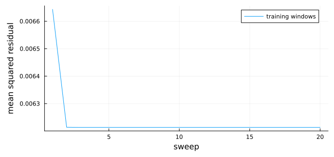
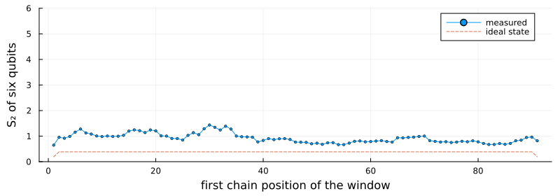
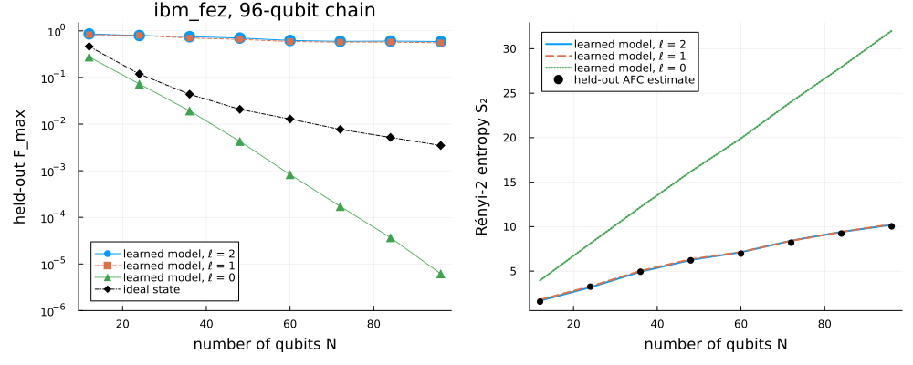

import TutorialFeedback from '@site/src/components/TutorialFeedback';

<OpenInLabBanner notebookPath="tutorials/classical-shadows.ipynb" />


{/* cspell:ignore Votto Ljubotina Lancien Cirac Zoller Serbyn Piroli Vermersch Elben Kueng Preskill Flammia Sundar Branciard Rath Brisbane Rényi siteinds npzread npzwrite mktempdir juliaup println hline yerror xlabel ylabel yscale ylims jackknife depolarizing depolarization kron eigvals DMRG maxbond permutedims hcat topright utriangle bottomleft topleft markerstrokecolor markerstrokewidth dashdot sigdigits Zenodo */}

*Usage estimate: 34 minutes on a Heron r2 processor (NOTE: This is an estimate only. Your runtime might vary.)*

## Learning outcomes

- Collect randomized measurements on an IBM&reg; quantum processor from Julia and save them for later analysis
- Check the measurement data for faulty qubits and gates before learning
- Fit a matrix product operator (MPO) model of a noisy state to classical shadows
- Validate the model on held-out measurements and compare it with the ideal circuit
## Prerequisites

- Classical shadows, as introduced in the [Shadow tomography of the Greenberger-Horne-Zeilinger (GHZ) state](/tutorials/shadow-tomography) tutorial
- Density matrices and mixed states, covered in [Basics of quantum information](/learning/courses/basics-of-quantum-information)
- Running circuits from Julia with `Qiskit.jl` and `QiskitIBMRuntime.jl`, introduced in the [Simulate time evolution of the transverse-field Ising model](/tutorials/time-evolution) tutorial
## Background

On a real quantum processor, noise turns the pure state $|\psi\rangle$ that a circuit is designed to prepare into a mixed state $\rho$. Full quantum state tomography can reconstruct $\rho$, but the number of measurements it needs grows exponentially with the number of qubits. Votto et al. [\[1\]](#references) instead learned a compact model of $\rho$ for up to 96 qubits from randomized measurements. This tutorial follows their workflow.

In a randomized measurement [\[2\]](#references), every qubit $i$ is rotated by an independent random unitary $u_i$ and then measured in the computational basis. One draw of the rotations is called a *measurement setting*, and each setting is repeated for $N_M$ shots. A shot with outcome bits $s_i$ gives the *classical shadow* [\[3\]](#references)

$$
\hat\rho=\bigotimes_{i=1}^{N}\left(3\,u_i^\dagger|s_i\rangle\langle s_i|u_i-\mathbb{1}\right),
$$

whose average over settings and shots is $\rho$. The prerequisite tutorial draws each $u_i$ from the three Pauli bases; this tutorial, like the paper, draws them uniformly from all single-qubit unitaries (Haar random), and the same formula applies.

Shadows estimate properties of a few qubits at a time. The paper combines them into a *matrix product operator* (MPO), which writes the density matrix as a chain of small tensors, one per qubit; noisy states with short-range correlations need only small bonds between neighboring tensors. Like the density matrix renormalization group (DMRG) algorithm, the learner sweeps along the chain and updates one tensor at a time, so that the model matches the shadows on the window of $2\ell+1$ qubits centered on that tensor (Equation 4 of the paper). The bond dimension stays fixed during these updates, so the learner never truncates the model. Because data enter only through these windows, the number of settings needed does not grow with the length of the chain.

The settings are split into a training set and a testing set. On the testing set, the paper estimates the max fidelity between $\rho$ and the model $\sigma$,

$$
\mathcal{F}_{\max}(\rho,\sigma)=\frac{\mathrm{tr}(\rho\sigma)}{\max\left(\mathrm{tr}\,\rho^2,\ \mathrm{tr}\,\sigma^2\right)}.
$$

Measuring $\mathrm{tr}(\rho\sigma)$ directly would take exponentially many measurements. Instead, the paper assumes the *approximate factorization condition* (AFC): correlations in $\rho$ decay within a few qubits, so global overlaps and purities factor into terms on blocks of $k$ neighboring qubits. The purity also gives the Rényi-2 entropy $S_2=-\log_2\mathrm{tr}\,\rho^2$, which measures how mixed the state is.

The paper prepares the depth-$D$ kicked-Ising state

$$
|\psi\rangle=\left(\prod_{j} e^{i\frac{\pi}{4}Z_jZ_{j+1}}\prod_j e^{-i\frac{\pi}{8}X_j}\right)^{D}|0\rangle^{\otimes N}
$$

on 96 qubits of `ibm_brisbane`, an Eagle processor, with 2,048 settings of 1,024 shots for $D=1$. Figure 1(c,d) of the paper reports two results for $D=1$:

- The learned model reaches $\mathcal{F}_{\max}\approx 75\%$ with the experimental state at $N=96$, far above the overlap of the ideal state $|\psi\rangle$ with the experiment.
- The entropy grows linearly, $S_2\approx(0.14\text{ to }0.15)\,N$, and the entropy of the model agrees with an independent estimate from the testing set.

This tutorial checks both results, first in an eight-qubit simulation where the exact answers are known, and then in a new 96-qubit run on `ibm_fez`, a Heron r2 processor. The learner is an independent Julia implementation of the equations in the paper and its supplement.
## Requirements

This tutorial requires macOS or Linux, because `Qiskit.jl` does not support Windows yet ([Qiskit.jl issue #15](https://github.com/Qiskit/Qiskit.jl/issues/15)). You also need the following:

- Julia 1.11, from the [Julia download page](https://julialang.org/downloads/) or with `juliaup add 1.11`, and the `IJulia` package:
  ```
  julia -e 'using Pkg; Pkg.add("IJulia")'
  ```
- For the hardware example, an [IBM Quantum&reg; Platform account](https://quantum.cloud.ibm.com/) with access to a QPU that has at least 96 qubits, and [saved credentials](/guides/save-credentials). Without an account, you can run the hardware example from the saved measurements of the `ibm_fez` run that produced the results in this tutorial. The other sections run without an account.

The notebook uses [`Qiskit.jl`](https://github.com/Qiskit/Qiskit.jl) and [`QiskitIBMRuntime.jl`](https://github.com/Qiskit/QiskitIBMRuntime.jl) to build and run circuits, [`RandomMeas.jl`](https://github.com/bvermersch/RandomMeas.jl) [\[4\]](#references) for randomized measurements (it also provides `ITensors.jl` and `ITensorMPS.jl`), and `NPZ.jl`, `JSON.jl`, and `Plots.jl`. This tutorial is tested with `Qiskit.jl` 0.6.1, `QiskitIBMRuntime.jl` 0.3.2, and `RandomMeas.jl` 0.3.1.

There are two ways to set up the environment:

- *Option 1*: Install the latest compatible versions of the packages into a temporary environment. Run the following cell without changes.
- *Option 2*: Reproduce the tested environment exactly. Set `download_toml_files = true` in the following cell. The cell downloads `Project.toml` and `Manifest.toml` from the [documentation repository](https://github.com/Qiskit/documentation/tree/main/docs/tutorials/assets/classical-shadows/julia) into an `env_tutorial/classical-shadows/` folder next to this notebook, then installs the exact version of every package that the manifest records, including indirect dependencies. For details, see the [Julia documentation on these files](https://pkgdocs.julialang.org/v1/toml-files/).

```julia
using Pkg
using Downloads

download_toml_files = false

if !download_toml_files
    # Option 1: Install the latest compatible versions into a temporary environment
    Pkg.activate(mktempdir(); io=devnull)
    Pkg.add([
        PackageSpec(name="Qiskit", version="0.6"),
        PackageSpec(name="QiskitIBMRuntime", version="0.3"),
        PackageSpec(name="RandomMeas", version="0.3"),
        PackageSpec(name="NPZ"),
        PackageSpec(name="JSON"),
        PackageSpec(name="Plots"),
    ]; io=devnull)
else
    # Option 2: Install the exact tested versions recorded in Project.toml and Manifest.toml
    base_url = "https://raw.githubusercontent.com/Qiskit/documentation/main/docs/tutorials/assets/classical-shadows/julia"
    env_dir = joinpath(@__DIR__, "env_tutorial", "classical-shadows")
    mkpath(env_dir)
    for file in ("Project.toml", "Manifest.toml")
        Downloads.download("$base_url/$file", joinpath(env_dir, file))
    end
    Pkg.activate(env_dir; io=devnull)
    Pkg.instantiate(; io=devnull)
end
```

## Setup

```julia
using RandomMeas  # also loads ITensors and ITensorMPS
using Qiskit, QiskitIBMRuntime
using Random, LinearAlgebra, Statistics
using Downloads, SHA, NPZ, JSON, Plots

# Download the helper module that implements the learner, unless a copy exists
docs_url = "https://raw.githubusercontent.com/Qiskit/documentation/main"
helper_file = joinpath(@__DIR__, "env_tutorial", "classical-shadows", "mpo_learning.jl")
if !isfile(helper_file)
    mkpath(dirname(helper_file))
    helper_url = "$docs_url/docs/tutorials/assets/classical-shadows/julia/mpo_learning.jl"
    Downloads.download(helper_url, helper_file)
end
include(helper_file)
using .ShadowMPOLearning
BLAS.set_num_threads(1)  # the learner multiplies many small matrices
```

The helper module [`mpo_learning.jl`](https://github.com/Qiskit/documentation/blob/main/docs/tutorials/assets/classical-shadows/julia/mpo_learning.jl), which the Setup cell downloads, implements the learner. The tutorial calls the following functions from it:

| Function | Purpose |
| --- | --- |
| `kicked_ising_reference(N, D; depolarization)` | Exact MPO of the ideal kicked-Ising state, or of the state after local depolarizing noise |
| `split_settings(group; seed, train_fraction)` | Randomly assign measurement settings to training and testing sets (half each by default) |
| `training_marginals(train; ell, prior)` | Shadow estimates of every learning window, from the training settings only |
| `fitted_prior(ideal, train)` | Prior for common randomized measurements (CRM), fitted to the measured purity of each window, as in the paper |
| `learn_mpo(marginals, N; ell, maxbond, sweeps)` | Sweep the one-site update of the paper along the chain, starting from the maximally mixed state |
| `max_fidelity(a, b)`, `mpo_overlap(a, b)` | Exact $\mathcal{F}_{\max}$ and $\mathrm{tr}(ab)$ between two MPOs |
| `afc_estimate`, `afc_statistics`, `afc_prefix_curve` | AFC estimates of $\mathcal{F}_{\max}$ and $S_2$ from the testing settings, with jackknife error bars |

The learner stores the MPO in the Pauli basis. This keeps the model Hermitian with unit trace, but it does not force the model to be positive semidefinite, so the notebook reports how negative its eigenvalues become.
## Small-scale simulator example

Start with a system small enough to compute everything exactly: the depth-one kicked-Ising state on eight qubits, with 12% local depolarizing noise to model the hardware. Because the noisy state is known, you can compare the learned model with it directly.

### Step 1: Map classical inputs to a quantum problem

The function `kicked_ising_reference` returns the exact state as an MPO. With `depolarization=0.12`, the Bloch vector of every qubit shrinks by 12% after the circuit.

```julia
N = 8
ideal = kicked_ising_reference(N, 1)
rho = kicked_ising_reference(N, 1; depolarization=0.12)
println("Purity of the noisy state: ", round(mpo_overlap(rho, rho), digits=3))
println("F_max between the noisy and ideal states: ", round(max_fidelity(rho, ideal), digits=3))
```

```text
Purity of the noisy state: 0.327
```

```text
F_max between the noisy and ideal states: 0.56
```

### Step 2: Optimize problem for quantum hardware execution

This example samples measurement outcomes classically, so there is no circuit to transpile. The hardware example covers this step.

### Step 3: Execute using Qiskit primitives

Use `RandomMeas.jl` to draw 2,048 Haar-random measurement settings and sample 256 shots from each, then split the settings evenly into training and testing sets. Split by setting rather than by shot: shots from the same setting share its rotations, so they are not independent.

```julia
Random.seed!(20260921)
sites = siteinds("Qubit", N)
settings = [LocalUnitaryMeasurementSetting(N; site_indices=sites, ensemble=Haar) for _ in 1:2048]
measurements = MeasurementGroup(to_itensor_mpo(rho, sites), settings, 256)
split = split_settings(measurements; seed=20260921)
println(length(split.train_ids), " training settings, ", length(split.test_ids), " testing settings")
```

```text
1024 training settings,
```

```text
1024 testing settings
```

### Step 4: Post-process and return result in desired classical format

Learn the model with the paper's depth-one parameters: windows that extend $\ell=2$ qubits on each side of the updated tensor, a bond dimension of 4, and 20 sweeps starting from the maximally mixed state. The first sweep updates neighboring pairs of tensors, which lets the bond dimension grow from 1 to 4; every later sweep updates one tensor at a time at that fixed bond dimension.

To reduce the statistical noise of the shadows, the paper uses *common randomized measurements* (CRM) [\[5\]](#references). For each setting, it subtracts the average shadow that a prior guess of the state would produce in the same setting, and then adds back the prior's exact value. The correction averages to zero, so the prior changes the size of the statistical error but not what is estimated. Here the prior is the ideal state with 10% local depolarization, close to the true 12%. On hardware, the noise level is unknown, so the hardware example fits the prior to measured purities instead, as the paper does.

```julia
prior = kicked_ising_reference(N, 1; depolarization=0.10)
marginals = training_marginals(split.train; ell=2, prior)
fit = learn_mpo(marginals, N; ell=2, maxbond=4, sweeps=20)
sigma = fit.model
plot([h.sweep for h in fit.history], [h.local_loss for h in fit.history];
    xlabel="sweep", ylabel="mean squared residual", label="training windows",
    size=(680, 320), left_margin=5Plots.mm, bottom_margin=5Plots.mm)
```



The residual measures how far the model's windows are from the training shadows. It drops when the one-site updates start, in the second sweep, and then stays approximately constant instead of reaching zero, because the shadows contain statistical noise that a model with a small bond dimension cannot reproduce.

Because this state is known, you can compare the learned model with it exactly, and also compare the two simplest guesses with it: the CRM prior and the ideal state.

```julia
eigenvalues = eigvals(Hermitian(dense_operator(sigma)))
println("F_max with the noisy state")
println("  learned model: ", round(max_fidelity(rho, sigma), digits=3))
println("  CRM prior:     ", round(max_fidelity(rho, prior), digits=3))
println("  ideal state:   ", round(max_fidelity(rho, ideal), digits=3))
println("Most negative eigenvalue of the model: ", round(minimum(eigenvalues), digits=4))
println("Total negative eigenvalue weight:      ", round(-sum(min.(eigenvalues, 0)), digits=4))
```

```text
F_max with the noisy state
```

```text
learned model: 0.993
  CRM prior:     0.911
  ideal state:   0.56
Most negative eigenvalue of the model: -0.0076
Total negative eigenvalue weight:      0.0348
```

The learned model is closer to the noisy state than either the prior or the ideal state, so it has learned the noise from the data. Its small negative eigenvalues come from the finite number of measurements.

On hardware, the state is unknown, so you estimate $\mathcal{F}_{\max}$ from the testing settings instead. AFC splits the chain into blocks $A_1,\dots,A_R$ of $k$ qubits and approximates the purity by

$$
\mathrm{tr}\,\rho^2\approx\frac{\prod_{i=1}^{R-1}\mathrm{tr}\,\rho_{A_iA_{i+1}}^2}{\prod_{i=2}^{R-1}\mathrm{tr}\,\rho_{A_i}^2},
$$

and $\mathrm{tr}(\rho\sigma)$ by the same ratio of local overlaps. With $k=4$, the two blocks cover all eight qubits and the formula is exact; with $k=2$, it relies on the factorization assumption. The jackknife error bars, which leave out one testing setting at a time, cover the statistical error of the testing data only, not the randomness of training or the AFC approximation.

```julia
for k in (2, 4)
    estimate = afc_estimate(sigma, split.test; k, statistics=afc_statistics(split.test, k; prior))
    println("k = $k: held-out F_max = ", round(estimate.fidelity, digits=3), " ± ",
        round(estimate.fidelity_sem, digits=3))
end
println("Exact F_max:              ", round(max_fidelity(rho, sigma), digits=3))
```

```text
k = 2: held-out F_max = 0.966
```

```text
± 0.036
k = 4: held-out F_max =
```

```text
0.958 ± 0.049
Exact F_max:              0.993
```

Both held-out estimates agree with the exact value within their error bars.

## Large-scale hardware example

Now run the experiment on a 96-qubit chain of `ibm_fez`, a Heron r2 processor. Like `ibm_brisbane`, it has a heavy-hex coupling map and a similar noise level.

Collecting the data takes 1,024 Sampler jobs and about 34 minutes of QPU time. If you don't have access to a QPU with at least 96 qubits, or the queue is long, run the hardware example from the measurements recorded on `ibm_fez` on 27 September 2026, which produced the results shown in this tutorial. With `use_saved_data = true`, the notebook downloads these measurements (15 MB) from [Zenodo](https://doi.org/10.5281/zenodo.24116174) [\[6\]](#references) in Step 1 and skips job submission in Step 3. To collect your own data, set it to `false`.

```julia
use_saved_data = true;  # set to false to collect new measurements on hardware
```

### Step 1: Map classical inputs to a quantum problem

Each setting needs one circuit: the kicked-Ising circuit, a $U(\theta,\phi,\lambda)$ gate on each qubit for $u_i$, and a measurement of every qubit. Sampling $\theta=2\arcsin\sqrt{v}$, with $v$, $\phi/2\pi$, and $\lambda/2\pi$ uniform in $[0,1)$, makes $U$ Haar random. The `u3_matrix` function returns the matrix of $U$, which Step 4 uses.

The budget is 1,024 settings of 1,024 shots, half the number of settings in the paper, split evenly between training and testing. With saved data, the cell loads the recorded angles. Otherwise, it draws new angles and saves them before you submit anything, because you cannot analyze the outcomes without them. If the file already exists, the cell loads it, so that the angles still match the saved outcomes after you restart the session.

```julia
"Matrix of the U(θ, ϕ, λ) gate, as used by `qc.u` in Qiskit."
u3_matrix(θ, ϕ, λ) = [cos(θ/2)              -exp(im*λ)*sin(θ/2);
                      exp(im*ϕ)*sin(θ/2)    exp(im*(ϕ + λ))*cos(θ/2)]

"Angles (θ, ϕ, λ) for which `u3_matrix(θ, ϕ, λ)` is a Haar-random unitary."
random_u3_angles() = (2asin(sqrt(rand())), 2π*rand(), 2π*rand())

N_hw, NU_hw, NM_hw = 96, 1024, 1024
data_directory = joinpath(@__DIR__, "classical-shadows-data")
saved_file = joinpath(data_directory, "ibm-fez-run.npz")
run_directory = joinpath(data_directory, "new-run")
settings_file = joinpath(run_directory, "settings.npz")
if use_saved_data
    saved_url = "https://zenodo.org/records/24116174/files/ibm-fez-run.npz?download=1"
    saved_sha256 = "c42f4d8d42e5083e9e152b4fec0846884ebe3be003e5ab528deebf4f00c9fe50"
    if !isfile(saved_file)
        mkpath(data_directory)
        println("Downloading the saved ibm_fez run (15 MB)...")
        Downloads.download(saved_url, saved_file * ".part")
        mv(saved_file * ".part", saved_file)
    end
    bytes2hex(open(sha256, saved_file)) == saved_sha256 ||
        error("$saved_file is incomplete or corrupted; delete it and run this cell again")
    saved_run = npzread(saved_file)
    angles = saved_run["angles"]
elseif isfile(settings_file)
    angles = npzread(settings_file)["angles"]
else
    mkpath(joinpath(run_directory, "outcomes"))
    Random.seed!(20260927)
    angles = Array{Float64}(undef, NU_hw, N_hw, 3)
    for r in 1:NU_hw, i in 1:N_hw
        angles[r, i, :] .= random_u3_angles()
    end
    npzwrite(settings_file, Dict("angles" => angles))
end
println("Measurement settings: ", size(angles, 1), " × ", size(angles, 2), " qubits")
```

```text
Measurement settings: 1024
```

```text
× 96 qubits
```

### Step 2: Optimize problem for quantum hardware execution

A chain is only as good as its worst qubit, so choose the 96 physical qubits yourself. The `transpile` function of `Qiskit.jl` cannot yet accept a fixed initial layout, and in a test on `ibm_phoenix`, the layout it chose included a qubit with 51% readout error. The following chain is the 96-qubit path in the `ibm_fez` coupling map that the error-aware layout of the Python Qiskit `transpile` function (with `optimization_level=3`) selected from the calibration data of 27 September 2026. Its mean readout error is 1.6%, but a heavy-hex lattice has few 96-qubit paths, and this one includes qubit 35, which has a 15% readout error. Calibrations change, so choose a new chain from the current [calibration data](https://quantum.cloud.ibm.com/computers) before you run on another day or QPU.

To keep this chain, write the circuits directly in native gates instead of transpiling them. A $U(\theta,\phi,\lambda)$ gate equals $R_Z(\phi+\pi)\,\sqrt{X}\,R_Z(\theta+\pi)\,\sqrt{X}\,R_Z(\lambda)$ up to a global phase. This decomposition covers both the random rotations and the kick $e^{-i\frac{\pi}{8}X}=U(\pi/4,-\pi/2,\pi/2)$. The gate $e^{i\frac{\pi}{4}Z_jZ_{j+1}}$ equals a CZ gate followed by $S^\dagger$ on both qubits, up to a global phase. Because these $S^\dagger$ gates are diagonal, they commute with the CZ gates, so each qubit collects one $R_Z(-\pi/2)$ per bond before its measurement rotation.

```julia
num_device_qubits = 156
# Physical qubits of ibm_fez, in IBM numbering, forming the chain
chain_physical = [
    2, 3, 4, 5, 6, 7, 8, 9, 10, 11, 12, 13, 14, 15, 19, 35, 34, 33, 39, 53, 54, 55, 59, 75, 74,
    73, 79, 93, 94, 95, 99, 115, 114, 113, 119, 133, 132, 131, 130, 129, 128, 127, 137, 147, 146,
    145, 144, 143, 136, 123, 124, 125, 117, 105, 106, 107, 108, 109, 110, 111, 98, 91, 90, 89,
    88, 87, 86, 85, 77, 65, 66, 67, 68, 69, 70, 71, 58, 51, 50, 49, 48, 47, 46, 45, 37, 25, 24,
    23, 22, 21, 36, 41, 42, 43, 56, 63]
chain = chain_physical .+ 1  # Qiskit.jl numbers qubits from 1

"Apply U(θ, ϕ, λ) to qubit q with native gates: rz(λ), sx, rz(θ + π), sx, rz(ϕ + π)."
function native_u!(qc, q, θ, ϕ, λ)
    qc.rz(λ, q)
    qc.sx(q)
    qc.rz(θ + π, q)
    qc.sx(q)
    qc.rz(ϕ + π, q)
end

"Kicked-Ising circuit on `chain`, then the rotations of one setting and a measurement."
function native_setting_circuit(chain, angles, num_device_qubits)
    n = length(chain)
    qc = QuantumCircuit(num_device_qubits, n)
    for q in chain
        native_u!(qc, q, π/4, -π/2, π/2)       # e^{-iπ/8 X}
    end
    for i in 1:n-1
        qc.cz(chain[i], chain[i + 1])          # e^{iπ/4 ZZ}, up to the S† gates below
    end
    for (i, q) in enumerate(chain)
        bonds = (i > 1) + (i < n)
        qc.rz(-π/2 * bonds, q)                 # one S† per bond
        native_u!(qc, q, angles[i, 1], angles[i, 2], angles[i, 3])
        qc.measure(q, i)                       # outcome of chain qubit i goes to bit i
    end
    qc
end

circuits = [native_setting_circuit(chain, angles[r, :, :], num_device_qubits) for r in 1:NU_hw]
println(length(circuits), " circuits, each with ", count(inst -> inst.name == "cz", circuits[1].data), " CZ gates")
```

```text
1024 circuits, each with
```

```text
95 CZ gates
```

### Step 3: Execute using Qiskit primitives

`QiskitIBMRuntime.jl` runs one circuit per Sampler job, so collecting the data requires 1,024 jobs. The following cell keeps up to 32 jobs in the queue and saves the outcomes of each setting as soon as its job finishes. Each shot is returned as a vector of bits, in which element $i$ is the outcome of chain qubit $i$.

You must retrieve the results in the same session that submitted the jobs, because `QiskitIBMRuntime.jl` cannot yet look up a job by its ID ([qiskit-ibm-runtime-c issue #28](https://github.com/Qiskit/qiskit-ibm-runtime-c/issues/28)). If a job fails, the cell issues a warning and continues. If the session stops, run Steps 1 through 3 again. Rerunning the cell submits only the settings whose outcomes are missing. With `use_saved_data = true`, the cell submits nothing.

```julia
outcome_file(r) = joinpath(run_directory, "outcomes", "setting_$(lpad(r, 4, '0')).npz")

"Save the outcomes of setting `r` as a (shots × N) matrix of 0/1 values."
function save_outcomes(r, job)
    try
        samples = get_sampler_job_results(job, service)
        bits = UInt8.(permutedims(reduce(hcat, samples)))
        npzwrite(outcome_file(r), Dict("bits" => bits))
    catch err
        @warn "Setting $r failed and was not saved; run this cell again to resubmit it" err
    end
end

if use_saved_data
    println("Using the saved ibm_fez measurements; no jobs submitted")
else
    backend_name = "ibm_fez"
    service = Service()  # uses the credentials saved on this computer
    backend = only(b for b in backend_search(service) if b.name == backend_name)
    open(joinpath(run_directory, "metadata.json"), "w") do io
        JSON.print(io, Dict("backend" => backend_name, "N" => N_hw, "depth" => 1, "settings" => NU_hw,
                            "shots" => NM_hw, "chain" => chain_physical), 2)
    end
    in_flight = []
    for r in 1:NU_hw
        isfile(outcome_file(r)) && continue
        push!(in_flight, (r, run_sampler_job(service, backend, circuits[r], NM_hw)))
        length(in_flight) >= 32 && save_outcomes(popfirst!(in_flight)...)
    end
    foreach(job -> save_outcomes(job...), in_flight)
    println("Saved outcomes: ", count(r -> isfile(outcome_file(r)), 1:NU_hw), " of ", NU_hw, " settings")
end
```

```text
Using the saved ibm_fez measurements; no jobs submitted
```

### Step 4: Post-process and return result in desired classical format

This step reads only saved data: the downloaded `ibm_fez` run if `use_saved_data` is true, or otherwise the files that Step 3 wrote. You can therefore run it in a new session without submitting jobs (run the Setup cell, the `use_saved_data` cell, and Step 1 first). The downloaded file stores the 96 outcomes of each shot packed into 12 bytes, most significant bit first, so the loader unpacks them. `RandomMeas.jl` labels outcomes 1 and 2, so the loader also adds 1 to every bit.

```julia
"Build a `MeasurementGroup` from the angles and a function `outcomes(r)` that returns
the (shots × N) 0/1 outcomes of setting `r`."
function measurement_group(angles, outcomes)
    settings_count, n = size(angles, 1), size(angles, 2)
    sites = siteinds("Qubit", n)
    data = map(1:settings_count) do r
        rotations = Array{ComplexF64}(undef, n, 2, 2)
        for i in 1:n
            rotations[i, :, :] = u3_matrix(angles[r, i, :]...)
        end
        MeasurementData(Int.(outcomes(r)) .+ 1;
            measurement_setting=LocalUnitaryMeasurementSetting(rotations; site_indices=sites))
    end
    MeasurementGroup(data)
end

if use_saved_data
    packed = saved_run["outcomes"]  # settings × shots × 12 bytes
    # Bit i of a shot is in byte (i - 1) ÷ 8 + 1, most significant bit first
    unpack(r) = [(packed[r, s, (i - 1) ÷ 8 + 1] >> (7 - (i - 1) % 8)) & 0x01
                 for s in 1:size(packed, 2), i in 1:N_hw]
    group_hw = measurement_group(angles, unpack)
else
    group_hw = measurement_group(angles, r -> npzread(outcome_file(r))["bits"])
end
println(group_hw.NU, " settings × ", group_hw.NM, " shots on ", group_hw.N, " qubits")
```

```text
1024 settings ×
```

```text
1024 shots on 96 qubits
```

Before learning, check the data. A broken qubit or a badly calibrated gate makes the measured state much more mixed around it, and it can make the learner diverge. The purity of a few neighboring qubits is a model-free benchmark of this noise: the function `get_purity` from `RandomMeas.jl` estimates $\mathrm{tr}\,\rho_A^2$ for a subsystem $A$ by comparing pairs of shots from the same setting. Compute the Rényi-2 entropy $S_2=-\log_2\mathrm{tr}\,\rho_A^2$ of every window of six neighboring qubits, and compare it with the same window of the ideal state. The ideal value is not zero, because each window is entangled with the rest of the chain; noise increases it, and a broken qubit pushes every window that contains it toward the maximum of six.

```julia
ideal_hw = kicked_ising_reference(N_hw, 1)
width = 6
starts = 1:N_hw - width + 1
window_entropy(rho, w) = -log2(mpo_overlap(segment_mpo(rho, w), segment_mpo(rho, w)))
measured_entropy = [-log2(get_purity(group_hw, collect(j:j + width - 1))) for j in starts]
ideal_entropy = [window_entropy(ideal_hw, j:j + width - 1) for j in starts]
worst = argmax(measured_entropy)
println("S₂ of six-qubit windows: median ", round(median(measured_entropy), digits=2), "; highest ",
    round(measured_entropy[worst], digits=2), " (chain positions ", worst, " to ", worst + width - 1, ")")
println("Ideal state: ", round(minimum(ideal_entropy), digits=2), " to ", round(maximum(ideal_entropy), digits=2))
plot(starts, measured_entropy; marker=:circle, markersize=2, label="measured",
    xlabel="first chain position of the window", ylabel="S₂ of six qubits", ylims=(0, width),
    legend=:topright, size=(800, 280), left_margin=5Plots.mm, bottom_margin=5Plots.mm)
plot!(starts, ideal_entropy; linestyle=:dash, label="ideal state")
```

```text
S₂ of six-qubit windows: median 0.9
```

```text
; highest 1.43 (chain positions 30 to 35)
Ideal state: 0.19 to 0.39
```



Every window is more mixed than the ideal state, by about half a bit to one bit, and the noisiest stretch is around chain positions 30 to 35. No window comes close to the maximum of six, so no qubit is broken, and the analysis uses the whole 96-qubit chain. If some windows had an entropy close to six, you would remove the qubit that those windows share and learn the longest part of the chain without it.

The same purities determine the CRM prior. For each window, `fitted_prior` takes the ideal state and fits a local depolarizing strength so that its purity matches the purity measured in the training settings, as in the paper.

The `learn_and_validate` function in the following cell performs the rest of the analysis. It learns the model from the training settings, then estimates $\mathcal{F}_{\max}$ and $S_2$ on the testing settings for the first $N$ qubits of the chain, in steps of 12. These are the quantities in Figure 1(c,d) of the paper. The ideal state is evaluated on the same testing data as a baseline.

The cell runs the function with $\ell=2$ and then repeats it with $\ell=1$ and $\ell=0$ to see how much the size of the learning windows matters. The bond dimension can be at most $4^\ell$, so $\ell=0$ learns a product state: each qubit on its own, with no correlations between qubits.

```julia
function learn_and_validate(group; ideal, ell=2, k=3, sizes=12:12:group.N, seed=20260921, train_fraction=0.5)
    split = split_settings(group; seed, train_fraction)
    prior = fitted_prior(ideal, split.train)
    marginals = training_marginals(split.train; ell, prior)
    fit = learn_mpo(marginals, group.N; ell, maxbond=min(4, 4^ell), sweeps=20)
    last(fit.history).purity <= 1 ||
        @warn "The model has purity above one, so the fit diverged. Collect more settings or shots."
    statistics = afc_statistics(split.test, k; prior)
    learned = afc_prefix_curve(fit.model, statistics, split.test.NU; k, sizes)
    baseline = afc_prefix_curve(ideal, statistics, split.test.NU; k, sizes)
    model_entropy = [-log2(mpo_overlap(prefix_mpo(fit.model, n), prefix_mpo(fit.model, n))) for n in sizes]
    (; ell, fit, split, learned, baseline, model_entropy)
end

function plot_validation(results, title)
    n = [r.n for r in first(results).learned]
    # Marker, size, and line style per ℓ. The ℓ = 1 squares are small enough to sit inside the
    # ℓ = 2 circles, so both stay visible where the two curves overlap.
    style = Dict(2 => (:circle, 7, :solid), 1 => (:rect, 3.5, :dash), 0 => (:utriangle, 5, :dot))
    fidelity = plot(yscale=:log10, ylims=(1e-6, 1.5), legend=:bottomleft, xlabel="number of qubits N",
        ylabel="held-out F_max", title=title)
    entropy = plot(xlabel="number of qubits N", ylabel="Rényi-2 entropy S₂", legend=:topleft)
    held_out = first(results).learned
    # Draw every error bar before any marker, so the bars stay behind the symbols
    for (color, result) in enumerate(results)
        scatter!(fidelity, n, [r.fidelity for r in result.learned]; yerror=[r.fidelity_sem for r in result.learned],
            markersize=0, markerstrokecolor=color, label="")
    end
    scatter!(entropy, n, [r.entropy for r in held_out]; yerror=[r.entropy_sem for r in held_out],
        markersize=0, markerstrokecolor=:black, label="")
    for (color, result) in enumerate(results)
        marker, markersize, linestyle = style[result.ell]
        label = "learned model, ℓ = $(result.ell)"
        plot!(fidelity, n, [r.fidelity for r in result.learned]; color, marker, markersize, linestyle,
            markerstrokewidth=0, label)
        plot!(entropy, n, result.model_entropy; color, linestyle, linewidth=2, label)
    end
    plot!(fidelity, n, [r.fidelity for r in first(results).baseline]; marker=:diamond, markersize=5,
        linestyle=:dashdot, color=:black, label="ideal state")
    scatter!(entropy, n, [r.entropy for r in held_out]; marker=:circle, markersize=4, color=:black,
        label="held-out AFC estimate")
    plot(fidelity, entropy; layout=(1, 2), size=(1000, 400), left_margin=7Plots.mm, bottom_margin=7Plots.mm)
end

function summarize(result)
    final = last(result.learned)
    println("ℓ = ", result.ell, ", N = ", final.n, ": held-out F_max = ", round(final.fidelity, sigdigits=3), " ± ",
        round(final.fidelity_sem, sigdigits=2), " (ideal state: ", round(last(result.baseline).fidelity, sigdigits=2), ")")
    println("  S₂ = ", round(final.entropy, digits=2), " ± ", round(final.entropy_sem, digits=2),
        " held out; ", round(last(result.model_entropy), digits=2), " from the model")
    lowest = minimum(minimum(eigvals(Hermitian(operator_from_coefficients(local_coefficients(result.fit.model, w)))))
                     for w in unique(learning_windows(final.n, max(result.ell, 1))))
    println("  Most negative eigenvalue in any learning window: ", round(lowest, digits=4))
end

results_hw = [learn_and_validate(group_hw; ideal=ideal_hw, ell) for ell in (2, 1, 0)]
foreach(summarize, results_hw)
plot_validation(results_hw, "ibm_fez, 96-qubit chain")
```

```text
ℓ = 2
```

```text
, N = 96: held-out F_max = 0.591 ± 0.1 (ideal state: 0.0035)
  S₂ = 10.04 ± 0.28 held out; 10.21 from the model
  Most negative eigenvalue in any learning window: -0.0523
ℓ = 1, N = 96: held-out F_max = 0.554 ± 0.094 (ideal state: 0.0035)
  S₂ = 10.04 ± 0.28 held out; 10.26 from the model
  Most negative eigenvalue in any learning window: -0.0215
ℓ = 0, N = 96: held-out F_max = 6.18e-6 ± 1.1e-6 (ideal state: 0.0035)
  S₂ = 10.04 ± 0.28 held out; 32.01 from the model
  Most negative eigenvalue in any learning window: 0.0012
```



The results reproduce both claims of the paper on a different processor:

- **The model describes the data far better than the ideal state.** At $N=96$, the held-out $\mathcal{F}_{\max}$ of the $\ell=2$ model is 0.59 ± 0.10, compared with 0.0035 for the ideal state. The paper reports about 0.75 on `ibm_brisbane`.
- **The entropy of the model agrees with the testing data at every $N$.** At $N=96$, it is 10.2 from the model and 10.0 ± 0.3 from the testing data, or $S_2/N\approx 0.10$, compared with 0.14 to 0.15 on the older `ibm_brisbane`.

The comparison of window sizes shows where the information is. With $\ell=1$, the model is almost as good ($\mathcal{F}_{\max}=0.55\pm0.09$), so for these data, correlations beyond a few qubits add little. With $\ell=0$, the product state misses the entanglement between neighboring qubits: its entropy grows to 32 instead of 10, and its $\mathcal{F}_{\max}$ falls even faster than that of the ideal state, to $6\times10^{-6}$ at $N=96$.

Keep the following limitations in mind when you read these numbers:

- **Training split.** The error bars cover the statistical error of the testing data only. Other random splits of the same settings give $\mathcal{F}_{\max}$ between 0.49 and 0.59 at $N=96$ for $\ell=2$.
- **Final sweep.** The learner always returns the model from the final sweep, so the testing data never influence the model.
- **Positivity.** The model is not constrained to be positive semidefinite; its most negative eigenvalue in a learning window is about $-0.05$. Its $\mathcal{F}_{\max}$ and $S_2$ therefore describe an operator, not certified properties of a physical state.
- **Factorization.** Every held-out estimate relies on the AFC assumption, which the measurements themselves cannot certify.
## Next steps

<Admonition type="tip" title="Recommendations">

- Repeat the experiment at depth two with the paper's parameters for that depth ($\ell=3$ and a maximum bond dimension of 8), and determine how many measurement settings the learner needs.
- Learn with the two-site update instead (`update=:two_site` in `training_marginals` and `learn_mpo`), which truncates the bond dimension after every step, and see how it behaves with fewer training settings.
- Learn without the CRM prior (`prior=nothing`) and compare the held-out fidelity.
- Apply the same analysis to the authors' published [`ibm_brisbane` measurements](https://doi.org/10.5281/zenodo.18323569).
- Read the [supplement of the paper](https://arxiv.org/abs/2507.12550) for the derivation of the update and of the AFC estimators.
- Explore other randomized-measurement protocols in the [`RandomMeas.jl` examples](https://github.com/bvermersch/RandomMeas.jl/tree/main/examples).

</Admonition>
## References

1. M. Votto, M. Ljubotina, C. Lancien, J. I. Cirac, P. Zoller, M. Serbyn, L. Piroli, and B. Vermersch, "Learning mixed quantum states in large-scale experiments", Phys. Rev. Lett. 136, 090801 (2026). [arXiv:2507.12550](https://arxiv.org/abs/2507.12550)
2. A. Elben, S. T. Flammia, H.-Y. Huang, R. Kueng, J. Preskill, B. Vermersch, and P. Zoller, "The randomized measurement toolbox", Nat. Rev. Phys. 5, 9 (2023). [arXiv:2203.11374](https://arxiv.org/abs/2203.11374)
3. H.-Y. Huang, R. Kueng, and J. Preskill, "Predicting many properties of a quantum system from very few measurements", Nat. Phys. 16, 1050 (2020). [arXiv:2002.08953](https://arxiv.org/abs/2002.08953)
4. A. Elben and B. Vermersch, "RandomMeas.jl: A Julia package for randomized measurements in quantum devices", Quantum 10, 2086 (2026). [arXiv:2509.12749](https://arxiv.org/abs/2509.12749)
5. B. Vermersch, A. Rath, B. Sundar, C. Branciard, J. Preskill, and A. Elben, "Enhanced estimation of quantum properties with common randomized measurements", PRX Quantum 5, 010352 (2024). [arXiv:2304.12292](https://arxiv.org/abs/2304.12292)
6. H. Zou, "Randomized measurements of a 96-qubit kicked-Ising state on ibm_fez", Zenodo (2026). [doi:10.5281/zenodo.24116174](https://doi.org/10.5281/zenodo.24116174)

<TutorialFeedback />
