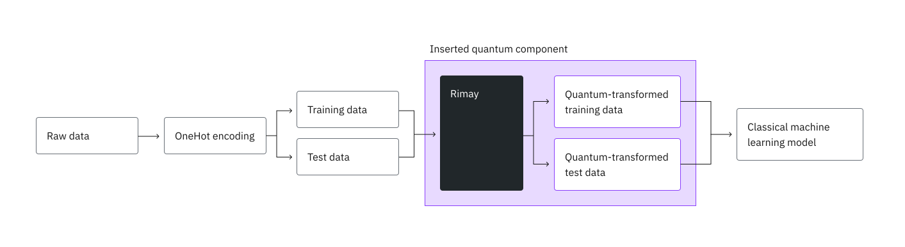

import TutorialFeedback from '@site/src/components/TutorialFeedback';

<OpenInLabBanner notebookPath="tutorials/classify-credit-risk-with-rimay-quantum-feature-extraction.ipynb" />


{/* cspell:ignore Rimay, Kipu, counterdiabatic, OpenML, Simen, Garrigós, Hegade, Cadavid, Dalal, Barrios, Alvarado, Solano, Murilo, Narendra, Erdman, Beltrani, Vedangi, Pathak, Mohammadbagherpoor, Hofmann, Statlog, xq, xh */}

<Admonition type="note">
Qiskit Functions are an experimental feature available only to IBM Quantum&reg; Premium Plan, Flex Plan, and On-Prem (through IBM Quantum Platform API) Plan users. They are in preview release status and subject to change.
</Admonition>

*Usage estimate: 2 minutes on a Nighthawk r2 processor. (NOTE: This is an estimate only. Your runtime might vary.)*
## Learning outcomes

- Prepare tabular data with categorical and numerical columns for the Rimay Qiskit Function.
- Fit a quantum feature mapping on training data and map the test data in the same run.
- Train classical models on quantum-transformed features, alone and combined with the original features.
- Compare the results against a purely classical baseline.

## Prerequisites

Before you start this tutorial, you should be familiar with the following topics:

- [Introduction to Qiskit Functions](/guides/functions)
- Supervised classification with [scikit-learn](https://scikit-learn.org/stable/supervised_learning.html)
## Background

Many machine learning problems in industry involve small- or medium-sized tabular datasets, where adding more data is not an option and model accuracy plateaus. Credit risk scoring is a typical example. A lender uses a few dozen attributes to decide whether the applicant is likely to repay the credit.

Rimay, a Qiskit Function by Kipu Quantum, adds a quantum preprocessing step to such a pipeline. It implements the digitized counterdiabatic quantum feature extraction algorithm [\[1\]](#references). Every input feature is mapped to one qubit. The feature values and the mutual information between features set the local fields and couplings of a spin-glass Hamiltonian. Counterdiabatic dynamics then evolve the quantum system toward its low-energy states, and the single- and two-body expectation values measured at the end become the new, quantum-transformed features. These features capture nonlinear correlations between the inputs, and you can feed them into any classical model.



This tutorial uses the German credit dataset from OpenML [\[2\]](#references), with 1000 applicants and 20 attributes, to train a random forest classifier. You first establish a classical baseline, then send the data to Rimay, and finally train the same kind of model on the quantum-transformed features, on their own and combined with the original features.
## Requirements

Before you start this tutorial, make sure that you have the following packages installed:

- IBM Quantum Compute client (`pip install qiskit-ibm-runtime`)
- Qiskit Functions (`pip install qiskit-ibm-catalog`)
- scikit-learn (`pip install scikit-learn`)
- pandas (`pip install pandas`)
- Matplotlib (`pip install matplotlib`)

You also need access to the Rimay function from the [Qiskit Functions Catalog](https://quantum.cloud.ibm.com/functions).
## Setup

Import the packages and define two helpers: one that trains a random forest, and one that computes the metrics used throughout the tutorial.

```python
# Added by doQumentation — installs the packages this notebook needs if they are missing
import importlib.util

_needed = {"matplotlib": "matplotlib", "numpy": "numpy", "pandas": "pandas", "qiskit_ibm_catalog": "qiskit-ibm-catalog", "sklearn": "scikit-learn"}
_missing = [pip for module, pip in _needed.items()
            if importlib.util.find_spec(module) is None]
# One at a time, so a package that fails to install does not block the others
for _pip in _missing:
    %pip install -q {_pip}
if not _missing:
    print("\u2713 All required packages are installed")
```

```python
import matplotlib.pyplot as plt
import numpy as np
import pandas as pd
from qiskit_ibm_catalog import QiskitFunctionsCatalog
from sklearn.datasets import fetch_openml
from sklearn.ensemble import RandomForestClassifier
from sklearn.metrics import (
    accuracy_score,
    f1_score,
    precision_score,
    recall_score,
    roc_auc_score,
)
from sklearn.model_selection import train_test_split
from sklearn.preprocessing import OneHotEncoder

def train_random_forest(x, y, n_estimators, max_depth):
    """Train a random forest classifier with fixed hyperparameters."""
    model = RandomForestClassifier(
        n_estimators=n_estimators,
        max_depth=max_depth,
        min_samples_split=5,
        min_samples_leaf=1,
        max_features="sqrt",
        random_state=42,
        n_jobs=-1,
    )
    return model.fit(x, y)

def evaluate(model, x, y):
    """Return the classification metrics of a trained model on a test set."""
    y_pred = model.predict(x)
    y_proba = model.predict_proba(x)[:, 1]
    return {
        "Accuracy": accuracy_score(y, y_pred),
        "AUC": roc_auc_score(y, y_proba),
        "F1 score": f1_score(y, y_pred),
        "Precision": precision_score(y, y_pred),
        "Recall": recall_score(y, y_pred),
    }
```

### Configure IBM Quantum credentials

Authenticate with your [IBM Quantum Platform API key](https://quantum.cloud.ibm.com/), load the Rimay function, and select the least busy quantum processor available to your instance.

```python
catalog = QiskitFunctionsCatalog(channel="ibm_quantum_platform")
rimay = catalog.load("kipu-quantum/rimay")

backend = catalog.least_busy(operational=True, simulator=False)
print(backend.name, backend.num_qubits)
```

```text
ibm_fez 156
```

## Step 1: Map classical inputs to a quantum problem

Rimay maps every numerical input feature onto one qubit, so the first step is to turn the raw table into numerical features.

### Load the dataset

Load the German credit dataset directly from OpenML. The `class` column holds the label: `good` for applicants who repaid their credit and `bad` for those who did not.

```python
df = fetch_openml(data_id=31, as_frame=True).frame
print(df.shape)
df.head()
```

```text
(1000, 21)
```

```text
checking_status  duration                  credit_history  \
0              <0         6  critical/other existing credit   
1        0<=X<200        48                   existing paid   
2     no checking        12  critical/other existing credit   
3              <0        42                   existing paid   
4              <0        24              delayed previously   

               purpose  credit_amount    savings_status employment  \
0             radio/tv           1169  no known savings        >=7   
1             radio/tv           5951              <100     1<=X<4   
2            education           2096              <100     4<=X<7   
3  furniture/equipment           7882              <100     4<=X<7   
4              new car           4870              <100     1<=X<4   

   installment_commitment     personal_status other_parties  ...  \
0                       4         male single          none  ...   
1                       2  female div/dep/mar          none  ...   
2                       2         male single          none  ...   
3                       2         male single     guarantor  ...   
4                       3         male single          none  ...   

   property_magnitude age  other_payment_plans   housing existing_credits  \
0         real estate  67                 none       own                2   
1         real estate  22                 none       own                1   
2         real estate  49                 none       own                1   
3      life insurance  45                 none  for free                1   
4   no known property  53                 none  for free                2   

                  job num_dependents  own_telephone foreign_worker class  
0             skilled              1            yes            yes  good  
1             skilled              1           none            yes   bad  
2  unskilled resident              2           none            yes  good  
3             skilled              2           none            yes  good  
4             skilled              2           none            yes   bad  

[5 rows x 21 columns]
```

### Encode the features

Convert the label to a binary value, and one-hot encode the 13 categorical columns. The code drops the first category of each column to avoid redundant features, which results in 48 numerical features.

```python
y = (df["class"] == "good").astype(int)

features = df.drop(columns="class")
categorical_cols = [
    col for col in features.columns if features[col].dtype.name == "category"
]
encoder = OneHotEncoder(
    sparse_output=False, handle_unknown="ignore", drop="first"
)
encoded = pd.DataFrame(
    encoder.fit_transform(features[categorical_cols]),
    columns=encoder.get_feature_names_out(categorical_cols),
    index=features.index,
)
x = pd.concat([features.drop(columns=categorical_cols), encoded], axis=1)
print(f"{x.shape[1]} features")
```

```text
48 features
```

### Split into training and test sets

Hold back 20% of the applicants as a test set. A stratified split keeps the share of good and bad credits equal in both sets.

```python
x_train, x_test, y_train, y_test = train_test_split(
    x, y, test_size=0.2, random_state=42, stratify=y
)
print(f"Training set: {x_train.shape}, test set: {x_test.shape}")
```

```text
Training set: (800, 48), test set: (200, 48)
```

### Establish a classical baseline

Train a random forest on the classical features. In Step 4, you compare the quantum-transformed features against its metrics.

```python
baseline = train_random_forest(
    x_train, y_train, n_estimators=500, max_depth=12
)
results = {"Classical": evaluate(baseline, x_test, y_test)}
pd.DataFrame(results).T
```

```text
Accuracy       AUC  F1 score  Precision    Recall
Classical     0.765  0.781071  0.845902   0.781818  0.921429
```

### Upload the data to Rimay

Rimay reads its inputs from CSV files that you upload to the function. The features and the labels go into separate files. You also upload the test set, so that Rimay maps it with the same mapping it fits on the training set.

```python
x_train.to_csv("x_train.csv", index=False)
y_train.to_csv("y_train.csv", index=False)
x_test.to_csv("x_test.csv", index=False)

for file_name in ("x_train.csv", "y_train.csv", "x_test.csv"):
    catalog.file_upload(file_name, rimay)
```

## Step 2: Optimize the problem for quantum hardware execution

Rimay builds and transpiles the circuits for the processor you select, so there is no circuit to optimize by hand. Specify the number of shots per circuit, within the following constraints:

- Every feature needs one qubit, so the processor must have at least as many qubits as the dataset has features.
- Rimay runs one circuit per row, training and test rows together. A single job can request at most 10 million executions, so the number of rows times `shots` must stay within that budget.

Check both limits before you submit the job.

<Admonition type="note">
A job must also finish within 24 hours, including the time its circuits wait in the queue, or it is stopped without a result.
</Admonition>

```python
shots = 5000

n_rows = len(x_train) + len(x_test)
n_features = x_train.shape[1]
print(f"Qubits needed: {n_features} of {backend.num_qubits} available")
print(f"Executions: {n_rows * shots:,} of 10,000,000 allowed")
```

```text
Qubits needed: 48 of 156 available
Executions: 5,000,000 of 10,000,000 allowed
```

### Calculate the function size

Every job runs at a function size, `S`, `M`, or `L`, which selects the compute resources it runs on. For Rimay, the size depends on the number of rows that a job maps, training and test rows together. If you request a size that is too small, the job fails with error `4600`. For the sizes and their limits, see [Function sizes](/guides/kipu-rimay#function-sizes) in the Rimay guide.

The following cell defines the size calculator. It runs on your machine, reads only the data that you pass to it, and submits nothing.

```python
from os import PathLike
from typing import Any, Literal, Sequence, Sized

Size = Literal["S", "M", "L"]

# Upper bounds (inclusive) in samples.
_SMALL = 2_999
_MEDIUM = 9_999

FIT_TRANSFORM, TRANSFORM, DELETE = "fit-transform", "transform", "delete"

# Which positions of input_file hold samples, per mode. The labels in
# y_train submit no circuits of their own, so they are not counted.
SAMPLE_POSITIONS = {FIT_TRANSFORM: (0, 2), TRANSFORM: (0,)}

def calculate_function_size(problem: Sequence[Sized], **kwargs: Any) -> Size:
    """Return the size ("S", "M" or "L") required to run the function."""
    metrics = _measure(problem, **kwargs)
    if _is_small(metrics):
        return "S"
    if _is_medium(metrics):
        return "M"
    return "L"

def _measure(problem: Sequence[Sized], **kwargs: Any) -> dict:
    """The samples the job submits."""
    return {"samples": count_samples(problem, kwargs.get("mode"))}

def count_samples(problem: Sequence[Sized], mode: Any) -> int:
    """Rows across the data sets of ``problem`` that carry samples."""
    if mode == DELETE:
        return 0
    if mode not in SAMPLE_POSITIONS:
        raise ValueError(f"cannot size mode {mode!r}")
    if _is_name(problem) or (
        isinstance(problem, (list, tuple))
        and any(_is_name(data) for data in problem)
    ):
        raise TypeError(
            "pass the data, not the file name: read each input_file, e.g. with "
            "pandas.read_csv, and pass the data sets in input_file order"
        )
    if not isinstance(problem, (list, tuple)):
        raise TypeError(
            "pass a list of data sets in input_file order, e.g. [x_train, y_train], "
            f"not a single {type(problem).__name__}"
        )
    return sum(
        len(problem[i]) for i in SAMPLE_POSITIONS[mode] if i < len(problem)
    )

def _is_name(value: Any) -> bool:
    """A file name or path rather than data."""
    return isinstance(value, (str, bytes, PathLike))

def _is_small(metrics: dict) -> bool:
    """Determine if the metrics fit T-size 'S'."""
    return metrics["samples"] <= _SMALL

def _is_medium(metrics: dict) -> bool:
    """Determine if the metrics fit T-size 'M'."""
    return metrics["samples"] <= _MEDIUM
```

Pass the data sets in the same order as the files in `input_file`, together with the mode of the run:

```python
size = calculate_function_size(
    [x_train, y_train, x_test], mode="fit-transform"
)
print(size)
```

```text
S
```

## Step 3: Execute using Qiskit primitives

Run Rimay in `fit-transform` mode. It fits a quantum feature mapping on `x_train.csv` and `y_train.csv`, and maps both the training and the test sets with it. The order of the files in `input_file` matters. List the training features, the training labels, and then the optional test features. Pass the size that you calculated as `function_size`.

```python
job = rimay.run(
    mode="fit-transform",
    input_file=[
        "x_train.csv",
        "y_train.csv",
        "x_test.csv",
    ],  # This order matters
    backend_name=backend.name,
    shots=shots,
    function_size=size,
)
print(job.job_id)
```

```text
de5094df-bb17-4924-9605-d6196a4aa999
```

### Monitor the job

Check the status of the job while it runs. `job.result()` blocks until the job has finished.

```python
print(job.status())
```

```text
INITIALIZING
```

```python
result = job.result()
print(result["output_files"])
```

```text
['de5094df-bb17-4924-9605-d6196a4aa999_xq_train.csv', 'de5094df-bb17-4924-9605-d6196a4aa999_xq_test.csv']
```

The result holds a `mapping_id`, which identifies the mapping that this run fitted. You do not need it in this tutorial, because the test set was mapped in the same run. Record this ID if you want to map new rows later with `mode="transform"`. It is the only way to access the fitted mapping, and without it, you must fit and pay for a new one. The mapping is built for the qubit layout of this processor, so a later `transform` run must pass the same `backend_name`.

```python
mapping_id = result["mapping_id"]
```

## Step 4: Post-process and return the result in the desired classical format

### Download the quantum-transformed features

Download the files that the job wrote, by using the names in `output_files`. Each name starts with the job ID, so the files of this run stay available after later runs. Pass `target_name` so that each file is saved under its own name.

```python
train_file, test_file = result["output_files"]
for file_name in (train_file, test_file):
    catalog.file_download(file_name, rimay, target_name=file_name)

xq_train = pd.read_csv(train_file).to_numpy()
xq_test = pd.read_csv(test_file).to_numpy()
print(f"Quantum-transformed features: {xq_train.shape[1]}")
```

```text
586kiB [00:00, 1.13MiB/s]
147kiB [00:00, 336kiB/s]
```

```text
Quantum-transformed features: 99
```

### Train on the quantum-transformed features

Train a random forest on the quantum-transformed features alone.

```python
quantum = train_random_forest(
    xq_train, y_train, n_estimators=900, max_depth=15
)
results["Quantum"] = evaluate(quantum, xq_test, y_test)
```

### Train on classical and quantum features combined

Stack the original and the quantum-transformed features, and train the same model on the combination.

```python
xh_train = np.hstack([x_train.to_numpy(), xq_train])
xh_test = np.hstack([x_test.to_numpy(), xq_test])

hybrid = train_random_forest(
    xh_train, y_train, n_estimators=900, max_depth=15
)
results["Hybrid"] = evaluate(hybrid, xh_test, y_test)
```

### Compare the results

Compare the three models on the test set.

```python
comparison = pd.DataFrame(results).T
print(comparison.round(3))

comparison[["Accuracy", "AUC", "F1 score"]].T.plot.bar(rot=0, figsize=(8, 4))
plt.ylim(0.5, 1.0)
plt.ylabel("Score on the test set")
plt.title("Random forest on classical, quantum, and hybrid features")
plt.show()
```

```text
Accuracy    AUC  F1 score  Precision  Recall
Classical     0.765  0.781     0.846      0.782   0.921
Quantum       0.730  0.784     0.827      0.750   0.921
Hybrid        0.730  0.791     0.825      0.756   0.907
```


The AUC measures how well a model ranks good above bad credits, independent of a decision threshold, which makes it the most informative metric on this imbalanced dataset (70% good credits). In Kipu Quantum's benchmarks, the quantum-transformed features on their own reached an AUC similar to the classical baseline, and the hybrid model, which combines both, reached the highest AUC and F1 score. The quantum-transformed features therefore add information that the classical features do not provide on their own.

### Clean up (optional)

A fitted mapping stays available until you delete it. If you do not want to map further data with it, delete it. A deletion does no quantum work, uses no QPU time, and cannot be undone.

```python
# rimay.run(mode="delete", mapping_id=mapping_id).result()
```

```text
{'output_files': [],
 'mode': 'delete',
 'deleted': True,
 'mapping_id': 'eUCy4EnZM7G9jYo5b2Pu-TuCXK7zX_wPTT67g9J1dVE',
 'metadata': {'version': '0.6.0', 'resource_usage': {}}}
```

## Conclusion

### What you accomplished

In this tutorial, you accomplished the following:

1. Prepared a real-world credit risk dataset with categorical and numerical attributes for quantum feature extraction.
2. Established a classical random forest baseline.
3. Used Rimay to fit a quantum feature mapping on quantum hardware and map the training and test sets in one run.
4. Trained the same model on quantum-transformed and on combined features, and compared them with the baseline.

### Key takeaways

- Rimay fits into an existing machine learning pipeline as one additional preprocessing step. You keep your data preparation and your classical model.
- The number of qubits bounds the number of input features, and the number of rows times `shots` bounds the size of a single job.
- Use the quantum-transformed features combined with the original features as a default, because the model can use both.
## Next steps

<Admonition type="tip" title="Recommendations">
- Read the [Rimay guide](/guides/kipu-rimay) to learn about all inputs, map new data with `mode="transform"`, and see further benchmarks.
- Read how quantum feature extraction was applied to satellite image classification [\[3\]](#references).
</Admonition>
## References

[1] Simen, A., et al. (2025). Digitized Counterdiabatic Quantum Feature Extraction. arXiv preprint [arXiv:2510.13807](https://arxiv.org/abs/2510.13807).

[2] Hofmann, H. (1994). Statlog (German Credit Data). [OpenML dataset 31](https://www.openml.org/search?type=data&sort=runs&id=31&status=active).

[3] Zhang, Q., et al. (2026). Quantum-enhanced satellite image classification. arXiv preprint [arXiv:2602.18350](https://arxiv.org/abs/2602.18350).

<TutorialFeedback />
